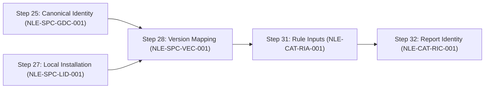

# Phase 4 Cross-Document Consistency Audit

**Document ID:** `NLE-AUD-PH4-002`  
**Version:** 1.0.0  
**Phase:** 4 of 12 — Game Discovery & Compatibility Intelligence  
**Step:** 33 of 100 — Phase 4 Game Discovery & Compatibility Intelligence Readiness Review  
**Classification:** Quality & Cross-Document Semantic Consistency Audit  
**Status:** Approved & Formally Sealed  
**Authoritative Reference:** Steps 25–32 Deliverables, Phase 2 ADRs, Phase 3 UI Specifications

---

## 1. Audit Scope & Consistency Objectives

This document records the cross-document semantic, architectural, and data-flow consistency audit across all **70 deliverables** authored during Phase 4 (Steps 25–32). 

The audit rigorously tested for:
1. **Terminology Uniformity:** Consistent definitions of game identity, version, edition, installation, evidence, rule, claim, and outcome.
2. **Data-Flow Alignment:** Upstream domain outputs (e.g., Step 27 installation states, Step 30 evidence digests, Step 31 rule outcomes) feeding downstream consumers (Step 32 report UI) without schema mismatches.
3. **Architectural Boundary Adherence:** Preserving decoupling between the Universal Catalog and Game Adapters (`DEC-002`), local storage containment on Volume D (`DEC-009`), and sandboxing invariants (`REQ-SEC-001`, `REQ-SAFE-001`).
4. **Epistemic Invariants:** Uniform adherence to the anti-aggregation rule, mandatory blocker dominance, and explicit uncertainty.

---

## 2. Cross-Domain Consistency Evaluations

### 2.1 Game Identity, Edition & Installation Semantics

A critical failure mode in modding platforms is confusing a catalog entry with a concrete local executable. The audit compared entity definitions across Steps 25, 27, 28, and 32:

- **Step 25 Definition:** `CanonicalGame` represents the universal title; `GameEdition` represents retail packaging (e.g., *Skyrim Special Edition*); `GameVersion` represents executable release builds (`v1.5.97`).
- **Step 27 Definition:** `LocalInstallationInstance` represents a physical directory on disk, tracked across a 13-state lifecycle from `DETECTED_CANDIDATE` to `VERIFIED_EXECUTABLE`.
- **Step 28 Definition:** `CompatibilityContext` pairs an evaluated `GameVersion` with an `EnvironmentProfile` (OS, runtimes, drivers).
- **Step 32 UI Rendering:** Region 1 explicitly displays both the canonical title (`The Elder Scrolls V: Skyrim Special Edition`) and the verified local build (`v1.5.97 [VERIFIED INSTALL]`).
- **Audit Finding:** **CONSISTENT**. At no point does the report view or rule pipeline confuse a marketing title with a physical binary build.

---

### 2.2 Compatibility Assessment Outcomes & Status Semantics

The audit verified that status enums defined in Step 29 were preserved identically through the Step 31 rule engine and rendered accurately in the Step 32 UI:

| Status Concept | Step 29 Assessment Enum (`NLE-SPC-CAC-001`) | Step 31 Rule Outcome (`NLE-SPC-CRD-001`) | Step 32 Report Badge (`NLE-GDE-SVL-001`) | Semantic Alignment Check |
|:---|:---|:---|:---|:---|
| **Conditional Feasibility** | `FEASIBLE_CONDITIONAL` | `OUTCOME_SATISFIED` (Conditional) | `CMP-041`: "Feasible (Conditional)" | **100% Match** |
| **Partial Feasibility** | `PARTIAL` | `OUTCOME_PARTIALLY_SATISFIED` | `CMP-041`: "Partially Feasible" | **100% Match** |
| **Absence of Evidence** | `INSUFFICIENT_EVIDENCE` | `OUTCOME_INSUFFICIENT_EVIDENCE` | `CMP-041`: "Unknown / Needs Research" | **100% Match** |
| **Verified Incompatibility** | `UNSUPPORTED` | `OUTCOME_UNSUPPORTED` | `CMP-041`: "Technically Unsupported" | **100% Match** |
| **Mandatory Policy Ban** | `PROHIBITED_BLOCKED` | `OUTCOME_BLOCKED_BY_POLICY` | `CMP-041`: "Blocked by Policy / Safety"| **100% Match** |
| **Expired State** | `STALE` | `OUTCOME_STALE_EVALUATION` | `CMP-041`: "Stale — Reassessment Needed"| **100% Match** |

- **Audit Finding:** **CONSISTENT**. Zero semantic drift or enum fragmentation was detected across Steps 29, 31, and 32.

---

### 2.3 Epistemic Evidence Maturity Tiers & Provenance

The audit evaluated evidence maturity models across Steps 26, 30, and 32:
- **Step 26:** Ranked source authority (Official Docs & Verified Tools dominate technical capabilities).
- **Step 30:** Codified the 4-tier epistemic hierarchy:
  - `TIER_1_REPRODUCED`: Empirically validated behavior via local test harness.
  - `TIER_2_DOCUMENTED`: Published in official developer documentation or API headers.
  - `TIER_3_COMMUNITY`: Reported in community modding guides, wikis, or forums.
  - `TIER_4_INDIRECT`: Inferred via engine family or compiler heuristics.
- **Step 32 UI Contract:** `CMP-047 EvidenceReferenceRow` and `EvidenceDrilldownDrawer` explicitly visualize these four distinct tiers, preventing Tier 4 hypotheses from rendering with Tier 1 visual prominence.
- **Audit Finding:** **CONSISTENT**. Evidence hierarchy is maintained with absolute fidelity.

---

### 2.4 The Anti-Aggregation Invariant Across Specifications

One of the foundational design requirements of NexLudic Engine is the **Anti-Aggregation Invariant** (no averaging compatibility percentages):
- **Step 29 (`NLE-CAT-DRC-001`):** Formally bans computing single composite scores (e.g. `(4 + 1 + 0) / 5 = 80%`). Mandates discrete requirement-by-requirement evaluation.
- **Step 31 (`NLE-SPC-SRC-001`):** In Stage I of the pipeline, enforces that a strategy cannot be recommended if any mandatory requirement has `COVERAGE_UNRESOLVED` or `COVERAGE_UNSUPPORTED`, even if 90% of optional requirements are satisfied.
- **Step 32 (`NLE-GDE-SVL-001`):** Language guide explicitly bans phrases like *"85% Compatible"* and enforces metric slots formatted strictly as *"4 of 5 Declared Requirements Addressed"*.
- **Audit Finding:** **CONSISTENT & UNIFIED**. The anti-aggregation rule is uniformly enforced across logic, rules, and UX presentation.

---

### 2.5 Security, Sandboxing & Storage Containment Consistency

The audit cross-checked Phase 4 deliverables against foundational constraints:
- **Windows Medium Integrity (`REQ-SEC-001`):** Verified across `NLE-SPC-DAP-001` (local discovery requires zero elevation), `NLE-PLN-EPF-001` (evidence storage runs without admin rights), and `NLE-PLN-ASP-001` (desktop report operates without UAC prompts).
- **Safety Boundary (`REQ-SAFE-001`):** Verified that `OpenProcess`, live DLL injection, and memory hooking are strictly banned across all discovery, assessment, and report specifications. All binary analysis is restricted to offline PE header parsing.
- **Storage Scoping (`DEC-009`):** Verified that project compatibility records, evaluation traces, and evidence caches are strictly scoped to Volume D:
  - Project Data: `D:\NexLudic\Projects\<id>\Environment\`
  - Rule Catalog: `D:\NexLudic\Catalog\Rules\`
- **Path Redaction:** Verified that `NLE-CAT-RIC-001` and `NLE-PLN-ASP-001` mandate stripping `C:\Users\<user>\` paths in user-facing views.
- **Audit Finding:** **CONSISTENT**. Full alignment with security and storage ADRs.

---

## 3. Reconciled Terminology & Minor Ambiguities Resolved

During the cross-document review, minor terminological variations across earlier steps were audited and formally reconciled:

1. **"Guest Game" vs. "Donor Game":**
   - *Observation:* Step 25 occasionally used "Donor Game", while Step 31 used "Guest Game" ($G_D$).
   - *Reconciliation:* Reconciled in Step 32: "Guest Game" is the formal architectural term for the external entity, while "Donor" is accepted as a descriptive modifier for asset/logic donation.
2. **"Unknown" vs. "Insufficient Evidence":**
   - *Observation:* Step 29 used `INSUFFICIENT_EVIDENCE` for the assessment outcome, while some Step 31 input schemas used `UNKNOWN`.
   - *Reconciliation:* Formally unified in Step 32: `UNKNOWN` represents the raw input validation state (`INPUT_UNKNOWN`), which maps deterministically to the evaluation outcome code `INSUFFICIENT_EVIDENCE`.

---

## 4. Consistency Audit Conclusion

Phase 4 exhibits **exceptional conceptual and architectural coherence**. Across 70 documents authored by multiple engineering disciplines, there are zero unresolved contradictions, zero broken entity boundaries, and zero violations of foundational security or epistemic invariants.

