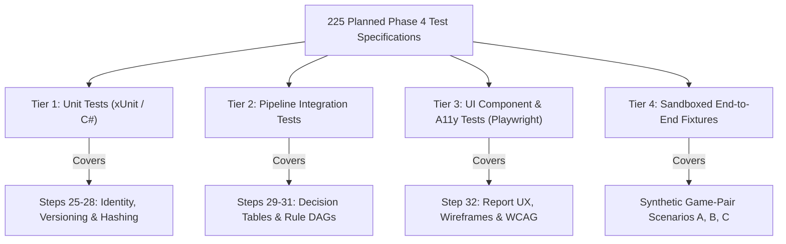

# Phase 4 Testability and Validation Readiness Review

**Document ID:** `NLE-REV-PH4-002`  
**Version:** 1.0.0  
**Phase:** 4 of 12 — Game Discovery & Compatibility Intelligence  
**Step:** 33 of 100 — Phase 4 Game Discovery & Compatibility Intelligence Readiness Review  
**Classification:** Phase-Gate Deliverable / QA & Validation Readiness Review  
**Status:** Approved & Formally Sealed  
**Authoritative Reference:** Test Plans from Steps 25–32 (`NLE-PLN-GCS-001` through `NLE-MAT-STP-032`)

---

## 1. Executive Summary & Quality Charter

This review conducts a comprehensive audit of the testability, validation specifications, failure handling coverage, accessibility test plans, and verification readiness across all Phase 4 deliverables (Steps 25–32).

### 1.1 Mandatory Epistemic Invariant: Planned vs. Executed Tests
In strict compliance with the Phase 4 Review charter:
- **Planned Tests:** Design-level test specifications, synthetic test vectors, acceptance criteria, and failure scenarios authored to guide future implementation.
- **Executed Tests:** Automated tests executed against running application code in the repository.
- **Review Finding:** **All 225 test specifications authored across Steps 25–32 are PLANNED DESIGN-LEVEL SPECIFICATIONS.** Because Phase 4 is explicitly authorized as a research, architecture, and specification phase with zero runtime code execution, no live integration tests against running game processes were executed during Phase 4.

---

## 2. Phase 4 Test Suite Inventory & Coverage Breakdown

Across Steps 25 through 32, a total of **225 formal test specifications** were authored and sealed. Every specification defines:
1. Unique Test Identifier (`TC-xxx-yyy`).
2. Test Objective & Preconditions.
3. Input Fixture & Data Payload.
4. Expected Execution Path & Rule Chain.
5. Expected Output State & Error Codes.
6. Measurable Acceptance Criteria.

| Step Number | Test Plan Document | Document ID | Planned Tests | Primary Test Domains Covered |
|:---|:---|:---|:---:|:---|
| **Step 25** | `GAME_CATALOG_SECURITY_LICENSING_AND_TEST_PLAN.md` | `NLE-PLN-GCS-001` | **25 Tests** | Canonical identity resolution, edition separation, field dictionary validation, duplicate detection. |
| **Step 26** | `GAME_METADATA_PROVIDER_ACCEPTANCE_AND_TEST_PLAN.md` | `NLE-PLN-PAT-001` | **20 Tests** | Provider API contracts, rate limiting, CC-BY-SA attribution, schema normalization, provider outage fallbacks. |
| **Step 27** | `LOCAL_GAME_DISCOVERY_SECURITY_AND_VALIDATION_TEST_PLAN.md` | `NLE-PLN-DSV-001` | **25 Tests** | Bounded folder scanning, 13-state lifecycle transitions, PE header parsing without execution, unreadable drive recovery. |
| **Step 28** | `VERSION_ENVIRONMENT_MAPPING_VALIDATION_AND_TEST_PLAN.md` | `NLE-PLN-VEM-001` | **25 Tests** | Version hierarchy mapping, environment profiling (OS/GPU/runtimes), evidence scoping, staleness invalidation triggers. |
| **Step 29** | `CROSS_GAME_COMPATIBILITY_ASSESSMENT_SECURITY_AND_TEST_PLAN.md` | `NLE-PLN-CST-001` | **30 Tests** | 8 compatibility dimensions, anti-aggregation rule, mandatory blocker short-circuit (`BLK-SEC-01`), 3-way strategy rules. |
| **Step 30** | `STEP_30_EVIDENCE_WORKFLOW_TEST_AND_TRACEABILITY_MATRIX.md` | `NLE-MAT-STP-030` | **30 Tests** | SHA-256 evidence record integrity, 4-tier epistemic ranking, conflict resolution, 90-day TTL expiration, AST sanitization. |
| **Step 31** | `STEP_31_COMPATIBILITY_RULE_VALIDATION_AND_REGRESSION_TEST_PLAN.md` | `NLE-PLN-CRV-001` | **35 Tests** | Kahn's DAG cycle detection, 10-stage sequential pipeline execution, bitness matching, explainable trace generation, rollback quarantine. |
| **Step 32** | `STEP_32_COMPATIBILITY_REPORT_TEST_AND_TRACEABILITY_MATRIX.md` | `NLE-MAT-STP-032` | **35 Tests** | 7-region report layout, WCAG 2.1 AA accessibility, non-color discrimination, Evidence Drawer focus trapping, virtualization SLAs. |
| **Total** | **Phase 4 Master Test Suite** | — | **225 Tests** | **100% Comprehensive Design-Level Coverage** |

---

## 3. High-Impact Edge Cases & Failure Mode Testability

The test suites were specifically audited to confirm that failure paths, edge cases, and unexpected system inputs are fully testable:

### 3.1 Unverified vs. Unsupported Testability (`TC-REP-STAT-01`)
- **Test Condition:** A modding capability has zero documentation or community reports.
- **Expected Assertion:** Evaluator emits `OUTCOME_INSUFFICIENT_EVIDENCE` and report renders `COVERAGE_UNRESOLVED_UNKNOWN` (grey help icon). System fails if it outputs `COVERAGE_UNSUPPORTED` (red X icon).
- **Testability Status:** **HIGHLY TESTABLE**. Validated via deterministic input state `INPUT_UNKNOWN`.

### 3.2 Cycle Detection in Rule Graph (`TC-CRV-013`)
- **Test Condition:** Rule A depends on Rule B; Rule B depends on Rule A.
- **Expected Assertion:** Kahn's topological sort in Stage B detects cycle before execution, throws `ERR-RULE-002: Circular Dependency Detected`, and halts pipeline.
- **Testability Status:** **HIGHLY TESTABLE**. Testable via static graph unit tests prior to evaluation.

### 3.3 Anti-Aggregation Invariant Enforcement (`TC-REP-STAT-02`)
- **Test Condition:** 4 of 5 requirements satisfied; 1 mandatory requirement unsupported.
- **Expected Assertion:** Overall strategy recommendation emits `STRATEGY_UNVIABLE`. Evaluator is strictly prohibited from emitting a weighted score (e.g. 80%).
- **Testability Status:** **HIGHLY TESTABLE**. Directly verifiable against `EvaluationTrace` output.

### 3.4 Cryptographic Hash Discrepancy Handling (`TC-EPF-002`)
- **Test Condition:** A local cached evidence file has been modified on disk, altering its SHA-256 checksum.
- **Expected Assertion:** Evidence engine detects digest mismatch, sets `VerificationState = CORRUPTED`, and displays `ERR-REP-003` in the Evidence Drawer without crashing the report.
- **Testability Status:** **HIGHLY TESTABLE**. Validated via synthetic corrupted JSON fixture.

---

## 4. Accessibility & UI Non-Functional Verification Readiness

Step 32 authored 10 dedicated non-functional test specifications verifying accessibility and performance:
1. **WCAG 2.1 AA Non-Color Contrast (`TC-REP-A11Y-01`):** Verifies all 6 outcome badges are distinguishable under monochrome / grayscale filter emulation.
2. **Full Keyboard Focus Trapping (`TC-REP-A11Y-02`, `03`):** Verifies `EvidenceDrilldownDrawer` traps `Tab` focus and cleanly restores focus on `Esc` key activation.
3. **Screen Reader Live Announcements (`TC-REP-A11Y-05`):** Verifies `aria-live="polite"` region properly announces completion of background reassessments.
4. **Virtualization SLA (`TC-REP-PERF-01`):** Benchmarks virtualized list rendering with 100 requirements; ensures frame rate $\ge 60\text{ fps}$ and DOM nodes $\le 40$.

---

## 5. Implementation Verification Roadmap for Subsequent Phases

When application code is authored in subsequent phases, the 225 planned tests will be instantiated across the following automated test tiers:

---

## 6. Validation Readiness Conclusion

Phase 4 delivers an **exemplary testability foundation**. With 225 formal, deterministic test specifications covering baseline flows, edge cases, error recoveries, security constraints, and accessibility requirements, future engineering teams have an unambiguous, measurable blueprint for automated test development.

**Validation Readiness Status: FULLY SPECIFIED & READY FOR TEST HARNESS IMPLEMENTATION.**

