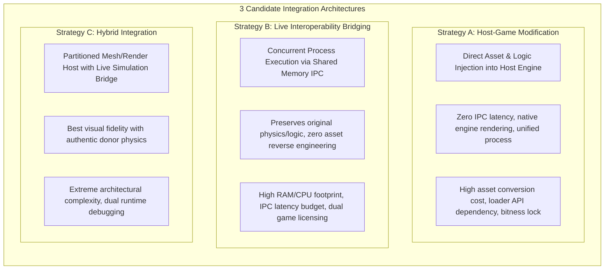
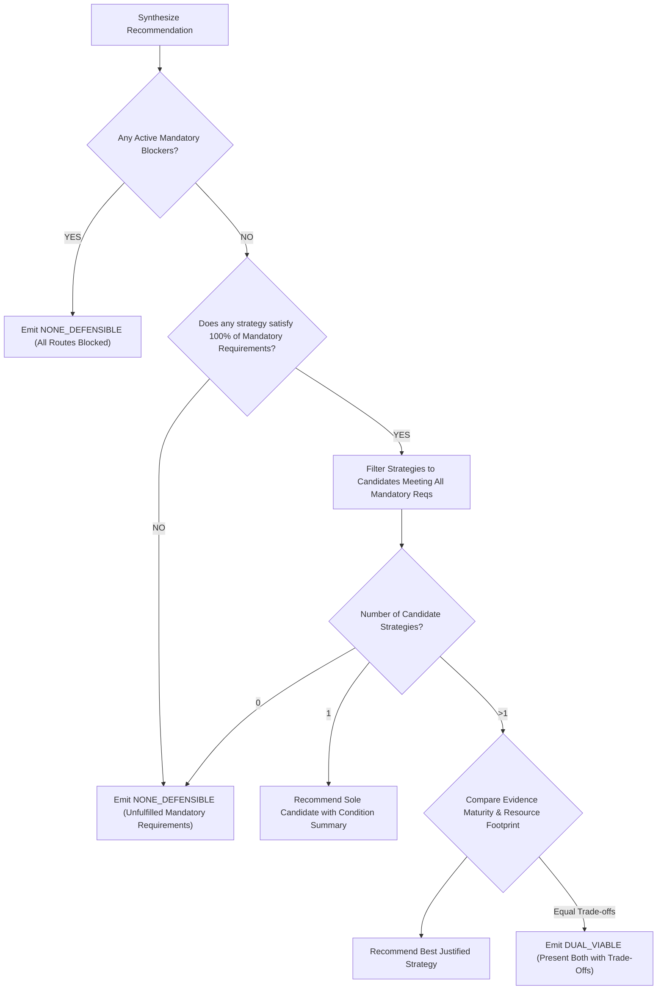

# Strategy Comparison and Recommendation UX Specification

**Document ID:** `NLE-SPC-SCR-001`  
**Version:** 1.0.0  
**Phase:** 4 of 12 — Game Discovery & Compatibility Intelligence  
**Step:** 32 of 100 — Game-Pair Compatibility Report & Recommendation Experience Specification  
**Classification:** Strategy Comparison & Recommendation Experience Specification  
**Status:** Approved Specification  
**Authoritative Reference:** `NLE-DOM-SPEC-001`, `NLE-SPC-CAC-001`, `NLE-SPC-SRC-001`, `INTEGRATION_STRATEGY_COMPARISON_AND_FEASIBILITY_RULES.md`

---

## 1. Strategy Comparison Architecture & Philosophy

NexLudic Engine provides a neutral, multi-path evaluation environment. Cross-game integration is rarely one-size-fits-all: one pair of games may excel at asset extraction and host modding (Strategy A), while another pair may require real-time telemetry bridging (Strategy B) or partitioned hybrid execution (Strategy C).

### 1.1 The Neutral Comparison Mandate
- **No Pre-Ordained Winners:** The report must never default to Strategy A simply because modding is familiar, nor Strategy B simply because live bridging sounds novel.
- **Equal Visual Weight:** All three strategies are rendered with equal layout prominence, uniform comparison criteria, and standardized metric slots. Visual emphasis (such as an accent border or "Recommended Route" chip) is applied strictly through algorithmic justification derived from `RuleSet` evaluation.
- **No Forced Winner:** If the evidence is insufficient to distinguish the best path, or if all three fail mandatory prerequisites, the engine displays **"No Defensible Recommendation Available"** with an explicit forensic breakdown.

---

## 2. The 3 Architectural Integration Strategies



---

## 3. Comparison Dimensions & Structured Card Layout

The Strategy Comparison section renders a 3-column responsive card group (`StrategyComparisonCardGroup`), followed by an expandable **Comparative Matrix Table**.

### 3.1 Card Specification: `StrategyCard` Component Contract

Each strategy card encapsulates the following structured sections:

```
+-------------------------------------------------------------------------+
| [STRATEGY IDENTIFIER]  Strategy A: Host-Game Modification               |
| [RECOMMENDATION STATUS]  RECOMMENDED ROUTE  (Chip: Cyan outlined)      |
+-------------------------------------------------------------------------+
| ARCHITECTURAL SUMMARY:                                                  |
| Translates donor vehicle meshes and physics collision trees into host   |
| engine formats; injects runtime control logic via SKSE64 hook plugins.  |
+-------------------------------------------------------------------------+
| KEY EVALUATION METRICS:                                                 |
| - Requirement Coverage:       4 of 5 Declared Requirements Addressed    |
| - Supporting Evidence:         3 Citations (Documented & Reproduced)     |
| - Critical Dependencies:       SKSE64 >= 2.0.20, Havok SDK tools        |
| - Memory & Performance:        Low Overhead (+45 MB RAM, 0ms IPC)       |
| - Operational Complexity:      Moderate (Asset Pipeline Tooling)        |
+-------------------------------------------------------------------------+
| IDENTIFIED TRADE-OFFS & LIMITATIONS:                                    |
| [!] Bone hierarchy re-targeting required for donor skeletal meshes.     |
| [!] Host physics engine cannot simulate true donor tire friction curve. |
+-------------------------------------------------------------------------+
| [Inspect Technical Route]  [Compare Side-by-Side]  [Select for Plan ->] |
+-------------------------------------------------------------------------+
```

### 3.2 8-Point Comparative Matrix Table

When the user expands the `[View Detailed Side-by-Side Comparison]` disclosure, the report displays an exhaustive comparison table:

| Comparison Dimension | Strategy A: Host Mod | Strategy B: Live Bridge | Strategy C: Hybrid Integration | Authoritative Rule Reference |
|:---|:---|:---|:---|:---|
| **1. Requirements Addressed** | 4 of 5 (80% Scope) | 3 of 5 (60% Scope) | 5 of 5 (100% Scope) | `NLE-SPC-SRC-001` |
| **2. Mandatory Constraints** | PASSED (No Blockers) | PASSED (No Blockers) | BLOCKED (Exceeds CPU Headroom) | `RULE-REQ-MAND-001` |
| **3. Process Bitness Match** | Required (Both 64-bit: MATCH) | Not Required (Isolated IPC) | Required for Host Component | `RULE-STR-HM-001` |
| **4. Runtime Communication** | Direct DLL Hooking | Shared Memory IPC (<2ms) | Mixed (Direct + IPC) | `RULE-STR-LB-001` |
| **5. Resource Footprint** | Host Process Only (+45MB) | Dual Processes (~4.2GB RAM) | Dual Processes (~4.8GB RAM) | `RULE-STR-LB-003` |
| **6. Modding Tooling Stack** | SKSE64, CommonLibSSE | NexBridge IPC Service | SKSE64 + NexBridge + Adapters | `RULE-STR-HM-002` |
| **7. Evidence Maturity** | Tier 2 (Documented Capability) | Tier 1 (Reproduced Benchmark) | Tier 4 (Heuristic Hypothesis) | `NLE-SPC-ECL-001` |
| **8. Maintenance Overhead** | Dependent on Host Patches | Resilient to Host UI Patches | Highly Sensitive to Both Games | `NLE-SPC-SRC-001` |

---

## 4. Recommendation Justification Logic & Epistemic Guardrails

### 4.1 Recommendation Synthesis Engine
The recommendation engine follows the sequential evaluation rules defined in `Stage I` of `EXPLAINABLE_COMPATIBILITY_EVALUATION_PIPELINE_SPECIFICATION.md`:



### 4.2 Guardrail Rules for Recommendation Presentation
1. **Never Recommend a Blocked Strategy:** Even if Strategy C fulfills 100% of functional requirements, if it violates system headroom (`RULE-STR-LB-003`) or triggers anti-cheat detection (`BLK-SEC-01`), it is marked `PROHIBITED` or `UNVIABLE` and excluded from recommendations.
2. **Explicit "Dual Viable" Scenarios:** When Strategy A and Strategy B offer equivalent requirement coverage with different, valid trade-offs (e.g., Strategy A offers native framerates but requires manual asset rigging; Strategy B offers instant zero-conversion gameplay but requires dual 16GB RAM), the report must **not fabricate an arbitrary tie-break**. It presents both as "Viable Alternatives" and explains the trade-off.
3. **No Automatic Commitment:** Clicking `[Select Strategy for Plan]` opens an **Approval & Commitment Modal** (`CMP-045`), requiring the user to explicitly acknowledge the technical trade-offs before saving the decision to the Project Workspace roadmap (`NAV-PRJ-PLN`).

---

## 5. Safe Next Action Boundaries (`REQ-SEC-001`, `REQ-SAFE-001`)

The Strategy Comparison interface adheres to strict system boundary safeguards:

| User Action | Permitted Interaction | Prohibited / Out-of-Scope Side Effect |
|:---|:---|:---|
| `[Inspect Technical Route]` | Expands read-only drawer detailing rule chain and parameters. | No disk access, no registry reads, no background network calls. |
| `[Compare Side-by-Side]` | Toggles side-by-side comparative table layout. | Purely UI layout state change. |
| `[Select Strategy for Plan]` | Navigates to `NAV-PRJ-PLN` with draft strategy parameters. | Does NOT modify project database files without confirmation. |
| `[Resolve Dependency]` | Deep-links to local environment settings or official documentation. | Never downloads binaries, executes installers, or modifies game folders. |
| `[Re-evaluate Strategy]` | Dispatches re-evaluation task to `FeasibilityAssessmentService`. | Read-only evaluation using existing cached and local metadata. |

