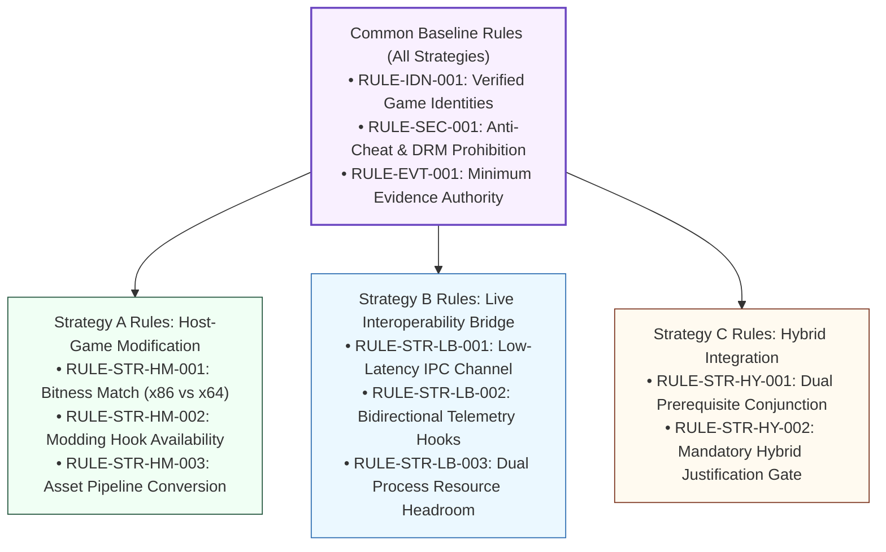
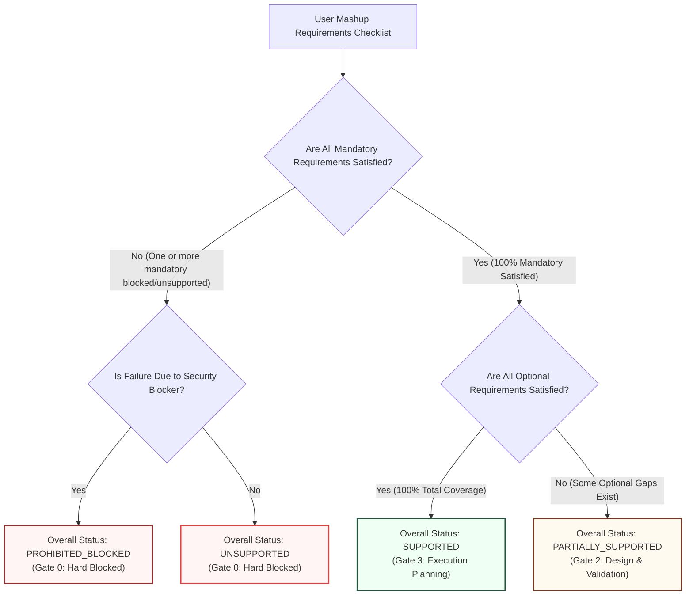

# Strategy-Specific Rules & Requirement Coverage Specification

**Document ID:** `NLE-SPC-SRC-001`  
**Version:** `1.0.0`  
**Status:** `APPROVED`  
**Workstream:** `Compatibility Rule Architecture, Rule Taxonomy, Domain Schema, Lifecycle Governance, and Evaluation Contracts`  
**Phase:** `4 of 12 — Game Discovery & Compatibility Intelligence`  
**Step:** `31 of 100`  
**Related Documents:**
- [COMPATIBILITY_RULE_CATALOG_AND_DOMAIN_SPECIFICATION.md](file:///d:/App%20Winrar%20Files/Nexludic%20Engine%20(working)/docs/game-discovery/COMPATIBILITY_RULE_CATALOG_AND_DOMAIN_SPECIFICATION.md) (`NLE-SPC-CRD-001`)
- [INTEGRATION_STRATEGY_COMPARISON_AND_FEASIBILITY_RULES.md](file:///d:/App%20Winrar%20Files/Nexludic%20Engine%20(working)/docs/game-discovery/INTEGRATION_STRATEGY_COMPARISON_AND_FEASIBILITY_RULES.md) (`NLE-RUL-ISC-001`)
- [CROSS_GAME_COMPATIBILITY_DECISION_TABLES.md](file:///d:/App%20Winrar%20Files/Nexludic%20Engine%20(working)/docs/game-discovery/CROSS_GAME_COMPATIBILITY_DECISION_TABLES.md) (`NLE-TAB-CCD-001`)
- [EXPLAINABLE_COMPATIBILITY_EVALUATION_PIPELINE_SPECIFICATION.md](file:///d:/App%20Winrar%20Files/Nexludic%20Engine%20(working)/docs/game-discovery/EXPLAINABLE_COMPATIBILITY_EVALUATION_PIPELINE_SPECIFICATION.md) (`NLE-SPC-EPE-001`)

---

## 1. Executive Summary & Purpose

This specification defines the formal rules governing strategy-specific evaluations (**Host-Game Modification**, **Live Interoperability Bridging**, and **Hybrid Integration**) and establishes deterministic synthesis logic for mapping technical findings to user requirement coverage within **NexLudic Engine**.

Different integration strategies impose radically different constraints on the game environment. In-process host modification requires strict binary architecture alignment, whereas live bridging requires out-of-process IPC channels. This document ensures that each strategy is evaluated on its own rigorous criteria and establishes that a project can never be marked "compatible" if a mandatory user requirement is unmet or blocked.

---

## 2. Common vs. Strategy-Specific Rules

Evaluation rules are partitioned into **Common Baseline Rules** and **Strategy-Specific Rules**:

### 2.1 Strategy A Rules: Host-Game Modification

| Rule ID | Rule Title | Evaluation Contract & Invariant | Failure Code / Action |
| :--- | :--- | :--- | :--- |
| **`RULE-STR-HM-001`** | In-Process Bitness Alignment | Both the Host game executable and the guest modification components must share identical binary bitness (`X86_32` or `X86_64`). | `ERR_BITNESS_MISMATCH`: Excludes Host Modification; recommends Live Bridge. |
| **`RULE-STR-HM-002`** | Host Extension Pipeline | The Host game must possess a documented, accessible modding interface (e.g. Creation Kit, Harmony, UE4SS pak loading). | `ERR_HOST_HOOK_UNAVAILABLE`: Strategy marked `UNSATISFIED`. |
| **`RULE-STR-HM-003`** | Asset Pipeline Conversion | If requirements involve imported models or textures, verified format conversion tools must exist between formats. | `ERR_ASSET_CONVERSION_UNSUPPORTED`: Content requirements blocked. |

### 2.2 Strategy B Rules: Live Interoperability Bridge

| Rule ID | Rule Title | Evaluation Contract & Invariant | Failure Code / Action |
| :--- | :--- | :--- | :--- |
| **`RULE-STR-LB-001`** | Out-of-Process IPC Feasibility | A secure, low-latency communication channel (Named Pipes or Shared Memory) must be supported without elevated privileges. | `ERR_IPC_CHANNEL_UNAVAILABLE`: Strategy marked `UNSATISFIED`. |
| **`RULE-STR-LB-002`** | Telemetry Hook Availability | Both games must support non-invasive event emission (via script extenders, plugin hooks, or memory-mapped telemetry). | `ERR_TELEMETRY_HOOK_MISSING`: State sync capabilities blocked. |
| **`RULE-STR-LB-003`** | Dual-Process Hardware Headroom | Host system RAM and CPU core count must meet the aggregate recommended minimums for running both games concurrently. | `WARN_RESOURCE_HEADROOM_CONSTRAINED`: Advisory warning; non-blocking. |

### 2.3 Strategy C Rules: Hybrid Integration

| Rule ID | Rule Title | Evaluation Contract & Invariant | Failure Code / Action |
| :--- | :--- | :--- | :--- |
| **`RULE-STR-HY-001`** | Dual Prerequisite Conjunction | All prerequisites for Strategy A AND all prerequisites for Strategy B must be simultaneously satisfied. | If either pure strategy fails, Hybrid is `UNSATISFIED`. |
| **`RULE-STR-HY-002`** | Hybrid Justification Gate | Hybrid is authorized **only** if mandatory requirements demand native in-game UI rendering AND real-time live synchronization. | `DEFERRED_PREFER_PURE_STRATEGY`: Recommends simpler pure strategy. |

---

## 3. Requirement Coverage Synthesis Logic

User mashup requirements are classified into **Mandatory Requirements** and **Optional Requirements**:

### 3.1 Synthesis Invariants
1. **Rule RUL-SRC-01 (Mandatory Dominance):** If even one mandatory requirement is blocked or unsupported, the overall assessment status **can never be `SUPPORTED` or `PARTIALLY_SUPPORTED`**. The status must be `UNSUPPORTED` or `PROHIBITED_BLOCKED`.
2. **Rule RUL-SRC-02 (Anti-Aggregation Invariant):** The system strictly bans scoring formulas that average requirement coverage (e.g. *"4 out of 5 requirements met = 80% compatible"*). Averaging is prohibited because an 80% score can conceal an unviable integration where the single missing feature is the core cross-game trigger.

---

## 4. Document Sign-Off & Verification

| Role | Reviewer | Verdict | Date |
| :--- | :--- | :--- | :--- |
| **Principal Software Architect** | Engine Architecture Team | Approved | 2026-11-17 |
| **Lead Game Interoperability Researcher**| Interoperability Research Group | Approved | 2026-11-17 |
| **Senior QA Automation Architect** | Test & Quality Assurance | Approved | 2026-11-17 |

