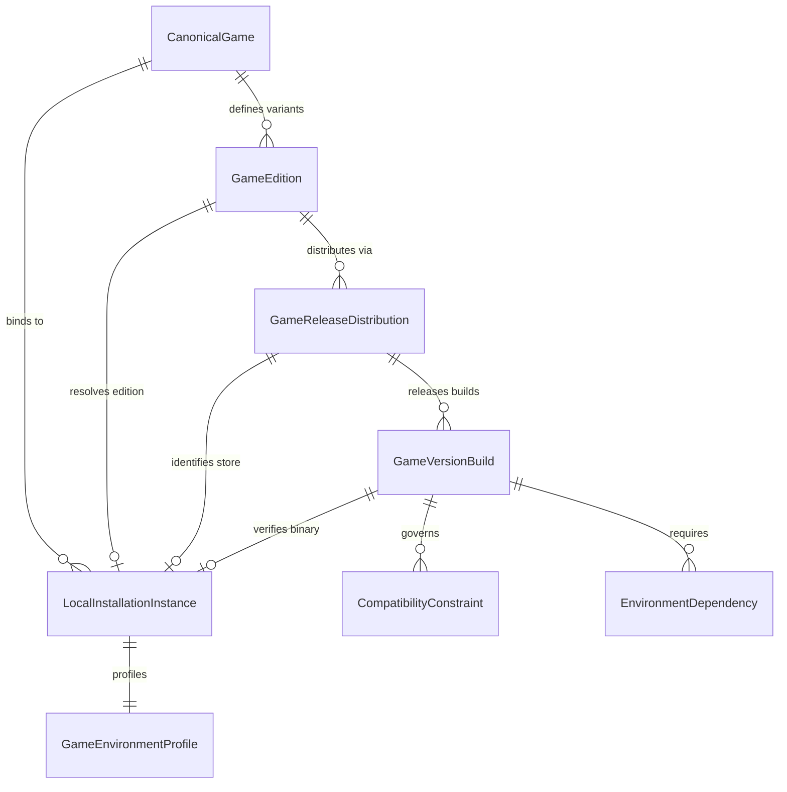

# Version & Edition Relationship Catalog

**Document ID:** `NLE-CAT-VER-001`  
**Version:** `1.0.0`  
**Status:** `APPROVED`  
**Workstream:** `Game Version Modeling, Edition and Release Relationships, Environment Profiles, Version-Specific Technical Evidence, Compatibility Constraints, and Assessment Freshness`  
**Phase:** `4 of 12 — Game Discovery & Compatibility Intelligence`  
**Step:** `28 of 100`  
**Related Documents:**
- [GAME_VERSION_EDITION_AND_ENVIRONMENT_COMPATIBILITY_MAPPING_SPECIFICATION.md](file:///d:/App%20Winrar%20Files/Nexludic%20Engine%20(working)/docs/game-discovery/GAME_VERSION_EDITION_AND_ENVIRONMENT_COMPATIBILITY_MAPPING_SPECIFICATION.md) (`NLE-SPC-VEC-001`)
- [GAME_CATALOG_DOMAIN_MODEL_AND_ENTITY_RELATIONSHIPS.md](file:///d:/App%20Winrar%20Files/Nexludic%20Engine%20(working)/docs/game-discovery/GAME_CATALOG_DOMAIN_MODEL_AND_ENTITY_RELATIONSHIPS.md) (`NLE-DOM-GCD-001`)
- [LOCAL_INSTALLATION_IDENTITY_AND_VERIFICATION_STATE_MODEL.md](file:///d:/App%20Winrar%20Files/Nexludic%20Engine%20(working)/docs/game-discovery/LOCAL_INSTALLATION_IDENTITY_AND_VERIFICATION_STATE_MODEL.md) (`NLE-DOM-INS-001`)
- [GAME_ENVIRONMENT_PROFILE_AND_COMPATIBILITY_CONTEXT_MODEL.md](file:///d:/App%20Winrar%20Files/Nexludic%20Engine%20(working)/docs/game-discovery/GAME_ENVIRONMENT_PROFILE_AND_COMPATIBILITY_CONTEXT_MODEL.md) (`NLE-DOM-ENV-001`)

---

## 1. Executive Summary & Purpose

This catalog defines the structural hierarchy, entity definitions, identification rules, relationship semantics, and uncertainty handling for all versioning and release entities in **NexLudic Engine**.

To support heterogeneous games without conflating commercial marketing labels with technical binary differences, the engine formalizes a strict five-tier entity hierarchy:
$$\text{CanonicalGame} \longrightarrow \text{GameEdition} \longrightarrow \text{GameReleaseDistribution} \longrightarrow \text{GameVersionBuild} \longleftrightarrow \text{LocalInstallationInstance}$$

---

## 2. Entity-Relationship Architecture

---

## 3. Detailed Entity Definitions & Attribute Specifications

### 3.1 Entity: `CanonicalGame`
- **Purpose:** Represents the timeless, conceptual creative work (e.g. *The Elder Scrolls V: Skyrim*). Its identity never changes regardless of updates, editions, or platforms.
- **Identity Scheme:** UUIDv5 generated from namespace `ns:nexludic:game:canonical` + normalized canonical title slug.
- **Attributes:**
  - `game_id`: UUIDv5 (Primary Key).
  - `canonical_title`: String (e.g. `"The Elder Scrolls V: Skyrim"`).
  - `slug`: String (`"the-elder-scrolls-v-skyrim"`).
  - `primary_genre`: String.
  - `franchise`: String (Nullable).
- **Ownership:** Universal Game Catalog (shared, persistent across all projects).
- **Unknown Value Behavior:** Cannot be unknown in a valid project. A project must bind to an identified or provisional canonical game record.
- **Lifecycle:** Created during catalog ingestion; immutable once established.

### 3.2 Entity: `GameEdition`
- **Purpose:** Represents a technically or commercially distinct edition of a canonical game that features unique engine characteristics, bundled assets, or script compiler changes (e.g. *Original Skyrim (2011)* vs. *Skyrim Special Edition (2016)* vs. *Skyrim VR (2018)*).
- **Identity Scheme:** UUIDv5 generated from `game_id` + normalized edition name.
- **Attributes:**
  - `edition_id`: UUIDv5 (Primary Key).
  - `game_id`: UUIDv5 (Foreign Key $\rightarrow$ `CanonicalGame`).
  - `edition_name`: String (e.g. `"Special Edition"`).
  - `engine_family`: String (e.g. `"Creation Engine 64-bit"`).
  - `target_bitness`: Enum (`X86_32`, `X86_64`, `ARM64`).
  - `has_separate_asset_pipeline`: Boolean.
- **Relationship Rule:** An edition must be technically justified (e.g., 32-bit vs 64-bit engine overhaul, VR runtime differences, or separate binary executables). Marketing-only packaging (e.g., "Standard Edition" vs "Deluxe Edition" with same binary) does not warrant a separate `GameEdition`.
- **Unknown Value Behavior:** If the user points to an unverified folder, `edition_id` is set to `NULL` (State: `PARTIALLY_IDENTIFIED`). The system retains the canonical game identity without guessing.

### 3.3 Entity: `GameReleaseDistribution`
- **Purpose:** Represents the specific digital storefront, distribution channel, or packaging mechanism for an edition (e.g., *Skyrim Special Edition on Steam* vs. *Skyrim Special Edition on GOG* vs. *Epic Games Store*).
- **Identity Scheme:** UUIDv5 generated from `edition_id` + `distribution_channel` (e.g., `STEAM`, `GOG`, `EPIC`, `DISC`, `STANDALONE`).
- **Attributes:**
  - `release_id`: UUIDv5 (Primary Key).
  - `edition_id`: UUIDv5 (Foreign Key $\rightarrow$ `GameEdition`).
  - `distribution_channel`: Enum (`STEAM`, `GOG`, `EPIC`, `XBOX_PC`, `STANDALONE_DRM_FREE`).
  - `platform_store_id`: String (e.g. Steam AppID `"489830"`, GOG Product ID `"1711230643"`).
  - `drm_type`: Enum (`STEAM_DRM`, `EPIC_DRM`, `XBOX_UWP`, `DRM_FREE`).
  - `has_executable_wrapper`: Boolean (indicates whether executable is wrapped with store telemetry).
- **Relationship Rule:** Storefront releases frequently maintain completely different executable binaries, patch schedules, memory offsets, and API hooks. Compatibility constraints must explicitly distinguish storefront releases.
- **Unknown Value Behavior:** When a game is discovered without launcher manifests (e.g., a standalone folder), `release_id` is marked `UNKNOWN` until user confirmation or PE header inspection clarifies it.

### 3.4 Entity: `GameVersionBuild`
- **Purpose:** Represents a concrete release build, binary patch, or compilation snapshot within a specific release distribution.
- **Identity Scheme:** UUIDv5 generated from `release_id` + normalized version/build string.
- **Attributes:**
  - `build_id`: UUIDv5 (Primary Key).
  - `release_id`: UUIDv5 (Foreign Key $\rightarrow$ `GameReleaseDistribution`).
  - `canonical_version`: String (Normalized SemVer or major.minor where valid).
  - `raw_version_string`: String (Verbatim string from PE header or manifest, e.g., `"1.6.1170.0.8"`).
  - `platform_build_id`: String (e.g. Steam BuildID `"1249021"`).
  - `release_date_utc`: Date (Nullable).
  - `primary_binary_name`: String (e.g., `"SkyrimSE.exe"`).
  - `primary_binary_sha256`: HexString(64) (Nullable).
  - `primary_binary_size_bytes`: Int64 (Nullable).
  - `is_latest_release`: Boolean.
  - `is_rollback_branch`: Boolean.
- **Unknown Value Behavior:** If an installation has an unparseable or custom version, `build_id` is set to a provisional instance with `raw_version_string = "UNKNOWN"`. In accordance with `DEC-002`, unknown version is non-blocking.

### 3.5 Entity: `EnvironmentDependency`
- **Purpose:** Represents an external modding framework, script extender, runtime library, or companion plugin required by a game version to enable integration capabilities.
- **Attributes:**
  - `dependency_id`: UUIDv5.
  - `dependency_name`: String (e.g., `"SKSE64"`, `"Script Hook V"`, `".NET 8.0 Desktop Runtime"`, `"Visual C++ Redistributable 2015-2022"`).
  - `dependency_type`: Enum (`SCRIPT_EXTENDER`, `MOD_LOADER`, `SYSTEM_RUNTIME`, `ENGINE_PLUGIN`, `NATIVE_LIBRARY`).
  - `supported_game_version_range`: String (e.g., `"[1.6.640, 1.6.659]"`).
  - `dependency_version`: String (e.g., `"2.2.3"`).
  - `is_mandatory`: Boolean.
  - `verification_indicator_path`: String (Relative file check path, e.g., `"skse64_1_6_640.dll"`).

---

## 4. Hierarchy Traversal & Multiplicity Rules

| Relationship | Cardinality | Traversal Invariants |
| :--- | :--- | :--- |
| `CanonicalGame` $\rightarrow$ `GameEdition` | `1 : N` ($N \ge 1$) | Every game has at least one edition (`Default Edition`). Editions never cross canonical games. |
| `GameEdition` $\rightarrow$ `GameReleaseDistribution` | `1 : N` ($N \ge 1$) | An edition may exist on multiple storefronts. A distribution belongs to exactly one edition. |
| `GameReleaseDistribution` $\rightarrow$ `GameVersionBuild` | `1 : N` ($N \ge 0$) | A distribution contains a chronological series of builds. Zero builds indicates unversioned metadata. |
| `GameVersionBuild` $\longleftrightarrow$ `LocalInstallationInstance` | `1 : 0..N` | A build may be installed zero, one, or multiple times across local drives. |
| `LocalInstallationInstance` $\rightarrow$ `GameEnvironmentProfile`| `1 : 1` | Exactly one active technical profile per local installation instance. |

---

## 5. Handling Incomparable and Non-Standard Versioning Schemes

1. **Non-SemVer Preservation:**
   - Real-world games frequently use versioning schemes such as `1.6.1170.0`, `v1.04b`, `Patch 7 Hotfix 2`, `Build 1084221`, or `2023.11.04`.
   - The engine **never** truncates, rounds, or coerces arbitrary strings into SemVer if doing so loses fidelity.
   - Both `canonical_version` (if normalized) and `raw_version_string` (verbatim) are permanently retained.
2. **Incomparability Mandate:**
   - Two version records belonging to different games, different editions, or non-ordered schemes cannot be compared using mathematical inequality operators ($<, >$).
   - If version comparison is requested between incompatible or opaque builds, the system returns `COMPARISON_UNDEFINED` and requires explicit discrete equality checks.
3. **Lineage Branches & Rollbacks:**
   - Games on Steam or GOG frequently support rollback branches (e.g., Steam `beta: 1.5.97-pre-ae`).
   - The model represents release branches as distinct siblings under `GameReleaseDistribution`, preventing rollback builds from being incorrectly treated as older builds on the main trunk.

---

## 6. Document Sign-Off & Verification

| Role | Reviewer | Verdict | Date |
| :--- | :--- | :--- | :--- |
| **Principal Software Architect** | Engine Architecture Team | Approved | 2026-11-17 |
| **Senior Domain-Model Architect** | Core Data Modeling | Approved | 2026-11-17 |
| **Senior Platform Release Specialist**| Platform Engineering | Approved | 2026-11-17 |

