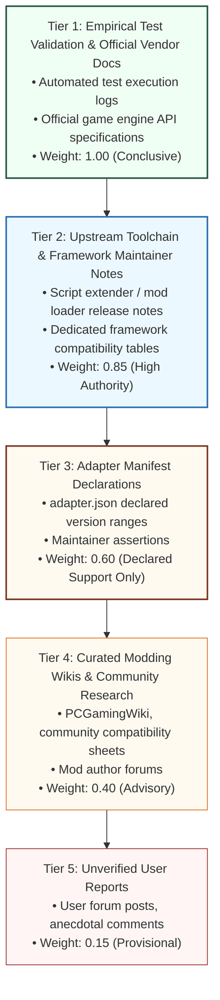
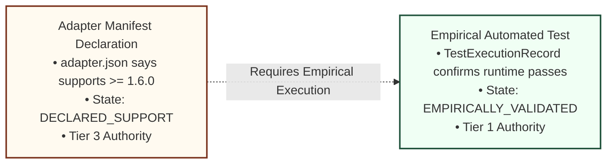

# Version Compatibility Evidence & Provenance Rules

**Document ID:** `NLE-RUL-VCE-001`  
**Version:** `1.0.0`  
**Status:** `APPROVED`  
**Workstream:** `Game Version Modeling, Edition and Release Relationships, Environment Profiles, Version-Specific Technical Evidence, Compatibility Constraints, and Assessment Freshness`  
**Phase:** `4 of 12 — Game Discovery & Compatibility Intelligence`  
**Step:** `28 of 100`  
**Related Documents:**
- [GAME_VERSION_EDITION_AND_ENVIRONMENT_COMPATIBILITY_MAPPING_SPECIFICATION.md](file:///d:/App%20Winrar%20Files/Nexludic%20Engine%20(working)/docs/game-discovery/GAME_VERSION_EDITION_AND_ENVIRONMENT_COMPATIBILITY_MAPPING_SPECIFICATION.md) (`NLE-SPC-VEC-001`)
- [VERSION_AND_EDITION_RELATIONSHIP_CATALOG.md](file:///d:/App%20Winrar%20Files/Nexludic%20Engine%20(working)/docs/game-discovery/VERSION_AND_EDITION_RELATIONSHIP_CATALOG.md) (`NLE-CAT-VER-001`)
- [GAME_ENVIRONMENT_PROFILE_AND_COMPATIBILITY_CONTEXT_MODEL.md](file:///d:/App%20Winrar%20Files/Nexludic%20Engine%20(working)/docs/game-discovery/GAME_ENVIRONMENT_PROFILE_AND_COMPATIBILITY_CONTEXT_MODEL.md) (`NLE-DOM-ENV-001`)
- [GAME_METADATA_FIELD_SOURCE_AUTHORITY_MATRIX.md](file:///d:/App%20Winrar%20Files/Nexludic%20Engine%20(working)/docs/game-discovery/GAME_METADATA_FIELD_SOURCE_AUTHORITY_MATRIX.md) (`NLE-MAT-FSA-001`)

---

## 1. Executive Summary & Purpose

This specification establishes the authoritative rules, evidentiary hierarchy, range evaluation standards, and conflict resolution protocols for recording and interpreting version-specific compatibility constraints within **NexLudic Engine**.

Every compatibility claim must possess unambiguous scope and verifiable provenance. A claim that a game or adapter is "compatible" is architecturally invalid unless it explicitly cites the exact build numbers, distribution platforms, required dependencies, and source evidence supporting that conclusion. This document prevents speculative claims, distinguishes unverified maintainer declarations from empirical test results, and establishes strict rules for handling conflicting or incomparable version data.

---

## 2. Evidentiary Hierarchy & Authority Tiers

Compatibility evidence is classified into five formal authority tiers:

### 2.1 Authority Tier Catalog

| Tier | Category Name | Permitted Sources | Epistemic Weight | Operational Usage |
| :--- | :--- | :--- | :--- | :--- |
| **Tier 1** | Empirical Validation & Official Specs | Automated test execution logs (`TestExecutionRecord`), official developer documentation, platform SDK headers. | $1.00$ | Authoritative ground truth. Overrides all lower tiers. |
| **Tier 2** | Maintainer Release Documentation | Official release notes from framework maintainers (e.g. SKSE team, ScriptHook team, UE4SS maintainers). | $0.85$ | Authoritative for framework-to-game build support. |
| **Tier 3** | Adapter Manifest Declarations | `adapter.json` declared compatibility ranges and maintainer claims. | $0.60$ | Treated as **Declared Intent**, not verified compatibility. |
| **Tier 4** | Curated Community Knowledge Bases | PCGamingWiki, ModDB, Nexus Mods compatibility articles. | $0.40$ | Advisory context for initial feasibility research. |
| **Tier 5** | Unverified User Submissions | Community forum comments, issue trackers, manual user flags. | $0.15$ | Flagged as `PROVISIONAL_UNVERIFIED`; requires verification. |

---

## 3. Schema Specification: `CompatibilityConstraint`

Every documented technical restriction or requirement is formalized as an immutable `CompatibilityConstraint` record:

| Field Name | Type | Nullable | Description |
| :--- | :--- | :--- | :--- |
| `constraint_id` | UUIDv4 | No | Unique identifier of this constraint rule. |
| `target_game_id` | UUIDv5 | No | Foreign Key $\rightarrow$ `CanonicalGame.game_id`. |
| `target_edition_id` | UUIDv5 | Yes | Foreign Key $\rightarrow$ `GameEdition.edition_id` (null if applies to all editions). |
| `target_release_id` | UUIDv5 | Yes | Foreign Key $\rightarrow$ `GameReleaseDistribution.release_id` (e.g. Steam-only). |
| `version_scope_type`| Enum | No | Scope type (`EXACT_BUILD`, `VERSION_RANGE`, `EXCLUDED_BUILDS`, `ALL_BUILDS`). |
| `range_expression` | String | Yes | Standardized mathematical interval expression (e.g. `"[1.6.640, 1.6.659]"`). |
| `platform_scope` | Enum | No | Target platform (`WINDOWS_X64`, `WINDOWS_X86`, `ANY_SUPPORTED`). |
| `constraint_nature` | Enum | No | Nature (`REQUIRED_PREREQUISITE`, `KNOWN_INCOMPATIBILITY`, `FEATURE_LIMITATION`). |
| `capability_key` | String | No | Target capability identifier (e.g. `cap:player_teleport` or wildcard `cap:*`). |
| `authority_tier` | Enum | No | Authority level (`TIER_1` through `TIER_5`). |
| `source_reference` | String | No | Permanent URI or document identifier of the evidence. |
| `source_citation` | String | No | Verbatim quotation or excerpt supporting the constraint. |
| `created_at_utc` | Timestamp | No | Record creation timestamp. |

---

## 4. Version Range Expression Syntax & Evaluation Rules

### 4.1 Standardized Interval Notation
When games and frameworks use ordered numeric versioning, version ranges must use standard mathematical interval notation:
- `[A, B]`: Inclusive lower bound $A$, inclusive upper bound $B$ ($A \le v \le B$).
- `[A, B)`: Inclusive lower bound $A$, exclusive upper bound $B$ ($A \le v < B$).
- `(A, B]`: Exclusive lower bound $A$, inclusive upper bound $B$ ($A < v \le B$).
- `[A, *)`: Minimum supported version $A$, with no upper bound ($v \ge A$).
- `(!A)`: Explicitly blacklisted or broken build $A$ ($v \ne A$).
- Examples:
  - `"[1.6.640, 1.6.659]"`: Supported on Steam 1.6.640 through GOG 1.6.659.
  - `"[1.5.97, *) (!1.6.1130)"`: Supported on 1.5.97 and newer, excluding broken patch 1.6.1130.

### 4.2 Incomparable Versions Fallback (`RUL-VCE-02`)
- If a game uses non-ordered build tokens (e.g. Steam BuildIDs, hashes, or arbitrary labels like `"Patch 7 Hotfix 2"`), interval expressions are **strictly prohibited**.
- Non-ordered builds must be evaluated using discrete **Set Membership Expressions**:
  $$\text{Syntax: } \text{IN}("build\_id\_1", "build\_id\_2", \dots) \quad\text{or}\quad \text{NOT\_IN}("build\_id\_x")$$
- The system must never attempt to order opaque strings lexicographically or numerically.

---

## 5. Epistemic Rules: Declaration vs. Validation

A critical defect in compatibility modeling is treating vendor or adapter assertions as proven fact. NexLudic Engine enforces two distinct evidence states:

1. **Rule RUL-VCE-03 (Declaration Boundary):** An adapter declaring support for a version range in its metadata (`adapter.json`) is classified as `DECLARED_SUPPORT`. It is **never** automatically promoted to `VALIDATED_COMPATIBILITY`.
2. **Rule RUL-VCE-04 (Empirical Promotion):** A version mapping is marked `EMPIRICALLY_VALIDATED` **only** when an authorized automated test harness or manual test execution record (`TestExecutionRecord`) records passing assertions on that specific build and platform.
3. **Rule RUL-VCE-05 (Negative Claims & Missing Evidence):**
   - The absence of documentation or the absence of a test record for version $X$ does **not** prove that version $X$ is incompatible.
   - The system must record such states as `UNDOCUMENTED_UNASSESSED`.
   - A claim of incompatibility (`KNOWN_INCOMPATIBILITY`) requires affirmative evidence: a known crash report, a breaking API change documented by maintainers, or a failing test execution log.

---

## 6. Conflict Resolution & Evidence Disagreements

When multiple sources disagree regarding the compatibility of a specific build:

1. **Hierarchy Rule:** Higher authority tiers strictly supersede lower authority tiers:
   $$\text{Tier 1 (Empirical Test)} > \text{Tier 2 (Maintainer Notes)} > \text{Tier 3 (Adapter Declaration)} > \text{Tier 4 (Wiki)} > \text{Tier 5 (Forum)}$$
2. **Audit Preservation:** When a lower-tier claim is superseded by a higher-tier claim, the lower-tier claim is **not** deleted. It is marked `SUPERSEDED` with a foreign pointer to the overriding constraint.
3. **Peer Conflict Handling:** If two sources within the same authority tier conflict (e.g. two conflicting maintainer notes or contradictory test logs on different hardware):
   - The constraint state is marked `EVIDENCE_CONFLICT`.
   - The system displays a warning banner highlighting both conflicting claims and citations.
   - The issue is flagged for manual engineering review. The system must never guess or average conflicting claims.

---

## 7. Document Sign-Off & Verification

| Role | Reviewer | Verdict | Date |
| :--- | :--- | :--- | :--- |
| **Principal Software Architect** | Engine Architecture Team | Approved | 2026-11-17 |
| **Senior Domain-Model Architect** | Core Data Modeling | Approved | 2026-11-17 |
| **Senior QA & Verification Specialist**| Test & Quality Assurance | Approved | 2026-11-17 |

