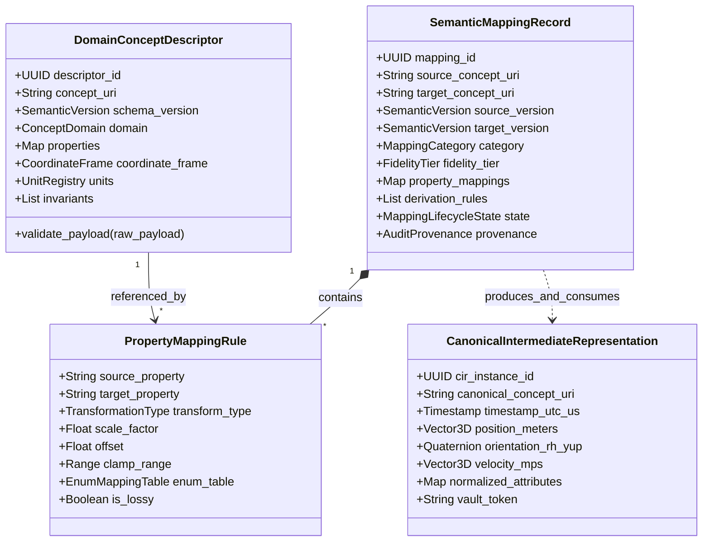

# CROSS-GAME SEMANTIC MAPPING, STATE REPRESENTATION AND NORMALIZATION SPECIFICATION

**Document Identifier:** `NLE-SPC-CSM-001`  
**Lifecycle Stage:** Authoritative Specification  
**Phase:** Phase 9 — Live Game Bridge & Hybrid Integration (Step 74 of 100)  
**Security & Integrity Level:** Medium Integrity Level (IL) / Strict Sandboxed Execution  
**Upstream Dependencies:** `NLE-SPC-LGB-001` (Step 70), `NLE-SPC-EDR-001` (Step 71), `NLE-SPC-CPA-001` (Step 72), `NLE-SPC-MVR-001` (Step 73), `NLE-SPC-CNR-001` (Step 63)  
**Downstream Dependents:** Step 75 (Continuous State Synchronization), Step 76 (Gameplay Orchestration), Step 77 (Bridge Observability & Diagnostics)

---

## 1. Executive Summary & Purpose

The **Cross-Game Semantic Mapping, State Representation and Normalization Specification** defines the authoritative architecture, data structures, invariants, and processing pipelines through which NexLudic Engine interprets, transforms, validates, and normalizes live game state and event messages exchanged between heterogeneous host games.

When two or more distinct game engines or simulation runtimes participate in a NexLudic bridge session (e.g., an Unreal Engine 5 vehicle simulator and a Unity fantasy RPG, or a Godot 2D top-down tactics engine and a proprietary 3D flight engine), they do not share internal memory layouts, coordinate conventions, unit definitions, state representations, or semantic vocabularies. Direct point-to-point data exchange without formal semantic mediation inevitably produces data distortion, unphysical state leaps, silent truncation, and logical desynchronization.

This specification establishes a mathematically grounded, contract-driven, deterministic **Canonical Intermediate Representation (CIR)** and translation pipeline that ensures every exchanged state attribute or event payload is strictly evaluated against declared semantic descriptors, normalized across coordinate/unit/type systems, assessed for fidelity, and safely projected without violating host-game integrity, security boundaries, or anti-cheat policies.

---

## 2. Inviolable Architectural Axioms & Boundaries

All semantic mapping, state representation, and data normalization operations within NexLudic Engine are governed by five inviolable foundational axioms:

### Axiom 1: The Multi-Layer Non-Equivalence Hierarchy
$$\text{Matching Field Names} \neq \text{Matching Data Types} \neq \text{Structural Validity} \neq \text{Semantic Equivalence} \neq \text{Runtime Compatibility}$$
- Two fields named `health` in separate games may both be `float32`, yet Game A interprets `100.0` as maximum hit points with permadeath while Game B interprets `100.0` as percentage of regenerative shield. Syntactic, structural, or lexical matches never imply semantic compatibility.

### Axiom 2: Strict Mapping Category Disambiguation
$$\text{Direct Mapping} \neq \text{Normalized Representation} \neq \text{Derived Value} \neq \text{Defaulted Value} \neq \text{Approximate / Lossy Mapping}$$
- An operation cannot blur categories. A transformed value must explicitly document its provenance (e.g., `PROVENANCE_OBSERVED_DIRECT`, `PROVENANCE_NORMALIZED_CANONICAL`, `PROVENANCE_DERIVED_FORMULA`, `PROVENANCE_DEFAULTED_FALLBACK`, or `PROVENANCE_APPROXIMATED_LOSSY`).

### Axiom 3: Functional Decoupling from Synchronization and Gameplay Logic
$$\text{Semantic Mapping (Step 74)} \neq \text{Continuous State Synchronization (Step 75)} \neq \text{Gameplay Orchestration (Step 76)}$$
- **Semantic Mapping (Step 74)** translates individual message payloads and state snapshots from Source Domain to Target Domain (or Canonical Representation) statically and deterministically.
- **Continuous State Synchronization (Step 75)** manages temporal extrapolation, dead reckoning, interpolation, jitter buffering, and reconciliation loops over time.
- **Gameplay Orchestration (Step 76)** enforces game rules, mashup objectives, win/loss conditions, and cross-game mechanics.

### Axiom 4: Anti-Cheat & Runtime Boundary Inviolability (`BLK-SEC-01`, `DEC-002`)
- NexLudic Engine operates strictly in user-space at Medium Integrity Level (IL).
- Semantic mapping never uses code injection, DLL hijacking, runtime memory scanning (`ReadProcessMemory`), dynamic hook placement, or binary tampering.
- All input data originates strictly from authorized, authenticated bridge envelopes delivered over the Step 73 messaging pipeline via loopback or local named pipes.

### Axiom 5: No Silent Distortion or Fabricated Equivalence
- If a source concept has no semantic counterpart in the target game, NexLudic Engine **shall never** invent arbitrary surrogate values or zero-fill fields silently.
- Concepts unsupported by the target are either explicitly preserved in an encrypted, opaque metadata vault (`vault_token`) for round-trip fidelity or rejected with an auditable semantic rejection code (`ERR_SEM_UNSUPPORTED_CONCEPT`).

---

## 3. End-to-End Semantic Mapping Architecture

```
+----------------------------------------------------------------------------------------------------+
|                                      BRIDGE MESSAGE ENVELOPE                                       |
|                               (From Step 73 Message Validation Pipeline)                           |
+----------------------------------------------------------------------------------------------------+
                                                   |
                                                   v
+----------------------------------------------------------------------------------------------------+
| 1. PAYLOAD DECODE & CONCEPT IDENTIFICATION                                                          |
|    - Resolve Source Concept Descriptor (NLE-CON-STD-001) via Endpoint Catalog                      |
|    - Extract Raw Payload into Typed Source Record                                                  |
+----------------------------------------------------------------------------------------------------+
                                                   |
                                                   v
+----------------------------------------------------------------------------------------------------+
| 2. SOURCE STRUCTURAL & RANGE VALIDATION                                                            |
|    - Validate Source Type Constraints, Boundary Invariants, Enumeration Boundaries                |
|    - Fail-Closed: Emit ERR_SEM_SOURCE_INVALID if malformed                                          |
+----------------------------------------------------------------------------------------------------+
                                                   |
                                                   v
+----------------------------------------------------------------------------------------------------+
| 3. CANONICAL INTERMEDIATE REPRESENTATION (CIR) NORMALIZATION                                       |
|    - Transform Spatial Coordinates to Canonical Frame (Right-Handed, Y-Up, Meters)                  |
|    - Transform Units (SI Units: m, s, kg, rad, N, Pa, J)                                           |
|    - Normalize Timestamps to UTC Unix Microseconds                                                 |
|    - Map Local Enums to Canonical Semantic Registry Tokens                                         |
+----------------------------------------------------------------------------------------------------+
                                                   |
                                                   v
+----------------------------------------------------------------------------------------------------+
| 4. SEMANTIC EQUIVALENCE & FIDELITY ASSESSMENT                                                      |
|    - Evaluate Mapping Eligibility against Negotiated Session Contract (Step 72)                     |
|    - Classify Equivalence: T0 (Full), T1 (Normalized), T2 (Approximate), T3 (Lossy), T4 (Reject)   |
|    - Attach Lossiness & Fidelity Manifest (NLE-POL-LAF-001)                                        |
+----------------------------------------------------------------------------------------------------+
                                                   |
                                                   v
+----------------------------------------------------------------------------------------------------+
| 5. TARGET PROJECTION & VALUE DERIVATION                                                            |
|    - Execute Deterministic Derivation Formulae (NLE-SPC-DMD-001)                                    |
|    - Vault Unmapped Source Fields into Round-Trip Metadata Token (vault_token)                     |
|    - Apply Explicit Range Clamping and Quantization with Audit Logging                             |
|    - Generate Typed Target Record complying with Target Concept Descriptor                         |
+----------------------------------------------------------------------------------------------------+
                                                   |
                                                   v
+----------------------------------------------------------------------------------------------------+
| 6. TARGET ENVELOPE PACKAGING & AUDIT RECORDING                                                     |
|    - Package into Outbound BridgeMessageEnvelope (Step 73)                                         |
|    - Record Mapping Telemetry (Latency, Precision Loss, Field Provenance)                          |
+----------------------------------------------------------------------------------------------------+
```

---

## 4. Architectural Domain Model & Core Entities



---

## 5. Failure Handling, Fallback, and Fail-Closed Guarantees

The semantic mapping engine must operate deterministically under all failure modes:

| Failure Mode | Trigger Condition | System Action | Error Code | Emitted Event |
| :--- | :--- | :--- | :--- | :--- |
| **Source Schema Violation** | Source payload lacks mandatory property or violates basic datatype | Drop payload, increment drop counter, emit audit alert | `ERR_SEM_SRC_SCHEMA_VIOLATION` | `OnSemanticMappingRejected` |
| **Out-of-Bounds Coordinate** | Position exceeds maximum physical domain bounds ($\pm 10^7$ m) | Clamp to boundary if policy allows; otherwise drop payload | `ERR_SEM_COORDINATE_OUT_OF_BOUNDS` | `OnCoordinateClamped` / `OnCoordinateRejected` |
| **Undefined Enum Mapping** | Source enum value not present in mapping table | Fall back to configured safe default if explicitly specified; otherwise reject | `ERR_SEM_ENUM_UNMAPPED` | `OnEnumMappingFailed` |
| **Cyclic Derivation Dependency** | Derivation rule graph contains topological cycle | Abort session admission; reject mapping record at load time | `ERR_SEM_DERIVATION_CYCLE` | `OnMappingValidationFailed` |
| **Lossiness Policy Violation** | Mapping fidelity tier is T3 (Lossy) but session requires T1 or T0 | Refuse message transmission; notify bridge session manager | `ERR_SEM_FIDELITY_INSUFFICIENT` | `OnFidelityThresholdExceeded` |
| **Opaque Vault Tampering** | Target returns modified `vault_token` with broken HMAC signature | Strip vaulted metadata, record security violation, fall back to fresh base | `ERR_SEM_VAULT_INTEGRITY_COMPROMISED`| `OnSecurityAnomalyDetected` |

---

## 6. Verification and Compliance Matrix

Every implementation of `NLE-SPC-CSM-001` must satisfy:
1. **Deterministic Output:** For any identical inputs $I$ and mapping record $M$, output payload $O$ must be bitwise identical across all executions.
2. **Zero Memory Allocation in Inner Loop:** Property transformations, unit scalings, and coordinate rotations must run without dynamic heap allocation within the per-message hot path.
3. **Traceability:** Every field in the generated target payload must trace back to an exact source field, derivation rule, or explicit default token.
