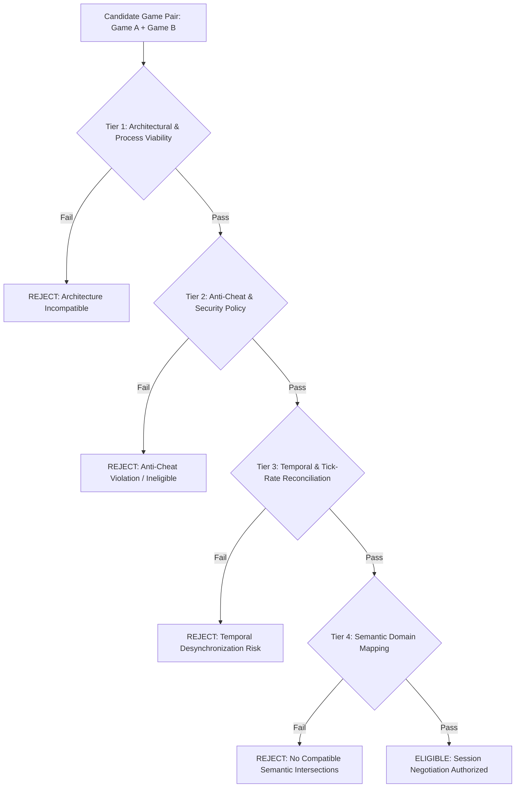

# GAME-PAIR ELIGIBILITY & CROSS-GAME SEMANTIC COMPATIBILITY POLICY

**Document ID:** `NLE-POL-GPE-001`  
**Classification:** Compatibility & Semantic Policy  
**Phase:** Phase 9 — Live Game Bridge & Hybrid Integration (Step 70)  
**Status:** Authoritative Foundation  
**Upstream Dependencies:** `NLE-SPC-LBA-001`, `NLE-MOD-CRB-001`, `NLE-POL-SLC-001`  
**Downstream Consumed By:** `NLE-CON-HIC-001`, Step 73 (Semantic Translation)  

---

## 1. Objective & Eligibility Scope

NexLudic Engine enables interoperability between heterogeneous games. However, not all game pairs can or should be bridged. 

This policy establishes the four-tier verification framework that determines whether a candidate pair of games (`Game A` and `Game B`) is eligible for live bridge activation, and governs how semantic mismatches are resolved without compromising game stability or player fairness.

---

## 2. Four-Tier Eligibility Verification Framework

A proposed game pair must pass all four evaluation tiers sequentially before a session contract may be generated:



### 2.1 Tier Breakdown & Criteria

#### Tier 1: Architectural & Process Viability
- **Process Isolation:** Both games must run as independent OS processes or containerized runtimes capable of establishing local IPC (Named Pipes, TCP loopback, or Domain Sockets).
- **Adapter Availability:** Both games must have verified NexLudic Adapter shims, mod scripts, or official developer telemetry endpoints available.

#### Tier 2: Anti-Cheat & Security Policy (`BLK-SEC-01` Compliance)
- **Zero Anti-Cheat Interference:** If either game deploys kernel-level anti-cheat (e.g., Vanguard, BattlEye, Easy Anti-Cheat) that categorizes local loopback IPC or memory shims as unauthorized tampering, the game pair is **CATEGORICALLY DISQUALIFIED** from live bridge interoperability.
- **Multiplayer Integrity:** Live bridge interop is strictly restricted to single-player sessions, offline modes, or private/whitelisted multiplayer servers explicitly authorized for modded gameplay. Bridging into public competitive servers is strictly prohibited.

#### Tier 3: Temporal & Tick-Rate Reconciliation
Games operate at radically different internal tick rates:
- Game A (e.g., Physics Simulation): 120 Hz tick rate.
- Game B (e.g., Voxel RPG): 20 Hz tick rate.
- **Policy Rule:** The bridge router enforces downsampling and temporal smoothing. High-frequency telemetry from Game A is sampled or averaged to match Game B's consumption rate. High-frequency bursts must never swamp slower game runtimes.

#### Tier 4: Semantic Domain Mapping
- At least one shared semantic domain must possess a valid, bi-directional or directional transformation schema (e.g., mapping inventory items, spatial coordinates, health pools, or day/night clock cycles).

---

## 3. Cross-Game Coordinate & Spatial Transformation

Cross-game spatial interop (e.g., player position mirroring or portal linking) requires explicit coordinate frame conversion:

```
+-----------------------------------+-----------------------------------+
| Engine / Game Standard           | Coordinate System Standard        |
+-----------------------------------+-----------------------------------+
| Unreal Engine                     | Left-Handed, Z-Up, Centimeters    |
| Unity                             | Left-Handed, Y-Up, Meters         |
| Source Engine (Half-Life 2)       | Right-Handed, Z-Up, Inches        |
| Minecraft (Java Edition)          | Right-Handed, Y-Up, Blocks/Meters |
+-----------------------------------+-----------------------------------+
```

### 3.1 Transformation Rules
1. **Canonical World Coordinates:** The Central Bridge Coordinator normalizes all positional telemetry to a Canonical Coordinate Standard: **Right-Handed, Y-Up, SI Meters**.
2. **Matrix Transformation:** Connectors are responsible for applying transformation matrices converting from local game coordinates to canonical coordinates on emission, and from canonical to local coordinates on reception.
3. **Precision & Quantization:** Floating-point coordinates must use IEEE 754 64-bit double precision (`float64`) to prevent cumulative rounding drift across long bridge sessions.

---

## 4. Semantic Lossiness & Graceful Degradation Policy

When mapping complex entities across games with asymmetric feature sets (e.g., transferring a custom enchanted weapon from Skyrim to Minecraft):

1. **Lossy Mapping Disclosure:** All semantic mappings that discard entity metadata (e.g., enchanting attributes not supported in the destination game) must be explicitly flagged in the capability contract with `lossy: true`.
2. **Metadata Preservation via Opaque Vaulting:** If an item is transferred from Game A to Game B, transformed into an equivalent native item in Game B, and subsequently transferred back to Game A, the engine preserves the original, unstripped Game A metadata in an encrypted vault envelope (`vault_token`). This enables lossless round-trip item transfers.
3. **Clamping & Invariant Preservation:** Value ranges (e.g., health, durability, speed) must be normalized to $[0.0, 1.0]$ unit intervals and clamped to destination game bounds to prevent game-breaking overflows.
