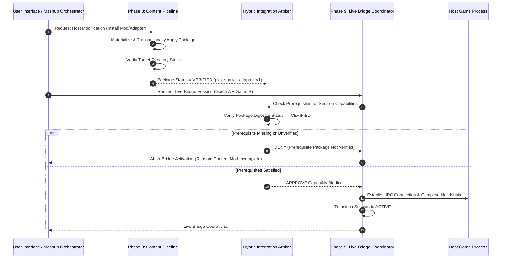

# HYBRID INTEGRATION CROSS-STRATEGY DEPENDENCY & AUTHORIZATION CONTRACT

**Document ID:** `NLE-CON-HIC-001`  
**Classification:** Cross-Subsystem Integration Contract  
**Phase:** Phase 9 — Live Game Bridge & Hybrid Integration (Step 70)  
**Status:** Authoritative Foundation  
**Upstream Dependencies:** `NLE-GAT-PH8-001` (Phase 8 Gate), `NLE-SPC-LBA-001`, `NLE-MOD-CRB-001`, `NLE-CON-DEC-001`  
**Downstream Consumed By:** `NLE-POL-SRS-001`, Step 76 (Hybrid Integration Orchestrator)  

---

## 1. Purpose & System Boundary Contract

This contract defines the authoritative binding and operational coupling between the **Phase 8 Host-Game Modification Subsystem** (filesystem packages, assets, mod files) and the **Phase 9 Live Game Interoperability Bridge Subsystem** (runtime IPC, sockets, live event streaming).

```
+-----------------------------------------------------------------------------------------+
|                               HYBRID INTEGRATION ARBITER                                |
|                                                                                         |
|       +------------------------------------+   +------------------------------------+   |
|       |         PHASE 8 SUBSYSTEM          |   |         PHASE 9 SUBSYSTEM          |   |
|       |  Target State: APPLIED & VERIFIED  |   |  Session State: ACTIVE / ROUTING   |   |
|       +-----------------+------------------+   +-----------------+------------------+   |
|                         |                                        |                      |
|                         \--------------------\  /----------------/                      |
|                                               v v                                       |
|                               +--------------------------------+                        |
|                               |  HYBRID CAPABILITY ENFORCEMENT |                        |
|                               | - Precedence Invariant         |                        |
|                               | - Dual User Authorization      |                        |
|                               | - Fault Decoupling             |                        |
|                               | - Target Drift Suspension      |                        |
|                               +--------------------------------+                        |
+-----------------------------------------------------------------------------------------+
```

---

## 2. Invariant Rules of Hybrid Integration

### 2.1 Rule 1: Strict Precedence of Content Modification
A live bridge capability that depends on host-game modifications (tagged with `requires_content_package = true` and referencing a `required_package_id`) **MUST NOT** be negotiated or activated unless:
1. The referenced package has been materialized, serialized, and verified under Step 65.
2. The package has been transactionally applied to the host game target directory under Step 67.
3. Post-modification target verification (Step 67 / Step 68) confirmed an uncompromised `VERIFIED` state with matching manifest digest.

### 2.2 Rule 2: Dual User Authorization Requirement
Filesystem modification and live runtime message exchange require separate, explicit user authorizations:
- **Phase 8 Authorization:** Explicit approval to modify, write, or replace files within the target game directory.
- **Phase 9 Authorization:** Explicit approval to establish local IPC channels, launch bridge connectors, and exchange live gameplay data between game runtimes.
- **Invariant:** Authorizing Phase 8 content modification **DOES NOT** imply authorization for Phase 9 live bridging. Authorizing Phase 9 live bridging **NEVER** grants Phase 8 filesystem modification privileges.

### 2.3 Rule 3: Decoupled Failure & Non-Destructive Fault Isolation
- If a live bridge connection fails (socket reset, timeout, process crash, invalid payload), the Hybrid Integration Arbiter **STRICTLY FORBIDS** triggering an automated filesystem rollback of Phase 8 packages.
- Rationale: Runtime network/socket disconnections are ephemeral process events. Triggering a destructive filesystem rollback while a game process is running risks severe data loss, save corruption, and unrecoverable host instability.

### 2.4 Rule 4: Target Drift & State Reconciliation Protection
- If external file changes or target drift are detected in the host game directory during an active live bridge session, the Arbiter transitions the bridge session immediately to `SUSPENDED`.
- Live message dispatch is paused until the user reconciles the target state via Phase 8 procedures.

---

## 3. Hybrid Capability Binding Schema

When a bridge session includes capabilities requiring underlying host modifications, the session contract binds the package manifest digest directly to the capability:

```json
{
  "$schema": "https://schemas.nexludic.dev/v1/bridge/hybrid-capability-binding.json",
  "binding_id": "hyb-01938a4b-8801-4123-bcde-998877665544",
  "session_id": "sess-9a7f3e12-4c28-4091-88f2-7104bce948a0",
  "capability_id": "telemetry.player.spatial",
  "package_dependency": {
    "package_id": "pkg_spatial_adapter_v1",
    "required_manifest_digest": "sha256:8f4c2e1a90b8d7c6e5f4a3b2c1d0e9f8a7b6c5d4e3f2a1b0c9d8e7f6a5b4c3d2",
    "verified_target_path": "D:/Games/Half-Life 2/hl2/custom/nexludic_spatial_adapter",
    "verified_timestamp_utc": "2026-11-20T15:58:30.000Z"
  },
  "runtime_connector": {
    "expected_transport": "NAMED_PIPE",
    "pipe_name": "\\.\pipe\nexludic-bridge-sess-9a7f3e12-valve",
    "process_id": 14208,
    "integrity_level": "MEDIUM"
  },
  "status": "BOUND_AND_VERIFIED"
}
```

---

## 4. Operational Sequence & Verification Flow



---

## 5. Security & Containment Assurance

1. **Medium IL Execution Enforcement:** The Hybrid Integration Arbiter validates that neither Phase 8 package materialization nor Phase 9 bridge sockets elevate process privileges above Windows Medium IL.
2. **Revocation Propagation:** If a user uninstalls or rolls back a Phase 8 package via the engine interface, the Arbiter immediately notifies the Live Bridge Coordinator, which terminates any active bridge sessions depending on that package.
