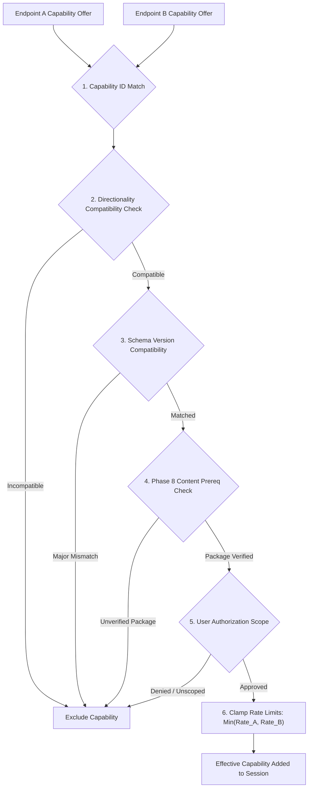

# LIVE BRIDGE CAPABILITY AGREEMENT & SESSION ADMISSION CONTRACT

**Document ID:** `NLE-CON-CAS-001`  
**Classification:** Core Interface Contract & Session Admission Specification  
**Phase:** Phase 9 — Live Game Bridge & Hybrid Integration (Step 72 of 100)  
**Status:** Authoritative Specification  
**Upstream Dependencies:** `NLE-SPC-CPN-001`, `NLE-POL-PNV-001`, `NLE-CON-DEC-001`, `NLE-CON-HIC-001` (Step 70 Hybrid Contract), `CANONICAL_CAPABILITY_TAXONOMY_AND_DOMAIN_MODEL.md` (Phase 5)  
**Downstream Consumed By:** `NLE-SPC-CSF-001`, Step 73 (Semantic Translation), Step 74 (Event Routing)  

---

## 1. Architectural Role & Objective

Capability agreement and session admission form the final logical gate before a bridge connection transitions into an active, routing session.

Even after peers are authenticated and a wire protocol is negotiated, the engine must:
1. Reconcile offered capabilities to determine the **Effective Capability Set**.
2. Verify that all mandatory capabilities are satisfied.
3. Validate Phase 8 content prerequisites via the Hybrid Integration Arbiter (`HIBA-07`).
4. Enforce user authorization boundaries via the Authorization Guard (`ASG-05`).
5. Mint an immutable `NegotiatedSessionContract` and perform a clean handoff to the Central Message Router (`CMR-02`).

---

## 2. Derivation of the Effective Capability Set

The effective capability set is strictly bounded by the mathematical intersection of what is offered, supported, verified, and authorized:

$$\text{EffectiveCapabilities} = \text{Offered}_A \cap \text{Offered}_B \cap \text{Supported}_{\text{Proto}} \cap \text{Verified}_{\text{Phase8}} \cap \text{Authorized}_{\text{User}}$$



### 2.1 Directional Matching Rules
- If A is `OUTBOUND` and B is `INBOUND` $\rightarrow$ Valid (Unidirectional A $\rightarrow$ B).
- If A is `INBOUND` and B is `OUTBOUND` $\rightarrow$ Valid (Unidirectional B $\rightarrow$ A).
- If A is `BIDIRECTIONAL` and B is `BIDIRECTIONAL` $\rightarrow$ Valid (Full Duplex).
- If A and B declare identical non-bidirectional directions (both `OUTBOUND` or both `INBOUND`) $\rightarrow$ **INCOMPATIBLE** (Capability dropped).

---

## 3. Session Admission Prerequisites Checklist

Before the Central Bridge Coordinator can admit the session into the active routing table, it must evaluate the **Session Admission Gate (`SEG-04`)**:

```
+----+--------------------------------------------+---------------------------------------+-------------+
| #  | Admission Prerequisite Check               | Verifying Component                   | Mandatory?  |
+----+--------------------------------------------+---------------------------------------+-------------+
| 1  | Connection Request valid & unexpired       | Connection Preflight Engine (CPE-01)  | MANDATORY   |
| 2  | Both peers authenticated via 4-tier proofs | Peer Authentication Handler (PAH-03)  | MANDATORY   |
| 3  | Wire protocol reconciled (NLE-WIRE-v1)     | Protocol Negotiator (PCN-04)          | MANDATORY   |
| 4  | All mandatory capabilities satisfied       | Protocol Negotiator (PCN-04)          | MANDATORY   |
| 5  | Phase 8 package dependencies VERIFIED      | Hybrid Integration Arbiter (HIBA-07)  | MANDATORY   |
| 6  | User security grant covers effective set   | Authorization Guard (ASG-05)          | MANDATORY   |
| 7  | No active competing claimant quarantine    | Registration Manager (ERM-02)         | MANDATORY   |
| 8  | Host OS resources within quota limits      | Flow Controller / Resource Guard      | MANDATORY   |
| 9  | Audit record successfully journaled        | Telemetry & Diagnostic Journal (TDJ-08)| MANDATORY  |
+----+--------------------------------------------+---------------------------------------+-------------+
```

---

## 4. Final Negotiated Session Contract Schema

Upon successful admission, the coordinator mints the immutable session contract:

```json
{
  "$schema": "https://schemas.nexludic.dev/v1/bridge/session-contract.json",
  "session_id": "sess-01938a4b-7777-7000-8801-abcdef998877",
  "connection_request_ref": "creq-01938a4b-8800-7000-8801-abcdef123456",
  "status": "ACTIVE",
  "established_at_utc": "2026-11-20T17:05:02.120Z",
  "expires_at_utc": "2026-11-20T19:05:02.120Z",
  "endpoints": {
    "initiator": "mojang:minecraft-java:99b1c43f01:inst-01938a4c",
    "responder": "valve:half-life-2:a8f9c12e5d:inst-01938a4b"
  },
  "wire_protocol": {
    "version": "NLE-WIRE-v1",
    "framing": "LENGTH_PREFIX_4B",
    "digest_algorithm": "SHA-256",
    "compression": "NONE"
  },
  "effective_capabilities": [
    {
      "capability_id": "telemetry.player.spatial",
      "version": "1.2.0",
      "direction": "OUTBOUND",
      "schema_uri": "https://schemas.nexludic.dev/v1/schemas/spatial-telemetry-v1.json",
      "clamped_rate_per_sec": 30,
      "requires_content_package": true,
      "bound_package_id": "pkg_spatial_adapter_v1"
    },
    {
      "capability_id": "inventory.item.transfer",
      "version": "1.0.0",
      "direction": "BIDIRECTIONAL",
      "schema_uri": "https://schemas.nexludic.dev/v1/schemas/inventory-transfer-v1.json",
      "clamped_rate_per_sec": 5,
      "requires_content_package": false
    }
  ],
  "runtime_governance": {
    "heartbeat_interval_ms": 1000,
    "heartbeat_timeout_ms": 3000,
    "max_frame_size_bytes": 1048576,
    "max_unacked_messages": 50
  }
}
```

---

## 5. Handoff to Runtime Routing & Hybrid Orchestration

1. **Message Router Handoff (`CMR-02`):** The session contract is registered in the routing table. Incoming frames matching `session_id` are now dispatched to destination channel queues.
2. **Hybrid Orchestrator Handoff (Step 76):** Exposes session readiness to the mashup orchestrator without conveying filesystem write authority.
3. **Inviolable Invariant:** Admission of the session **DOES NOT** imply that subsequent runtime state operations have succeeded or been verified.
