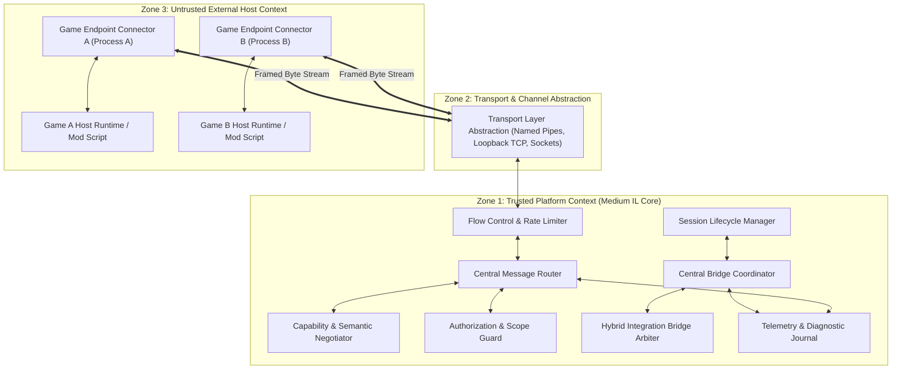
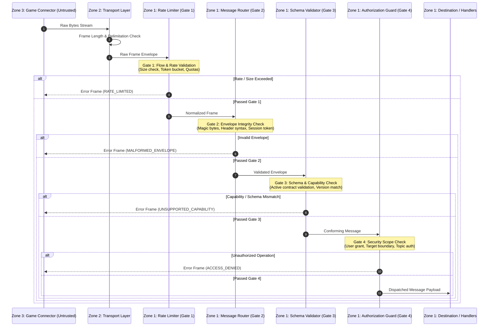

# LIVE BRIDGE COMPONENT RESPONSIBILITY & TRUST BOUNDARY MODEL

**Document ID:** `NLE-MOD-CRB-001`  
**Classification:** Architectural Domain & Trust Boundary Specification  
**Phase:** Phase 9 — Live Game Bridge & Hybrid Integration (Step 70)  
**Status:** Authoritative Foundation  
**Upstream Dependencies:** `NLE-SPC-LBA-001` (Live Game Interoperability Bridge Architecture), `DEC-002` (Windows Medium IL Constraint), `BLK-SEC-01` (Security Inviolability)  
**Downstream Consumed By:** `NLE-CON-DEC-001`, `NLE-POL-SRS-001`, Steps 71–78  

---

## 1. Scope & Objective

This document defines the formal component decomposition, architectural responsibilities, data flow boundaries, and security trust levels for all subsystems comprising the NexLudic Engine Live Game Interoperability Bridge. 

It establishes precise trust boundaries delineating what the central engine trusts, what it treats as hostile or untrusted, and how cross-boundary data flows must be validated, sanitized, and isolated.

---

## 2. Component Responsibility Matrix

The Phase 9 Live Bridge architecture is partitioned into nine discrete architectural components across three operational zones:

### 2.1 Detailed Component Responsibilities

| Component Identifier | Component Name | Execution Context | Trust Level | Primary Responsibilities |
| :--- | :--- | :--- | :--- | :--- |
| **`CBC-01`** | **Central Bridge Coordinator** | Core Engine Process | **Trusted** | Orchestrates subsystem initialization, manages global bridge state, coordinates multi-game sessions, and handles shutdown/draining. |
| **`CMR-02`** | **Central Message Router** | Core Engine Process | **Trusted** | Deserializes normalized envelopes, validates routing rules, resolves target endpoint addresses, and dispatches frames. |
| **`CSN-03`** | **Capability & Semantic Negotiator** | Core Engine Process | **Trusted** | Evaluates manifests, computes capability intersections, generates immutable session contracts, and binds semantic mapping rules. |
| **`SLM-04`** | **Session Lifecycle Manager** | Core Engine Process | **Trusted** | Maintains endpoint session state machines (`DISCONNECTED` to `TERMINATED`), processes heartbeats, and detects liveness timeouts. |
| **`ASG-05`** | **Authorization & Scope Guard** | Core Engine Process | **Trusted** | Intercepts all routed messages, checks operation scopes against user permissions, rejects unauthorized cross-game commands. |
| **`FRL-06`** | **Flow Control & Rate Limiter** | Core Engine Process | **Trusted** | Enforces frame size limits, token-bucket rate limiting per endpoint/topic, manages backpressure, and prevents buffer starvation. |
| **`HIBA-07`** | **Hybrid Integration Bridge Arbiter** | Core Engine Process | **Trusted** | Verifies Phase 8 package prerequisites before allowing live bridge activation; monitors host integrity during live sessions. |
| **`TDJ-08`** | **Telemetry & Diagnostic Journal** | Core Engine Process | **Trusted** | Append-only, tamper-evident recording of bridge lifecycle events, capability contracts, security violations, and error dumps. |
| **`TLA-09`** | **Transport Layer Abstraction** | Core Engine Process | **Boundary / Semi-Trusted** | Handles OS-level IPC socket/pipe I/O, length-prefixed frame delineation, connection acceptance, and physical byte streaming. |
| **`GEC-10`** | **Game Endpoint Connector** | Game Process / Shim | **Untrusted** | Implemented as a game mod, companion process, or script; converts internal game events to normalized bridge envelopes. |

---

## 3. Trust Boundary Model & Isolation Levels

### 3.1 Trust Zones Defined

1. **Zone 1: Trusted Platform Context (NexLudic Core Engine)**
   - **Environment:** Windows Medium Integrity Level (or POSIX standard user space).
   - **Assumptions:** Code running in this context is built, signed, and verified by NexLudic Engine. Memory is protected from unprivileged cross-process access.
   - **Security Stance:** Complete control over internal state; strictly adheres to least-privilege principles.

2. **Zone 2: Transport Boundary (IPC Communication Channels)**
   - **Environment:** Local Named Pipes (`\\.\pipe\nexludic-bridge-*`), Loopback Sockets (`127.0.0.1:[dynamic-port]`), Unix Domain Sockets.
   - **Assumptions:** OS-enforced isolation, but data transmitted across the wire may be truncated, delayed, or injected by unauthorized local processes if permissions are misconfigured.
   - **Security Stance:** Transport endpoints MUST enforce strict Access Control Lists (ACLs) restricted exclusively to the current user SID (`SECURITY_CREATOR_OWNER_RID`). No network-facing listeners.

3. **Zone 3: Untrusted External Host Context (Game Processes & Runtimes)**
   - **Environment:** Third-party game executables, Unity/Unreal runtimes, mod loaders (Fabric, Forge, UE4SS, MelonLoader).
   - **Assumptions:** External game code is inherently unstable, crash-prone, potentially malicious, or subject to proprietary anti-cheat surveillance.
   - **Security Stance:** **Zero Trust.** All data originating from Zone 3 is treated as completely untrusted input. The engine never assumes a game will send valid payloads, respect timing, or remain stable.

---

## 4. Cross-Boundary Data Flow & Validation Gates

Every message crossing from Zone 3 into Zone 1 must pass through four sequential validation gates:

---

## 5. Threat Vectors & Architectural Mitigations

| Threat ID | Threat Vector Description | Affected Component | Architectural Mitigation |
| :--- | :--- | :--- | :--- |
| **`THR-BRG-01`** | **Local Process Spoofing:** Rogue local process attempts to connect to bridge named pipe or loopback port. | Transport Layer (`TLA-09`) | Windows Named Pipes use strict Security Descriptors granting `GENERIC_ALL` strictly to the executing user token SID (`TokenUser`). Loopback sockets require an ephemeral 256-bit cryptographically random authentication token passed via secure handshake. |
| **`THR-BRG-02`** | **Message Flooding / Denial-of-Service:** Broken mod script transmits millions of events per second, exhausting engine CPU/RAM. | Flow Control (`FRL-06`) | Strict token-bucket rate limiting per endpoint and topic. Frame size hard ceiling (4MB default). High-water mark pauses socket read buffer immediately upon queue saturation. |
| **`THR-BRG-03`** | **Malformed / Exploit Payloads:** Host game sends deeply nested JSON, oversized strings, or buffer overflow exploits. | Message Router (`CMR-02`) | Strict schema parsing with maximum recursion depth (max 8 levels), bounded string lengths, and safe deserialization into immutable data models. Zero execution of code payloads. |
| **`THR-BRG-04`** | **Anti-Cheat False Positives:** Anti-cheat software detects bridge communication and flags user as cheating. | Architecture / Boundary | Bridge utilizes zero binary injection, zero memory hooks, and zero cross-process thread hijacking. Uses only standard OS IPC or official developer APIs. Bridge process is cleanly named and unattached. |
| **`THR-BRG-05`** | **Cross-Game Privilege Escalation:** Game A attempts to send commands that force Game B to delete saves, change files, or execute arbitrary OS actions. | Authorization Guard (`ASG-05`) | Strict domain whitelisting. Bridge capabilities are constrained to domain-specific semantic concepts (e.g., `inventory.transfer`, `player.teleport`). File I/O, process execution, and system calls are strictly forbidden in bridge schemas. |
| **`THR-BRG-06`** | **Replay Attacks & Out-of-Order Frames:** Stale state updates applied after newer updates, leading to state corruption. | Central Message Router (`CMR-02`) | Every message envelope contains a monotonically increasing `sequence_number` and a millisecond-precision UTC timestamp. The router rejects backwards sequences and stale messages outside the jitter window. |

---

## 6. Audit & Traceability Compliance

Every failure at any validation gate generates an immutable diagnostic record in the **Telemetry & Diagnostic Journal (`TDJ-08`)**, capturing:
- Timestamp (UTC ISO 8601 with microsecond precision).
- Offending Endpoint Identifier and Session ID.
- Gate ID where rejection occurred.
- Specific rejection reason code (e.g., `ERR_GATE4_UNAUTHORIZED_TOPIC`).
- Envelope header metadata (payload body is sanitized or hashed to prevent secret leakage).
