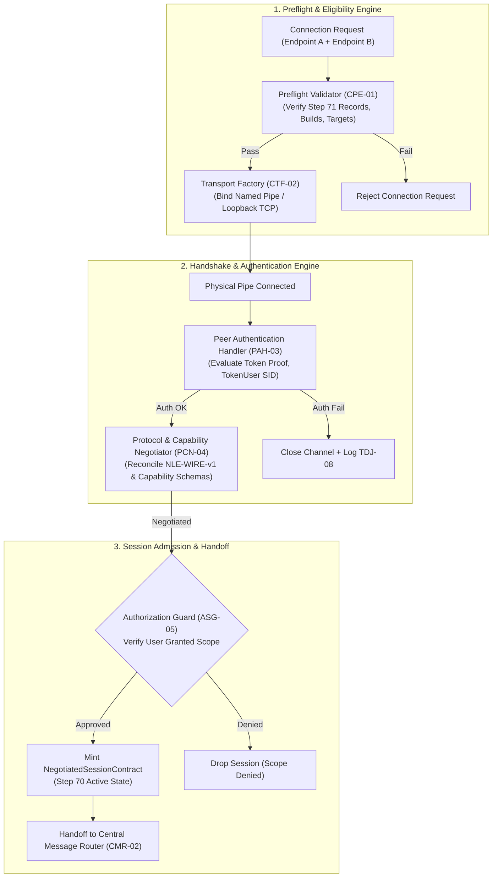
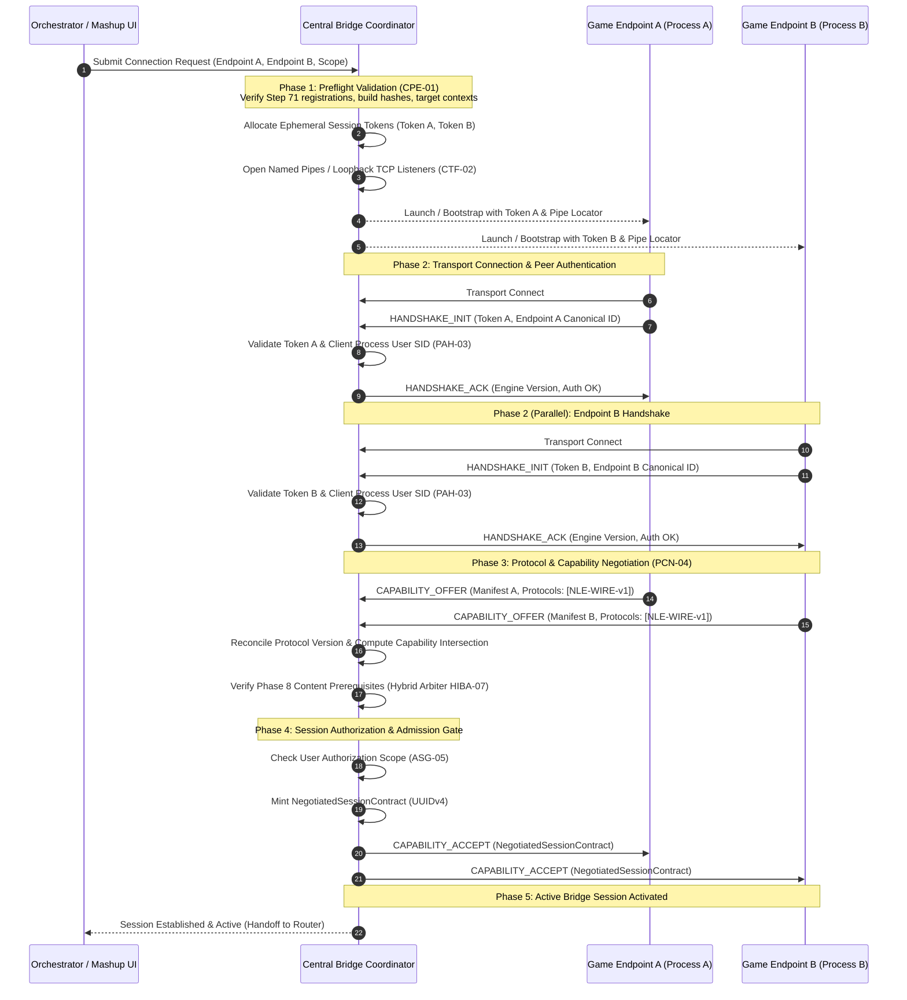

# LIVE BRIDGE CONNECTION ESTABLISHMENT, PEER AUTHENTICATION & PROTOCOL NEGOTIATION SPECIFICATION

**Document ID:** `NLE-SPC-CPN-001`  
**Classification:** Core Engineering & Security Specification  
**Phase:** Phase 9 — Live Game Bridge & Hybrid Integration (Step 72 of 100)  
**Status:** Authoritative Specification  
**Upstream Dependencies:** `NLE-SPC-LBA-001` (Live Game Bridge Architecture), `NLE-SPC-PME-001` (Protocol & Message Envelope Foundation), `NLE-POL-SLC-001` (Session Lifecycle & Capability Negotiation), `NLE-CON-DEC-001` (Domain Model & Canonical Identity), `NLE-SPC-EDR-001` (Endpoint Discovery & Registration), `NLE-CON-ERR-001` (Registration Contract), `NLE-POL-EIV-001` (Identity Verification Policy)  
**Downstream Consumed By:** Step 73 (Cross-Game Semantic Translation Engine), Step 74 (Bidirectional Event Routing), Step 76 (Hybrid Integration Orchestrator)  

---

## 1. Executive Summary & Purpose

This specification defines the authoritative engineering and security protocol governing the transition from registered, identity-assessed endpoints (Step 71) to an authenticated, compatible, explicitly authorized, and active bridge session (Step 70).

Establishing cross-game live interoperability involves complex interactions between heterogeneous game processes, local IPC transports, and sandboxed shims. To prevent security vulnerabilities, process instability, session confusion, and unauthorized state mutation, this specification formalizes the strict boundaries separating the seven distinct operational states of session establishment:

```
+----------------------------------------------------------------------------------------------------+
|                                    NEXLUDIC ENGINE PLATFORM                                        |
|                                                                                                    |
|   +--------------------------------------------------------------------------------------------+   |
|   |                        SESSION ESTABLISHMENT SEPARATION OF CONCERNS                        |   |
|   |                                                                                            |   |
|   |   +------------------+       +-------------------+       +--------------------+            |   |
|   |   |    CONNECTION    | ----> |       PEER        | ----> |      PROTOCOL      |            |   |
|   |   |   ESTABLISHED    |       |   AUTHENTICATED   |       |     NEGOTIATED     |            |   |
|   |   | Physical pipe/IPC|       | 4-Tier proof check|       | Wire version match |            |   |
|   |   +------------------+       +-------------------+       +---------+----------+            |   |
|   |                                                                    |                       |   |
|   |                                                                    v                       |   |
|   |   +------------------+       +-------------------+       +--------------------+            |   |
|   |   |     SESSION      | <---- |      SESSION      | <---- |     CAPABILITY     |            |   |
|   |   |      ACTIVE      |       |    AUTHORIZED     |       |       AGREED       |            |   |
|   |   | Handoff to router|       | Scope grant check |       | Effective subset   |            |   |
|   |   +------------------+       +-------------------+       +--------------------+            |   |
|   +--------------------------------------------------------------------------------------------+   |
|                                                                                                    |
|   ================================ INVIOLABLE VERIFICATION BOUNDARY ==============================  |
|    - An Active Session does NOT imply that runtime operations have been verified.                   |
|    - Operation verification requires independent empirical evidence (telemetry / state receipts).   |
+----------------------------------------------------------------------------------------------------+
```

$$\text{Connection Established} \neq \text{Peer Authenticated} \neq \text{Protocol Negotiated} \neq \text{Capabilities Agreed} \neq \text{Session Authorized} \neq \text{Session Active} \neq \text{Operation Verified}$$

---

## 2. Inviolable Architectural & Security Tenets

1. **Strict Non-Implication:**
   - Physical transport reachability does not imply peer authenticity.
   - Successful peer authentication does not imply wire protocol compatibility.
   - Compatible wire protocols do not imply capability agreement.
   - Capability agreement does not grant authorization to execute those capabilities.
   - Session activation does not imply that subsequent game-state operations are verified.
2. **Deterministic Preflight Verification:**
   Before any OS transport pipe or socket is established, both candidate endpoints must pass preflight validation confirming that their registration records in Step 71 are `REGISTERED_VERIFIED`, fresh, unrevoked, and bound to the exact target game builds.
3. **Identity-Bound Handshake Cryptography:**
   All handshake frames must cryptographically bind the ephemeral 256-bit handshake secret token, the canonical endpoint identifier (`provider:title-id:build-hash:instance-id`), and the transport channel descriptor. Session token reuse across different locators or PIDs triggers immediate quarantine.
4. **Non-Invasive Security Inviolability (`BLK-SEC-01`, `DEC-002`):**
   - The connection subsystem operates strictly at **Windows Medium Integrity Level**.
   - Zero DLL injection, zero API hooking, zero virtual memory reading/writing (`ReadProcessMemory`), zero anti-cheat or DRM circumvention.
   - Transports are restricted to local Named Pipes with explicit user SID DACLs and loopback TCP (`127.0.0.1`) with ephemeral token authentication.
5. **Fail-Closed Admission Policy:**
   If any preflight check, authentication proof, protocol negotiation gate, or authorization grant fails or times out, session admission is blocked immediately, transport channels are closed (`SO_LINGER = 0`), and provisional resources are deterministically reclaimed.

---

## 3. Handshake Architecture & Subsystem Decomposition

Connection establishment is orchestrated by the **Central Bridge Coordinator (`CBC-01`)** utilizing four specialized components:



### 3.1 Subsystem Role Breakdown
- **`CPE-01` Connection Preflight Engine:** Validates the static inputs of the connection request, confirming that both endpoint registrations are active, identity evidence is fresh, and game target definitions match.
- **`CTF-02` Connection Transport Factory:** Instantiates the approved OS IPC transport channel (Named Pipe or Loopback TCP) with strict DACL security descriptors.
- **`PAH-03` Peer Authentication Handler:** Executes the two-way cryptographic token exchange and validates process ownership against the local user token SID.
- **`PCN-04` Protocol & Capability Negotiator:** Evaluates protocol versions, selects wire format options, computes the mathematical intersection of supported capabilities, and clamps rate limits.
- **`ASG-05` Authorization & Scope Guard (Step 70):** Enforces user security grants, validating that the negotiated capability set does not exceed user-approved boundaries.

---

## 4. End-to-End Handshake Message Flow

The full handshake sequence from preflight to active session handoff proceeds through seven deterministic phases:



---

## 5. Document Roadmap & Traceability

This specification coordinates with the remaining Step 72 documents:
- **`NLE-CON-CRP-001`:** Connection Request, Preflight Contracts & Participant Validation.
- **`NLE-POL-PAI-001`:** Peer Authentication, Proof Evaluation & Identity-Binding Policies.
- **`NLE-POL-PNV-001`:** Protocol Negotiation, Version Selection & Feature Governance Policies.
- **`NLE-CON-CAS-001`:** Capability Agreement, Effective Set Derivation & Session Admission Contracts.
- **`NLE-SPC-CSF-001`:** 22-State Connection Lifecycle, Failure Classification & State Transitions.
- **`NLE-POL-CSS-001`:** Channel Security, Replay Defense, Downgrade Protection & Secret Handling.
- **`NLE-POL-TCR-001`:** Handshake Timeouts, Cancellation, Retry Safety & Concurrency Governance.
- **`NLE-CAT-CPN-001`:** Comprehensive Synthetic QA Test Plan (Scenarios A through AL: 38 scenarios).
- **`NLE-MAT-STP-072`:** Requirements Traceability Matrix (`CPN-REQ-001..038`).
- **`NLE-REG-STP-072`:** Open Architecture Decisions Register (`ADR-CPN-001..010`).
- **`NLE-REP-STP-072`:** Step 72 Completion Report.
