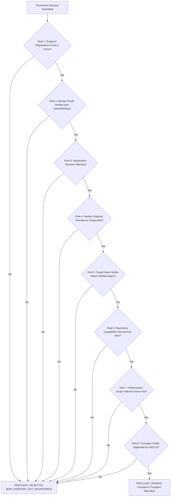

# LIVE BRIDGE CONNECTION REQUEST & PREFLIGHT CONTRACT

**Document ID:** `NLE-CON-CRP-001`  
**Classification:** Interface Contract & Preflight Validation Specification  
**Phase:** Phase 9 — Live Game Bridge & Hybrid Integration (Step 72 of 100)  
**Status:** Authoritative Specification  
**Upstream Dependencies:** `NLE-SPC-LBA-001`, `NLE-CON-DEC-001`, `NLE-CON-ERR-001`, `NLE-POL-EIV-001`  
**Downstream Consumed By:** `NLE-SPC-CPN-001`, `NLE-POL-PAI-001`, Steps 73–78  

---

## 1. Scope & Preflight Objectives

Before establishing physical transport channels or initiating cryptographic handshakes, the engine must rigorously evaluate the **Connection Request** to ensure that both candidate endpoints are registered, verified, structurally compatible, and authorized to connect.

Preflight validation eliminates unnecessary socket allocation, prevents unauthorized connection storms, and guarantees that no transport connection is opened for invalid or revoked participants.

---

## 2. Connection Request Contract

A Connection Request initiates the establishment of a bridge session between two registered endpoints:

```json
{
  "$schema": "https://schemas.nexludic.dev/v1/bridge/connection-request.json",
  "connection_request_id": "creq-01938a4b-8800-7000-8801-abcdef123456",
  "requested_at_utc": "2026-11-20T17:05:00.000Z",
  "mashup_definition_id": "mashup-mc-hl2-spatial-v1",
  "mashup_revision": 3,
  "initiator_endpoint": {
    "canonical_endpoint_id": "mojang:minecraft-java:99b1c43f01:inst-01938a4c",
    "registration_revision": 1,
    "expected_target_build": "99b1c43f01"
  },
  "responder_endpoint": {
    "canonical_endpoint_id": "valve:half-life-2:a8f9c12e5d:inst-01938a4b",
    "registration_revision": 2,
    "expected_target_build": "a8f9c12e5d"
  },
  "required_protocol_family": "NLE-WIRE",
  "required_wire_version": "NLE-WIRE-v1",
  "mandatory_capabilities": [
    "telemetry.player.spatial",
    "inventory.item.transfer"
  ],
  "transport_preference": "NAMED_PIPE",
  "authorization_scope_ref": "auth-scope-mashup-992",
  "timeout_policy": {
    "preflight_timeout_ms": 1000,
    "handshake_timeout_ms": 3000,
    "total_establishment_timeout_ms": 5000
  }
}
```

---

## 3. Preflight Participant Validation Rules

The Preflight Engine (`CPE-01`) evaluates eight mandatory validation rules before authorizing transport allocation:



### 3.1 Preflight Rule Enforcement Table

| Rule ID | Validation Rule Name | Enforcement Standard | Error Code on Failure |
| :--- | :--- | :--- | :--- |
| **`CHK-PRE-01`** | **Registration Existence** | Both endpoint IDs must resolve to existing records in the Step 71 registry. | `ERR_PRE_ENDPOINT_NOT_FOUND` |
| **`CHK-PRE-02`** | **Verification Status** | Both endpoints must have registration state `REGISTERED_VERIFIED`. | `ERR_PRE_ENDPOINT_UNVERIFIED` |
| **`CHK-PRE-03`** | **Revision Concurrency** | Registration revision in request must equal current `registration_revision`. | `ERR_PRE_REVISION_MISMATCH` |
| **`CHK-PRE-04`** | **Lifecycle Viability** | Neither endpoint may be in `SUSPENDED`, `REVOKED`, or `DEREGISTERED` state. | `ERR_PRE_ENDPOINT_INACTIVE` |
| **`CHK-PRE-05`** | **Target Build Binding** | Build hash in request must match current hash of host executable on disk. | `ERR_PRE_BUILD_HASH_STALE` |
| **`CHK-PRE-06`** | **Mandatory Capability Match**| Both endpoints must declare support for all requested `mandatory_capabilities`. | `ERR_PRE_CAPABILITY_UNSUPPORTED` |
| **`CHK-PRE-07`** | **Authorization Scope** | Active user security grant must explicitly authorize the requested game pair. | `ERR_PRE_AUTHORIZATION_DENIED` |
| **`CHK-PRE-08`** | **Transport Availability**| Requested transport profile must be available on the current OS platform. | `ERR_PRE_TRANSPORT_UNAVAILABLE` |

---

## 4. Preflight Result Contract

```json
{
  "$schema": "https://schemas.nexludic.dev/v1/bridge/preflight-result.json",
  "preflight_result_id": "pfr-01938a4b-9900-7000-8801-112233445566",
  "request_ref": "creq-01938a4b-8800-7000-8801-abcdef123456",
  "evaluated_at_utc": "2026-11-20T17:05:00.150Z",
  "status": "PREFLIGHT_PASSED",
  "evaluated_checks": [
    {"rule_id": "CHK-PRE-01", "result": "PASSED"},
    {"rule_id": "CHK-PRE-02", "result": "PASSED"},
    {"rule_id": "CHK-PRE-03", "result": "PASSED"},
    {"rule_id": "CHK-PRE-04", "result": "PASSED"},
    {"rule_id": "CHK-PRE-05", "result": "PASSED"},
    {"rule_id": "CHK-PRE-06", "result": "PASSED"},
    {"rule_id": "CHK-PRE-07", "result": "PASSED"},
    {"rule_id": "CHK-PRE-08", "result": "PASSED"}
  ],
  "allocated_transport": {
    "transport_kind": "NAMED_PIPE",
    "pipe_name_initiator": "\\.\pipe\nexludic-bridge-creq-01938a4b-initiator",
    "pipe_name_responder": "\\.\pipe\nexludic-bridge-creq-01938a4b-responder",
    "ephemeral_token_initiator_hash": "sha256:4a5b6c...",
    "ephemeral_token_responder_hash": "sha256:7d8e9f..."
  },
  "valid_until_utc": "2026-11-20T17:05:05.150Z"
}
```

**Preflight Freshness Invariant:** A passed preflight result is valid for strictly **5000ms**. If physical transport connection and handshake initiation do not occur within 5 seconds, the preflight result expires and must be re-evaluated.
