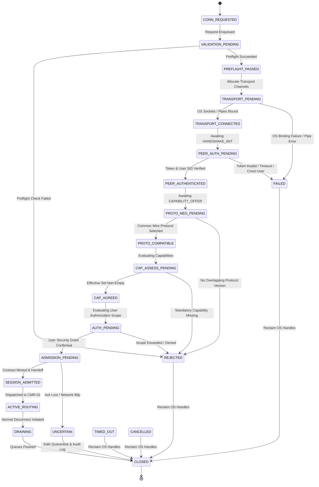

# LIVE BRIDGE CONNECTION STATE & FAILURE LIFECYCLE SPECIFICATION

**Document ID:** `NLE-SPC-CSF-001`  
**Classification:** Operational Governance & Finite State Machine Specification  
**Phase:** Phase 9 — Live Game Bridge & Hybrid Integration (Step 72 of 100)  
**Status:** Authoritative Specification  
**Upstream Dependencies:** `NLE-SPC-LBA-001`, `NLE-POL-SLC-001`, `NLE-SPC-CPN-001`, `NLE-CON-CAS-001`  
**Downstream Consumed By:** `NLE-POL-TCR-001`, Steps 73–78  

---

## 1. Connection-Establishment Finite State Machine (22 States)

To guarantee deterministic error handling, session containment, and prevent race conditions, the connection-establishment lifecycle is modeled as a 22-state finite state machine:

---

## 2. State Transition Matrix & Preconditions

| Source State | Destination State | Trigger Event | Mandatory Preconditions | Output Actions |
| :--- | :--- | :--- | :--- | :--- |
| **`CONN_REQUESTED`** | **`VALIDATION_PENDING`** | Enqueue | Valid JSON schema. | Start preflight timer (1000ms). |
| **`VALIDATION_PENDING`** | **`PREFLIGHT_PASSED`** | Preflight Success | All 8 preflight checks (`CHK-PRE-01..08`) pass. | Generate preflight result record. |
| **`PREFLIGHT_PASSED`** | **`TRANSPORT_PENDING`** | Bind Trigger | OS transport available. | Create Named Pipe instance with DACL. |
| **`TRANSPORT_PENDING`** | **`TRANSPORT_CONNECTED`**| Pipe Connected | Client connects to pipe. | Start handshake auth timer (500ms). |
| **`TRANSPORT_CONNECTED`**| **`PEER_AUTH_PENDING`** | Channel Open | Stream ready for frames. | Await `HANDSHAKE_INIT` frame. |
| **`PEER_AUTH_PENDING`** | **`PEER_AUTHENTICATED`** | Auth Success | Token valid, TokenUser SID matches. | Emit `HANDSHAKE_ACK` frame. |
| **`PEER_AUTHENTICATED`** | **`PROTO_NEG_PENDING`** | Offer Enqueued | `CAPABILITY_OFFER` received. | Start negotiation timer (1500ms). |
| **`PROTO_NEG_PENDING`** | **`PROTO_COMPATIBLE`** | Protocol Match | `NLE-WIRE-v1` agreed by both peers. | Proceed to capability evaluation. |
| **`PROTO_COMPATIBLE`** | **`CAP_AGREED`** | Capability Match | Mandatory capabilities satisfied. | Clamp rate limits. |
| **`CAP_AGREED`** | **`ADMISSION_PENDING`** | Scope Approved | Authorization Guard approves scope. | Mint session contract. |
| **`ADMISSION_PENDING`** | **`SESSION_ADMITTED`** | Contract Minted | Contract signed and stored. | Emit `CAPABILITY_ACCEPT` frames. |
| **`SESSION_ADMITTED`** | **`ACTIVE_ROUTING`** | Router Handoff | Channel queues bound to `CMR-02`. | Start 1000ms heartbeat loop. |

---

## 3. Failure Classification & Error Taxonomy

When session establishment fails, the coordinator records a structured failure code:

| Error Code | Failure Category | Description | Immediate Recovery Action |
| :--- | :--- | :--- | :--- |
| **`ERR_CONN_PREFLIGHT_FAILED`** | Preflight | Endpoint unverified, build hash mismatch, or missing capability. | Reject request. Release zero transport handles. |
| **`ERR_AUTH_CROSS_USER`** | Authentication | Client process running under foreign Windows user SID. | Immediate socket reset. Log security violation. |
| **`ERR_AUTH_TOKEN_MISMATCH`** | Authentication | Client supplied invalid or expired handshake secret token. | Immediate socket reset. Nullify token. |
| **`ERR_AUTH_TOKEN_REPLAY`** | Authentication | Client attempted to reuse previously consumed handshake token. | Severe security alert. Permanently block instance ID. |
| **`ERR_PROTO_NO_COMMON_VERSION`**| Negotiation | No overlapping wire protocol version between peers. | Emit `CAPABILITY_REJECT`. Close channel. |
| **`ERR_CAP_MANDATORY_MISSING`** | Negotiation | One or both peers lack declared support for mandatory topic. | Emit `CAPABILITY_REJECT`. Close channel. |
| **`ERR_ADM_SCOPE_DENIED`** | Authorization | User security grant does not permit requested game pair / topics. | Reject admission. Inform UI of denied scope. |
| **`ERR_CONN_TIMEOUT`** | Reliability | Step exceeded individual phase or total establishment timeout. | Cancel pending tasks. Close pipes. |
