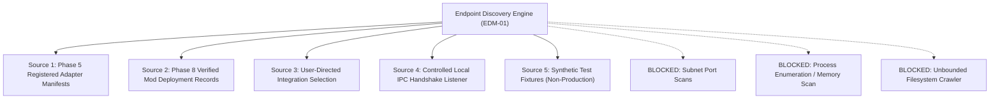

# LIVE BRIDGE DISCOVERY SOURCE POLICY & CANDIDATE SCHEMA

**Document ID:** `NLE-POL-DSP-001`  
**Classification:** Discovery Governance & Data Contract Specification  
**Phase:** Phase 9 — Live Game Bridge & Hybrid Integration (Step 71 of 100)  
**Status:** Authoritative Specification  
**Upstream Dependencies:** `NLE-SPC-LBA-001`, `NLE-CON-EID-001`, `LOCAL_GAME_INSTALLATION_DISCOVERY_AND_DETECTION_SPECIFICATION.md` (Phase 4), `CANONICAL_CAPABILITY_TAXONOMY_AND_DOMAIN_MODEL.md` (Phase 5)  
**Downstream Consumed By:** `NLE-CON-ERR-001`, `NLE-POL-DAP-001`, Steps 72–78  

---

## 1. Discovery Scope & Guiding Objectives

Endpoint discovery in NexLudic Engine is **strictly targeted, authorized, and bounded**. 

Discovery operations must locate integration endpoints relevant to an explicit, user-approved integration definition. Discovery is **NEVER** an open-ended scan of local network subnets, arbitrary ports, running processes, or filesystem hierarchies.

---

## 2. Approved Discovery Sources

Discovery candidates may be accepted only from explicitly approved discovery sources. Unapproved sources are rejected immediately.



### 2.1 Approved Source Catalog

| Source Identifier | Source Name | Trust Tier | Ingestion Mechanism | Security Controls |
| :--- | :--- | :--- | :--- | :--- |
| **`SRC-DSP-01`** | **Adapter Manifest Registry** | High | Phase 5 Adapter SDK catalog records. | Read-only access to signed adapter manifests. |
| **`SRC-DSP-02`** | **Content Pipeline Deployment Records** | High | Phase 8 verified package journals. | Validates that required bridge mod files were transactionally applied. |
| **`SRC-DSP-03`** | **Explicit User Selection** | Medium | User selects game integration definition via UI. | Requires explicit UI gesture; bounded scope. |
| **`SRC-DSP-04`** | **Local IPC Handshake Listener** | Untrusted (Zone 3) | Incoming connection on designated session Named Pipe. | Strict DACL check; requires pre-shared session token within 500ms. |
| **`SRC-DSP-05`** | **Synthetic Test Fixtures** | Isolated | Test harness in-memory fixtures. | Barred from production; active only during test runs. |

### 2.2 Categorically Prohibited Discovery Methods
In strict adherence to `BLK-SEC-01`:
1. **Network Port Scanning:** Scanning local subnets (e.g. `192.168.0.0/24`) or port ranges (e.g. `8000-9000`) is categorically forbidden.
2. **Process Enumeration / Memory Inspection:** Calling `EnumProcesses`, `Process32First/Next`, or inspecting virtual memory to find games is forbidden.
3. **DLL Injection / Hooking:** Injecting discovery shims into third-party binaries is forbidden.

---

## 3. Discovery Request Contract

A discovery request initiates a bounded query for candidate endpoints:

```json
{
  "$schema": "https://schemas.nexludic.dev/v1/bridge/discovery-request.json",
  "request_id": "dreq-01938a4b-7c12-7000-8801-abcdef123456",
  "requested_at_utc": "2026-11-20T16:30:00.000Z",
  "target_game": {
    "provider": "mojang",
    "title_id": "minecraft-java",
    "required_build_hash": "99b1c43f01"
  },
  "required_category": "HOST_GAME_ADAPTER",
  "required_protocol_version": "NLE-WIRE-v1",
  "approved_sources": [
    "SRC-DSP-01",
    "SRC-DSP-02",
    "SRC-DSP-04"
  ],
  "resource_limits": {
    "max_candidates": 10,
    "timeout_ms": 5000
  },
  "authorization_grant_ref": "auth-grant-88219"
}
```

---

## 4. Discovery Candidate Record Schema

When an endpoint is observed, the Discovery Manager constructs an immutable **Discovery Candidate Record**:

```json
{
  "$schema": "https://schemas.nexludic.dev/v1/bridge/discovery-candidate.json",
  "candidate_id": "cand-01938a4b-8801-4433-a1b2-c3d4e5f67890",
  "request_ref": "dreq-01938a4b-7c12-7000-8801-abcdef123456",
  "observed_at_utc": "2026-11-20T16:30:01.250Z",
  "source_id": "SRC-DSP-04",
  "claimed_identity": {
    "provider": "mojang",
    "title_id": "minecraft-java",
    "build_hash": "99b1c43f01",
    "instance_id": "inst-01938a4c"
  },
  "claimed_category": "HOST_GAME_ADAPTER",
  "observed_locator": {
    "kind": "NAMED_PIPE",
    "address_uri": "pipe://\\.\pipe\nexludic-bridge-sess-9a7f3e12-mojang"
  },
  "advertised_protocol_version": "NLE-WIRE-v1",
  "advertised_capabilities": [
    {
      "capability_id": "inventory.item.transfer",
      "version": "1.0.0",
      "direction": "BIDIRECTIONAL"
    },
    {
      "capability_id": "telemetry.player.spatial",
      "version": "1.2.0",
      "direction": "OUTBOUND"
    }
  ],
  "provenance_metadata": {
    "ingested_from": "LOCAL_PIPE_HANDSHAKE",
    "client_pid": 18420,
    "client_sid": "S-1-5-21-3623811015-3361044348-30300820-1001",
    "raw_handshake_digest": "sha256:d8e7f6a5b4c3d2e1f0a9b8c7d6e5f4a3b2c1d0e9f8a7b6c5d4e3f2a1b0c9d8e7"
  },
  "validation_status": "SYNTAX_VALID",
  "lifecycle_state": "CANDIDATE_OBSERVED"
}
```

---

## 5. Candidate Validation & Filtering Rules

1. **Syntactic Conformance:** All candidate fields must strictly validate against the JSON schema. Extra or unexpected fields trigger immediate schema rejection (`ERR_DSP_SCHEMA_VIOLATION`).
2. **Identifier Sanity:** `claimed_identity` fields must match canonical regex patterns. Malformed provider or title strings are rejected.
3. **Approved Source Match:** Candidates submitted from non-approved sources are dropped and logged as unauthorized discovery events.
4. **Observation Freshness:** A candidate record is valid for **30 seconds** from `observed_at_utc`. If registration is not initiated within 30s, the candidate expires and must be rediscovered.
