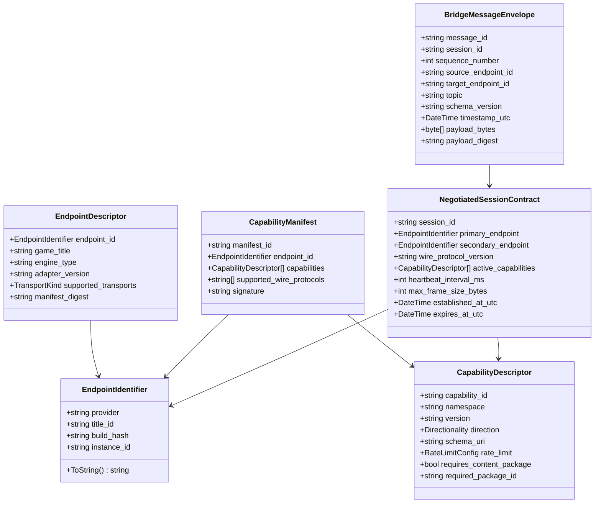

# LIVE BRIDGE DOMAIN MODEL, ENDPOINT IDENTITY & CAPABILITY CONTRACT

**Document ID:** `NLE-CON-DEC-001`  
**Classification:** Core Data Contracts & Domain Model Specification  
**Phase:** Phase 9 — Live Game Bridge & Hybrid Integration (Step 70)  
**Status:** Authoritative Foundation  
**Upstream Dependencies:** `NLE-SPC-LBA-001` (Bridge Architecture), `NLE-MOD-CRB-001` (Component Responsibility & Trust Boundaries)  
**Downstream Consumed By:** `NLE-REQ-TIC-001`, `NLE-SPC-PME-001`, `NLE-POL-SLC-001`, Steps 71–78  

---

## 1. Domain Entities & Conceptual Model

The NexLudic Engine Live Bridge operates on a formal domain model capturing the identities of running game endpoints, their dynamic capabilities, active session contracts, and message envelopes.



---

## 2. Canonical Identity Contracts

### 2.1 Endpoint Identity (`EndpointIdentifier`)

A game endpoint must possess a deterministic, globally unique canonical identity to distinguish multiple instances, versions, and game titles.

```
Canonical Format:
game-provider : title-id : build-hash : instance-id

Example:
valve:half-life-2:a8f9c12e5d:inst-01938a4b
mojang:minecraft-java:99b1c43f01:inst-01938a4c
```

**Identity Rules & Constraints:**
1. **`provider`:** Slug identifier of the game publisher or platform (e.g., `valve`, `mojang`, `epic`, `custom`). Must match regex `^[a-z0-9_\-]{3,32}$`.
2. **`title_id`:** Canonical slug for the specific game title (e.g., `half-life-2`, `minecraft-java`, `skyrim-se`). Must match regex `^[a-z0-9_\-]{3,64}$`.
3. **`build_hash`:** The first 10 hex characters of the SHA-256 hash of the host executable or primary package manifest. Distinguishes differing game patches or updates.
4. **`instance_id`:** Ephemeral UUIDv4 or monotonic session instance identifier to disambiguate multiple concurrent running processes of the same game title on the same host.

---

## 3. Capability Descriptors & Manifests

### 3.1 Capability Schema (`CapabilityDescriptor`)

Capabilities define granular units of runtime interaction. Each capability represents a specific semantic domain, such as telemetry, spatial position, inventory transfer, or event signaling.

```json
{
  "$schema": "https://schemas.nexludic.dev/v1/bridge/capability-descriptor.json",
  "capability_id": "telemetry.player.spatial",
  "namespace": "core.games.spatial",
  "version": "1.2.0",
  "direction": "OUTBOUND",
  "schema_uri": "https://schemas.nexludic.dev/v1/schemas/spatial-telemetry-v1.json",
  "rate_limit": {
    "max_messages_per_sec": 60,
    "burst_capacity": 10
  },
  "requires_content_package": true,
  "required_package_id": "pkg_spatial_adapter_v1"
}
```

**Field Invariants:**
- **`capability_id`:** Reverse-DNS or hierarchical dot-notated string uniquely identifying the capability within the ecosystem.
- **`direction`:** Enum indicating data flow:
  - `INBOUND`: Endpoint only receives this capability from the bridge.
  - `OUTBOUND`: Endpoint only produces/emits this capability to the bridge.
  - `BIDIRECTIONAL`: Endpoint both consumes and produces this capability.
- **`requires_content_package`:** Boolean flag. If `true`, this capability cannot be activated unless the specified `required_package_id` has been materialized, applied, and verified under Phase 8.

---

## 4. Negotiated Session Contract (`NegotiatedSessionContract`)

When two or more endpoints participate in a live bridge session, the Central Bridge Coordinator generates an immutable **Negotiated Session Contract** representing the active agreement between all parties.

```json
{
  "$schema": "https://schemas.nexludic.dev/v1/bridge/session-contract.json",
  "session_id": "sess-9a7f3e12-4c28-4091-88f2-7104bce948a0",
  "status": "ACTIVE",
  "endpoints": {
    "initiator": "mojang:minecraft-java:99b1c43f01:inst-01938a4c",
    "responder": "valve:half-life-2:a8f9c12e5d:inst-01938a4b"
  },
  "negotiated_wire_protocol": "NLE-WIRE-v1",
  "active_capabilities": [
    {
      "capability_id": "inventory.item.transfer",
      "version": "1.0.0",
      "direction": "BIDIRECTIONAL",
      "rate_limit_per_sec": 5
    },
    {
      "capability_id": "telemetry.player.spatial",
      "version": "1.2.0",
      "direction": "OUTBOUND",
      "rate_limit_per_sec": 30
    }
  ],
  "runtime_parameters": {
    "heartbeat_interval_ms": 1000,
    "heartbeat_timeout_ms": 3000,
    "max_frame_size_bytes": 1048576,
    "max_unacked_messages": 100
  },
  "established_at_utc": "2026-11-20T16:00:00.000Z",
  "expires_at_utc": "2026-11-20T18:00:00.000Z"
}
```

---

## 5. Message Envelope Contract (`BridgeMessageEnvelope`)

All communication over the live bridge, regardless of underlying transport, is encapsulated in the canonical **Bridge Message Envelope**.

```json
{
  "$schema": "https://schemas.nexludic.dev/v1/bridge/envelope.json",
  "envelope_version": "1.0",
  "message_id": "msg-01938a4b-7c12-7000-8801-abcdef123456",
  "session_id": "sess-9a7f3e12-4c28-4091-88f2-7104bce948a0",
  "sequence_number": 4201,
  "source_endpoint": "mojang:minecraft-java:99b1c43f01:inst-01938a4c",
  "target_endpoint": "valve:half-life-2:a8f9c12e5d:inst-01938a4b",
  "topic": "inventory.item.transfer",
  "schema_version": "1.0.0",
  "timestamp_utc": "2026-11-20T16:05:12.345Z",
  "payload_digest": "sha256:e3b0c44298fc1c149afbf4c8996fb92427ae41e4649b934ca495991b7852b855",
  "payload": {
    "item_id": "minecraft:iron_sword",
    "quantity": 1,
    "durability_normalized": 0.85,
    "custom_name": "Excalibur"
  }
}
```

### 5.1 Invariant Rules for Envelope Integrity

1. **Monotonic Sequences:** Within a given `session_id` and `source_endpoint`, `sequence_number` must strictly increment by 1 for each dispatched message.
2. **Digest Matching:** `payload_digest` must exactly match the SHA-256 hash of the canonical JSON string of the `payload` object. Mismatches trigger immediate rejection.
3. **Topic Authorization:** The `topic` must correspond to an active, negotiated capability listed in the active `NegotiatedSessionContract`.
4. **Boundary Isolation:** The `payload` must NEVER contain raw executable code, shell commands, filesystem paths, or pointers. Only schema-validated primitive data and domain structures are permitted.
