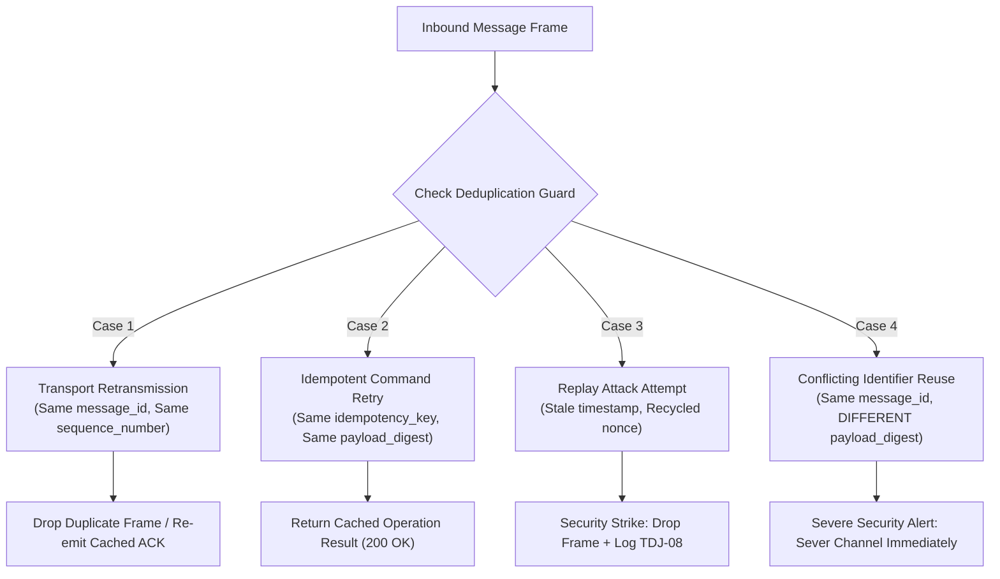

# LIVE BRIDGE DUPLICATE REPLAY, RETRY & IDEMPOTENCY POLICY

**Document ID:** `NLE-POL-DRI-001`  
**Classification:** Core Reliability & Security Policy  
**Phase:** Phase 9 — Live Game Bridge & Hybrid Integration (Step 73 of 100)  
**Status:** Authoritative Specification  
**Upstream Dependencies:** `NLE-SPC-LBA-001`, `NLE-CON-MEC-001`, `NLE-SPC-DAC-001`  
**Downstream Consumed By:** `NLE-POL-MOF-001`, Steps 74–78  

---

## 1. Scope & Threat Mitigation

Network latency spikes, pipe reconnections, and sender timeouts frequently cause messages to be retransmitted. 

This policy establishes the formal deduplication rules, replay attack defenses, and idempotency contracts enforced by the **Deduplication & Replay Guard (`DED-04`)** to prevent duplicate command execution and save corruption.

---

## 2. Duplicate Classification Taxonomy



---

## 3. Idempotency Key Contract (`idempotency_key`)

For state-changing `COMMAND_REQUEST` interactions (e.g. `inventory.item.transfer`, `entity.spawn`), the sender may supply an optional `idempotency_key` within the payload metadata:

```json
{
  "idempotency_key": "idem-01938a4b-9988-7000-8801-abcdef123456",
  "operation": "TRANSFER_ITEM",
  "item_id": "minecraft:diamond_sword",
  "quantity": 1
}
```

### 3.1 Idempotency Cache Rules
1. **Scope & Lifetime:** Idempotency records are cached in memory per `session_id` and retained for **60 seconds**.
2. **Deterministic Replay:** If a request with an active `idempotency_key` arrives and has already completed:
   - The operation is **NOT** executed a second time.
   - The previously cached `COMMAND_RESPONSE` is re-emitted immediately.
3. **Payload Digest Verification:** If the `idempotency_key` matches an existing entry but `payload_digest` differs, the router rejects the message with `ERR_IDEMPOTENCY_CONFLICTING_PAYLOAD`.

---

## 4. Replay Attack Protections

1. **Monotonic Sequence Enforcement:** Every endpoint channel maintains a strict 32-bit inbound sequence counter. If an incoming frame has $\text{sequence\_number} \le \text{last\_seen\_sequence}$, the frame is discarded immediately (`ERR_PME_004_SEQUENCE_REGRESSION`).
2. **Timestamp Skew Clamping:** Frame timestamps must fall within $\pm 5000\,\text{ms}$ of coordinator UTC time. Outside this jitter window, frames are rejected (`ERR_PME_005_STALE_TIMESTAMP`).
