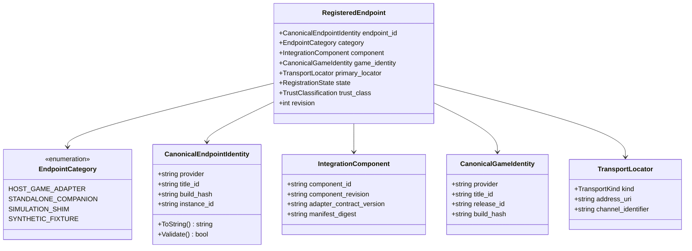

# LIVE BRIDGE ENDPOINT CATEGORIES, CANONICAL IDENTITY & OWNERSHIP CONTRACT

**Document ID:** `NLE-CON-EID-001`  
**Classification:** Domain Model & Identity Governance Contract  
**Phase:** Phase 9 — Live Game Bridge & Hybrid Integration (Step 71 of 100)  
**Status:** Authoritative Specification  
**Upstream Dependencies:** `NLE-SPC-LBA-001`, `NLE-CON-DEC-001`, `CANONICAL_GAME_IDENTITY_AND_VERSIONING_RULES.md` (Phase 4), `CANONICAL_CAPABILITY_TAXONOMY_AND_DOMAIN_MODEL.md` (Phase 5)  
**Downstream Consumed By:** `NLE-CON-ERR-001`, `NLE-POL-EIV-001`, Steps 72–78  

---

## 1. Domain Entities & Conceptual Model

To prevent ambiguous identity representation, the live bridge domain model establishes five distinct architectural concepts:



---

## 2. Endpoint Categories

Endpoints participating in live bridge communications must be explicitly classified into one of four supported categories:

| Category Identifier | Description | Execution Model | Trust Boundary |
| :--- | :--- | :--- | :--- |
| **`HOST_GAME_ADAPTER`** | An in-process mod script or shim running inside the host game runtime (e.g., Fabric mod, UE4SS script) exposing an IPC channel. | In-Process Guest / Mod Loader | Untrusted (Zone 3). Requires token authentication and strict sandboxing. |
| **`STANDALONE_COMPANION`** | An external helper process or companion application running alongside the game and communicating with it via official APIs. | Out-of-Process Local Executable | Untrusted (Zone 3). Must run as same Windows User Token SID. |
| **`SIMULATION_SHIM`** | An engine-hosted headless simulation, mock adapter, or translation proxy running inside NexLudic Engine. | Platform Process (Medium IL) | Semi-Trusted (Zone 2). Subject to engine-internal sandbox. |
| **`SYNTHETIC_FIXTURE`** | A deterministic test harness or mock participant used exclusively during testing and verification. | Test Runner Context | Isolated Test Harness. Strictly barred from production sessions. |

---

## 3. Canonical Endpoint Identity Contract

### 3.1 Canonical Syntax & Composition
Reusing the canonical standard established in `NLE-CON-DEC-001` and Phase 4 (`CANONICAL_GAME_IDENTITY_AND_VERSIONING_RULES.md`), every endpoint identity is represented by a deterministic four-part composite string:

$$\text{CanonicalEndpointIdentity} = \text{provider} : \text{title\_id} : \text{build\_hash} : \text{instance\_id}$$

```
Format:
^[a-z0-9_-]{3,32}:[a-z0-9_-]{3,64}:[a-f0-9]{10}:inst-[a-f0-9]{8,16}$

Examples:
mojang:minecraft-java:99b1c43f01:inst-01938a4c
valve:half-life-2:a8f9c12e5d:inst-01938a4b
bethesda:skyrim-se:c4e201bb89:inst-01938a4d
```

### 3.2 Component Field Invariants
1. **`provider`:** Normalized slug for the game publisher or platform (e.g. `valve`, `mojang`, `epic`). Cannot be empty or contain uppercase/special characters.
2. **`title_id`:** Canonical slug for the game title (e.g. `half-life-2`, `minecraft-java`).
3. **`build_hash`:** The first 10 hex characters of the SHA-256 hash of the host executable or root package manifest. Binds the endpoint strictly to a specific game build.
4. **`instance_id`:** Ephemeral UUID or monotonic session instance identifier prefixed with `inst-`. Disambiguates concurrent running instances of the same game on the same host.

---

## 4. Separation: Endpoint Identity vs Transport Locator

A critical architectural invariant is that an **Endpoint Identity is not a Transport Locator**:

| Attribute Dimension | Canonical Endpoint Identity | Transport Locator |
| :--- | :--- | :--- |
| **Definition** | Logical identity representing the game participant and its integration component. | Concrete physical address where the endpoint can currently be contacted. |
| **Durability** | Durable across transport reconnections, network switches, or temporary pipe closures. | Transient. May change upon process restart, port reallocation, or pipe teardown. |
| **Format** | `provider:title_id:build_hash:instance_id` | `pipe://\\.\pipe\nexludic-bridge-*` or `tcp://127.0.0.1:54321` |
| **Authority** | Assigned and governed strictly by NexLudic Engine Registration Manager (`ERM-02`). | Declared by host environment or dynamically allocated by OS transport stack. |
| **Trust Semantics** | Evaluated through cryptographic evidence and process attestation. | Zero inherent trust. Anyone on the machine can bind to an arbitrary port. |

---

## 5. Identity Ownership & Governance Authority

To prevent competing components from independently redefining or forging endpoint identities:

1. **Sole Assignment Authority:** The **NexLudic Engine Registration Manager (`ERM-02`)** is the sole authoritative entity permitted to assign or validate canonical endpoint identities.
2. **Prohibition of Self-Assignment:** External game connectors, mod scripts, and discovery scanners **CANNOT** self-assign an authoritative canonical identity. They submit *claimed identities* in registration requests; the engine validates or mints the canonical record.
3. **Immutability of Registered Core Fields:** Once an endpoint record is created, its `provider`, `title_id`, and `build_hash` are completely immutable. Any change in build hash requires a new registration record.
