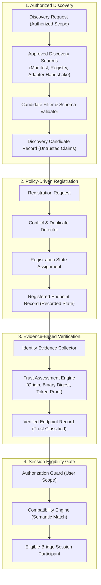
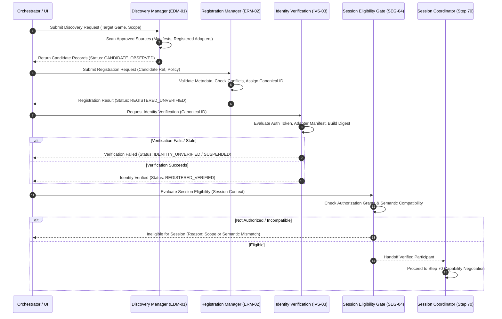

# LIVE BRIDGE ENDPOINT DISCOVERY, REGISTRATION & IDENTITY VERIFICATION SPECIFICATION

**Document ID:** `NLE-SPC-EDR-001`  
**Classification:** Core Engineering & Security Specification  
**Phase:** Phase 9 — Live Game Bridge & Hybrid Integration (Step 71 of 100)  
**Status:** Authoritative Specification  
**Upstream Dependencies:** `NLE-SPC-LBA-001` (Live Game Bridge Architecture), `NLE-MOD-CRB-001` (Component Responsibility & Trust Boundaries), `NLE-CON-DEC-001` (Domain Model & Canonical Identity), `CANONICAL_GAME_IDENTITY_AND_VERSIONING_RULES.md` (Phase 4), `CANONICAL_CAPABILITY_TAXONOMY_AND_DOMAIN_MODEL.md` (Phase 5)  
**Downstream Consumed By:** Step 72 (IPC Handshake & Process Identity Attestation), Step 73 (Semantic Translation), Step 76 (Hybrid Integration Orchestrator)  

---

## 1. Executive Summary & Purpose

This specification establishes the authoritative engineering and security contract for discovering, registering, identifying, and verifying integration endpoints that may participate in the NexLudic Engine Live Game Interoperability Bridge.

In any distributed cross-game interoperability architecture, the system must establish with rigorous certainty:
1. What integration endpoints physically exist and are accessible.
2. What software components they claim to represent.
3. Which game titles, builds, adapters, and interface contracts they support.
4. Whether their claimed identity can be independently verified against trusted evidence.
5. What operations they are authorized to perform.
6. Whether they are compatible and eligible to enter an active bridge session.

To prevent security vulnerabilities, process instability, and data corruption, this specification enforces a foundational architectural separation across the entire endpoint lifecycle:

$$\text{Discovery (Observed)} \neq \text{Registration (Recorded)} \neq \text{Verification (Evidenced)} \neq \text{Authorization (Permitted)} \neq \text{Compatibility (Viable)} \neq \text{Session (Active)}$$

```
+----------------------------------------------------------------------------------------------------+
|                                    NEXLUDIC ENGINE PLATFORM                                        |
|                                                                                                    |
|   +--------------------------------------------------------------------------------------------+   |
|   |                       ENDPOINT LIFECYCLE SEPARATION OF CONCERNS                            |   |
|   |                                                                                            |   |
|   |   +------------------+       +-------------------+       +--------------------+            |   |
|   |   |    DISCOVERY     | ----> |   REGISTRATION    | ----> |     IDENTITY       |            |   |
|   |   |   Candidate is   |       |  Identity record  |       |    VERIFICATION    |            |   |
|   |   |     observed     |       | created under pol |       | Evidence evaluated |            |   |
|   |   +------------------+       +-------------------+       +---------+----------+            |   |
|   |                                                                    |                       |   |
|   |                                                                    v                       |   |
|   |   +------------------+       +-------------------+       +--------------------+            |   |
|   |   |     SESSION      | <---- |   COMPATIBILITY   | <---- |   AUTHORIZATION    |            |   |
|   |   |    ACTIVATION    |       |    ASSESSMENT     |       |  Granular scope    |            |   |
|   |   | Live byte stream |       | Semantic contract |       | permissions granted|            |   |
|   |   +------------------+       +-------------------+       +--------------------+            |   |
|   +--------------------------------------------------------------------------------------------+   |
+----------------------------------------------------------------------------------------------------+
```

---

## 2. Inviolable Governance Tenets

1. **Strict Decoupling of Lifecycle Stages:**
   - Observing a candidate endpoint during discovery does not constitute registration.
   - Registering an endpoint under a policy does not verify its identity claims.
   - Verifying an identity does not confer authorization to invoke capabilities.
   - Authorizing capabilities does not imply cross-game semantic compatibility.
   - Compatibility does not automatically activate an active bridge session.
2. **Untrusted Metadata Boundary:**
   All advertised endpoint metadata (locators, display names, process identifiers, claimed game IDs, and declared capabilities) originating outside the trusted core are treated as **Untrusted Zone 3 Inputs** until validated against authoritative evidence.
3. **No Blanket Trust for Local Artifacts:**
   An endpoint is not trusted merely because it is located on `127.0.0.1`, operates via a local Named Pipe, claims to run under the user's account, or provides a familiar game title string.
4. **Non-Invasive Security Inviolability (`BLK-SEC-01`, `DEC-002`):**
   - The discovery and registration subsystems operate exclusively in standard user space (Windows Medium Integrity Level).
   - Zero network port scanning, zero subnet probing, zero arbitrary process scanning, zero memory inspection (`ReadProcessMemory`), zero DLL injection, and zero anti-cheat or DRM circumvention.
5. **Fail-Closed Verification Semantics:**
   If identity evidence is missing, expired, ambiguous, contradictory, or revoked, the system must fail closed. Trust cannot be assumed or granted for convenience.

---

## 3. High-Level Endpoint Management Architecture

The endpoint management pipeline operates within the Central Bridge Coordinator (`CBC-01`) via four specialized sub-components:



### 3.1 Sub-Component Responsibilities
- **`EDM-01` Endpoint Discovery Manager:** Dispatches discovery requests across authorized sources, validates incoming candidate structures, and generates immutable candidate records.
- **`ERM-02` Endpoint Registration Manager:** Governs registration requests, enforces uniqueness invariants, detects identifier collisions, and tracks registration revisions.
- **`IVS-03` Identity Verification Service:** Assesses cryptographic tokens, process owner SIDs, binary build digests, and adapter manifests against authoritative upstream evidence.
- **`SEG-04` Session Eligibility Gate:** Evaluates whether a verified endpoint meets all runtime authorization and semantic prerequisites before handing it off to the Step 70 Session Coordinator.

---

## 4. End-to-End Operational Lifecycle

The progression of an endpoint through the engine proceeds through six explicit gates:



---

## 5. Specification Roadmap & Traceability

This specification coordinates with the remaining Step 71 documents:
- **`NLE-CON-EID-001`:** Categories, Canonical Identity Format & Ownership Contracts.
- **`NLE-POL-DSP-001`:** Approved Discovery Sources, Scopes & Candidate Schemas.
- **`NLE-CON-ERR-001`:** Registration Requests, Results & State Machine Contracts.
- **`NLE-POL-EIV-001`:** Identity Verification & Trust Evidence Policies.
- **`NLE-POL-RRR-001`:** Revisioning, Revocation, Freshness & Deregistration Policies.
- **`NLE-CON-PCM-001`:** Protocol & Capability Metadata Validation Contracts.
- **`NLE-POL-ICI-001`:** Duplicate Identity, Conflict & Impersonation Handling Policies.
- **`NLE-POL-DAP-001`:** Authorization Boundaries, Privacy & Resource Quotas.
- **`NLE-CAT-EDR-001`:** Synthetic QA Test Plan (Scenarios A through AH).
- **`NLE-MAT-STP-071`:** Requirements Traceability Matrix (`EDR-REQ-001..034`).
- **`NLE-REG-STP-071`:** Open Architecture Decisions Register (`ADR-EDR-001..010`).
- **`NLE-REP-STP-071`:** Step 71 Completion Report.
