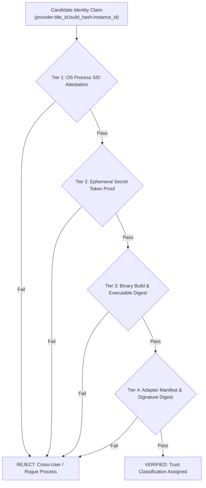

# LIVE BRIDGE ENDPOINT IDENTITY VERIFICATION & TRUST EVIDENCE POLICY

**Document ID:** `NLE-POL-EIV-001`  
**Classification:** Core Security & Identity Verification Policy  
**Phase:** Phase 9 — Live Game Bridge & Hybrid Integration (Step 71 of 100)  
**Status:** Authoritative Specification  
**Upstream Dependencies:** `NLE-SPC-EDR-001`, `NLE-CON-EID-001`, `NLE-CON-ERR-001`, `NLE-POL-SRS-001` (Step 70 Security Policy)  
**Downstream Consumed By:** `NLE-POL-RRR-001`, `NLE-POL-ICI-001`, Steps 72–78  

---

## 1. Scope & Objective

This policy defines the cryptographic, procedural, and environmental evidence required to verify an endpoint's claimed identity before it can be trusted for cross-game live communication.

The central tenet of this policy is:
**A claimed identity is merely an untrusted assertion. An identity becomes verified ONLY when backed by verifiable, uncompromised, and current trust evidence evaluated by the Identity Verification Service (`IVS-03`).**

---

## 2. Claimed Identity vs Verified Identity Distinction

| Identity Status | Definition | Authority & Source | Operational Rights |
| :--- | :--- | :--- | :--- |
| **Claimed Identity** | The identity strings and metadata self-reported by an external candidate endpoint during discovery or handshake. | Untrusted External Process (Zone 3). | Zero communication rights. Zero capability execution. |
| **Declared Identity** | The identity attributes registered in signed manifests, Phase 5 adapter metadata, or Phase 8 package records. | Signed Engine Manifests (Zone 1/2). | Reference metadata only; requires live attestation. |
| **Verified Identity** | An identity whose claims have been matched 100% against fresh, cryptographically validated evidence. | Confirmed by Identity Verification Service (`IVS-03`). | Eligible for capability negotiation and authorization evaluation. |

---

## 3. Four-Tier Identity Proof Taxonomy

To achieve verification, an endpoint must provide proof across four distinct dimensions:



### 3.1 Detailed Proof Requirements

#### Proof Type 1: OS Process User Token SID Attestation
- **Mechanism:** On Windows, the IPC transport inspects the client process token via `GetNamedPipeClientProcessId` and queries the primary token SID (`TokenUser`).
- **Constraint:** The client process SID must match the executing NexLudic Engine user SID exactly. Any connection originating from a different user account, guest account, or network identity is rejected immediately (`ERR_SEC_CROSS_USER_BLOCKED`).

#### Proof Type 2: Ephemeral Cryptographic Handshake Token Proof
- **Mechanism:** When NexLudic Engine launches or configures a bridge session, it generates an ephemeral 256-bit CSPRNG token passed to the authorized game connector via secure command-line bootstrap or in-memory pipe parameters.
- **Constraint:** The connector must echo this token in the `HANDSHAKE_INIT` frame within **500ms** of socket connection. Connections failing to present the token are severed without diagnostic disclosure.

#### Proof Type 3: Host Binary Build Digest Verification
- **Mechanism:** The `build_hash` component of the canonical ID must match the first 10 hex characters of the SHA-256 digest of the host executable file on disk, verified by Phase 4/Phase 8 target scanners.
- **Constraint:** If the game updates its executable (e.g. Steam patch), the build hash changes, invalidating any existing verification records.

#### Proof Type 4: Adapter Manifest & Signature Digest
- **Mechanism:** The integration component must reference a signed Phase 5 Adapter Manifest whose SHA-256 digest matches the engine's authoritative adapter catalog.
- **Constraint:** Unsigned or tampered adapter manifests are rejected immediately.

---

## 4. Endpoint Trust Classification Taxonomy

Based on the evidence evaluated, the engine assigns an explicit **Trust Classification**:

| Classification | Meaning & Criteria | Permitted Actions |
| :--- | :--- | :--- |
| **`UNVERIFIED`** | Candidate observed or registered, but proofs not yet evaluated. | Handshake and token exchange only. |
| **`PROVISIONAL_LIMITED`** | Proof Types 1 & 2 verified; Build/Manifest digests pending. | Read-only telemetry, low-rate pinging. |
| **`VERIFIED_HOST_MOD`** | All 4 Proof Types verified for in-process game mod. | Full bidirectional bridge interop under authorized scopes. |
| **`VERIFIED_STANDALONE`**| All 4 Proof Types verified for out-of-process companion app. | Full interop subject to companion API scope. |
| **`SUSPENDED`** | Previously verified, but heartbeat missed or target files modified. | State paused; message routing disabled. |
| **`REVOKED`** | Proof tampered, token reused, or user explicitly revoked. | Categorically blocked. Re-registration barred. |

---

## 5. Verification Record Schema

```json
{
  "$schema": "https://schemas.nexludic.dev/v1/bridge/verification-record.json",
  "verification_id": "vrec-01938a4b-5555-7000-8801-abcdef001122",
  "canonical_endpoint_id": "mojang:minecraft-java:99b1c43f01:inst-01938a4c",
  "verified_at_utc": "2026-11-20T16:32:00.000Z",
  "trust_classification": "VERIFIED_HOST_MOD",
  "evaluated_proofs": {
    "os_process_sid": {
      "verified": true,
      "client_pid": 18420,
      "client_sid": "S-1-5-21-3623811015-3361044348-30300820-1001",
      "matched_engine_sid": true
    },
    "ephemeral_token": {
      "verified": true,
      "token_hash": "sha256:88a9c1...",
      "handshake_latency_ms": 14
    },
    "build_digest": {
      "verified": true,
      "expected_hash": "99b1c43f01",
      "observed_hash": "99b1c43f01"
    },
    "adapter_manifest": {
      "verified": true,
      "manifest_id": "adp-minecraft-fabric-v1",
      "manifest_digest": "sha256:1a2b3c..."
    }
  },
  "overall_status": "VERIFICATION_SUCCESSFUL",
  "expires_at_utc": "2026-11-20T18:32:00.000Z"
}
```
