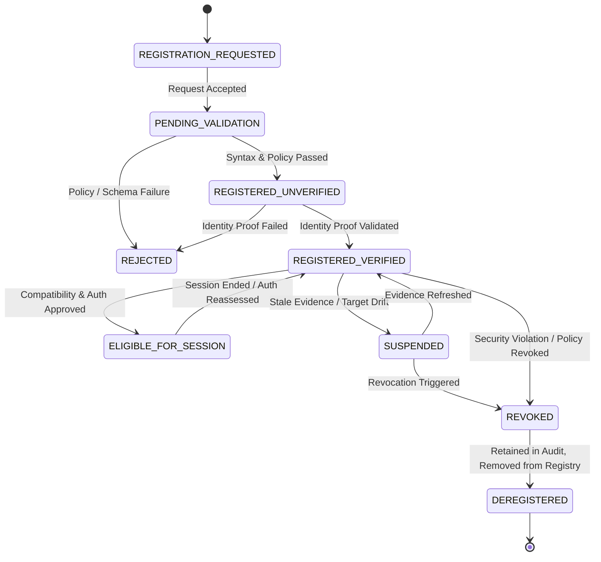

# LIVE BRIDGE ENDPOINT REGISTRATION REQUEST, RESULT & LIFECYCLE CONTRACT

**Document ID:** `NLE-CON-ERR-001`  
**Classification:** Operational Governance & Lifecycle State Contract  
**Phase:** Phase 9 — Live Game Bridge & Hybrid Integration (Step 71 of 100)  
**Status:** Authoritative Specification  
**Upstream Dependencies:** `NLE-SPC-EDR-001`, `NLE-CON-EID-001`, `NLE-POL-DSP-001`  
**Downstream Consumed By:** `NLE-POL-EIV-001`, `NLE-POL-RRR-001`, Steps 72–78  

---

## 1. Registration Purpose & Invariant Preconditions

Registration is the formal process of recording an endpoint within the Central Bridge Coordinator's registry under an approved policy.

### 1.1 Invariant Preconditions for Registration
Before a candidate can be recorded as a registered endpoint:
1. Candidate record must exist, be fresh (< 30s old), and have status `CANDIDATE_OBSERVED`.
2. A valid registration request must be submitted by an authorized caller.
3. No unresolved identity conflict or active impersonation block may exist for the canonical identifier.
4. The registration request must reference verified provenance evidence.

**Registration Invariant:** Registration establishes an administrative record of the endpoint. It **DOES NOT** grant active bridge communication rights or activate any capabilities.

---

## 2. Registration Finite State Machine (FSM)

The lifecycle of every registered endpoint is governed by a strict, deterministic state machine:



### 2.1 State Definitions

| Registration State | Description | Communication Rights |
| :--- | :--- | :--- |
| **`REGISTRATION_REQUESTED`** | Request received, queued for validation. | None. |
| **`PENDING_VALIDATION`** | Verifying schemas, conflict checks, and policy rules. | None. |
| **`REGISTERED_UNVERIFIED`** | Recorded in registry, but identity evidence not yet verified. | Handshake / Auth probe only. Zero game data. |
| **`REGISTERED_VERIFIED`** | Identity proof validated against authoritative evidence. | Eligible for capability negotiation. |
| **`ELIGIBLE_FOR_SESSION`** | Compatibility and authorization checks passed; ready for bridge. | Active bridge communication permitted upon session open. |
| **`SUSPENDED`** | Evidence stale, heartbeat delayed, or target files drifted. | Temporarily halted. |
| **`REVOKED`** | Identity compromised, user revoked, or security breach. | Categorically prohibited. |
| **`REJECTED`** | Failed initial validation or conflicting identity. | Terminated. |
| **`DEREGISTERED`** | Removed from active lookup; retained in audit journal. | None. |

---

## 3. Registration Request Contract

```json
{
  "$schema": "https://schemas.nexludic.dev/v1/bridge/registration-request.json",
  "registration_request_id": "rreq-01938a4b-9900-7000-8801-abcdef987654",
  "candidate_ref": "cand-01938a4b-8801-4433-a1b2-c3d4e5f67890",
  "requested_at_utc": "2026-11-20T16:31:00.000Z",
  "target_canonical_id": "mojang:minecraft-java:99b1c43f01:inst-01938a4c",
  "policy_version": "1.0.0",
  "identity_proof_references": [
    {
      "proof_type": "PROCESS_USER_SID_ATTESTATION",
      "evidence_digest": "sha256:5a6b7c8d9e0f..."
    },
    {
      "proof_type": "PHASE_5_ADAPTER_MANIFEST_DIGEST",
      "evidence_digest": "sha256:1a2b3c4d5e6f..."
    }
  ],
  "requesting_authority": "CORE_MASHUP_ORCHESTRATOR"
}
```

---

## 4. Registration Result Contract

```json
{
  "$schema": "https://schemas.nexludic.dev/v1/bridge/registration-result.json",
  "registration_id": "reg-01938a4b-7777-7000-8801-112233445566",
  "request_ref": "rreq-01938a4b-9900-7000-8801-abcdef987654",
  "canonical_endpoint_id": "mojang:minecraft-java:99b1c43f01:inst-01938a4c",
  "registration_revision": 1,
  "registered_at_utc": "2026-11-20T16:31:00.500Z",
  "state": "REGISTERED_UNVERIFIED",
  "trust_classification": "UNVERIFIED",
  "evaluated_checks": [
    {"check_id": "CHK_SCHEMA_VALIDATION", "result": "PASSED"},
    {"check_id": "CHK_CONFLICT_DETECTION", "result": "PASSED"},
    {"check_id": "CHK_POLICY_COMPLIANCE", "result": "PASSED"},
    {"check_id": "CHK_IDENTITY_PROOF_VERIFICATION", "result": "PENDING"}
  ],
  "granted_scope": {
    "allowed_topics": [],
    "max_frame_size": 1048576,
    "rate_limit_per_sec": 0
  },
  "diagnostics": {
    "warning_count": 0,
    "notes": "Endpoint recorded. Awaiting explicit identity verification before capability activation."
  }
}
```
