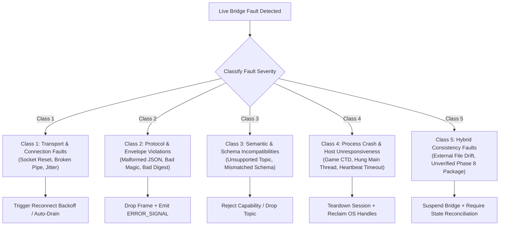
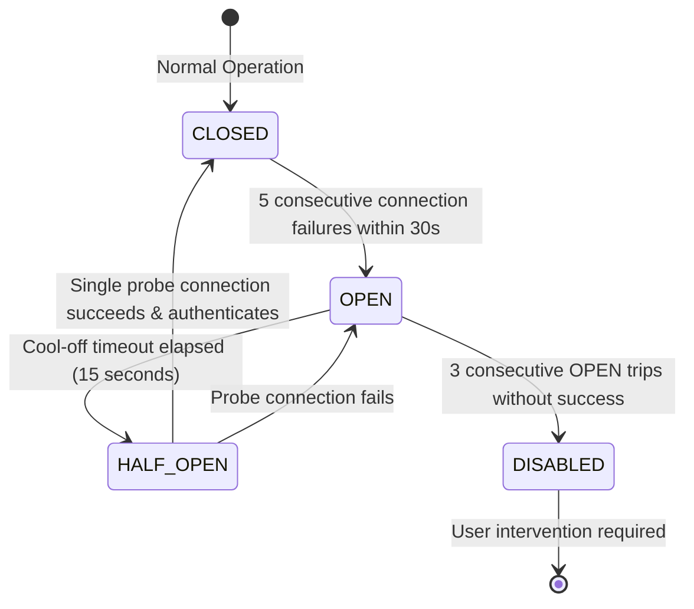

# LIVE BRIDGE FAILURE DIAGNOSTICS, RESOURCE & RECOVERY REQUIREMENTS

**Document ID:** `NLE-REQ-FDR-001`  
**Classification:** Reliability Engineering & Recovery Specification  
**Phase:** Phase 9 — Live Game Bridge & Hybrid Integration (Step 70)  
**Status:** Authoritative Foundation  
**Upstream Dependencies:** `NLE-SPC-LBA-001`, `NLE-MOD-CRB-001`, `NLE-POL-SLC-001`, `NLE-POL-SRS-001`  
**Downstream Consumed By:** `NLE-CAT-LBA-001`, Step 75 (Health Monitoring & Fault Recovery)  

---

## 1. Scope & Objective

Runtime bridge operations exist in a volatile environment where game processes may crash, hang, desynchronize, or disconnect abruptly. 

This specification establishes the comprehensive failure classification taxonomy, circuit breaker rules, graceful resource reclamation procedures, and diagnostic audit standards required to ensure the NexLudic Engine platform remains 100% resilient and stable under all failure conditions.

---

## 2. Failure Classification Taxonomy

Failures occurring within the Live Bridge subsystem are categorized into five distinct severity classes:



### 2.1 Detailed Failure Classification Table

| Class | Category Name | Typical Trigger Conditions | Immediate Engine Action | Recovery Strategy |
| :--- | :--- | :--- | :--- | :--- |
| **Class 1** | **Transport & Channel** | Client closed pipe, TCP RST, OS network buffer full, pipe broken. | Mark endpoint channel `DISCONNECTED`. Flush pending outbound frames. | Retry with exponential backoff (1s, 2s, 4s; max 3 retries) if configured; else terminate. |
| **Class 2** | **Protocol & Envelope** | Invalid magic bytes, payload SHA-256 mismatch, non-monotonic sequence number. | Emit `ERROR_SIGNAL` frame to sender. Increment channel error counter. | If error count exceeds 5 per minute, terminate connection due to protocol corruption. |
| **Class 3** | **Semantic & Schema** | Missing required schema property, value outside range, unrecognized topic. | Drop payload; record diagnostic warning. | Endpoint continues operating on other valid topics; degraded mode. |
| **Class 4** | **Process & Liveness** | Host game crashes to desktop (CTD), game thread hangs, 3 missed heartbeats. | Transition session to `SUSPENDED` then `TERMINATING`. Notify UI. | Close OS handles cleanly. Await user restart of host game. |
| **Class 5** | **Hybrid Consistency** | Host mod files modified externally during active session, target dirty flag set. | Transition session to `SUSPENDED`. Halt all cross-game event routing. | Prompt user for target state reconciliation via Phase 8 tools. |

---

## 3. Circuit Breakers & Reconnection Backoff Policy

### 3.1 Endpoint Circuit Breaker State Machine

To protect the engine and sibling game processes from crash loops or reconnect storms:



### 3.2 Jittered Exponential Backoff Formula
For endpoints configured for automatic reconnection:
$$t_{\text{backoff}} = \min\left(t_{\text{max}},\ t_{\text{base}} \times 2^{\text{attempt}} + \text{rand}(0,\ t_{\text{jitter}})\right)$$
- $t_{\text{base}} = 1000\,\text{ms}$
- $t_{\text{max}} = 15000\,\text{ms}$
- $t_{\text{jitter}} = 500\,\text{ms}$
- $\text{Max Retries} = 3$

---

## 4. Deterministic Resource Reclamation

When any bridge session terminates—whether gracefully via user request or abruptly via process crash—the engine must execute deterministic cleanup to prevent memory leaks and orphaned OS resources:

1. **OS Handle Closure:** Close all `SafeFileHandle` (Named Pipes) and `Socket` handles immediately (`SO_LINGER = 0` on forced teardown).
2. **Buffer Pool Release:** Return all pinned memory buffers and `ArrayPool<byte>` segments allocated for message framing to the engine's memory pool.
3. **Queue Draining:** Purge all pending inbound and outbound frame queues for the terminated session. Any in-flight QoS 1 messages are marked failed with `ERR_SESSION_TERMINATED`.
4. **Token Invalidation:** Immediately revoke and nullify the session's 256-bit authentication token in the active token store.
5. **Session Slot Deallocation:** Free the session routing slot in the Central Message Router.

---

## 5. Telemetry & Diagnostic Journal (`TDJ-08`) Specification

Every significant lifecycle transition, security violation, and protocol fault writes an immutable, structured record to the append-only journal (`bridge-audit.jsonl`).

```json
{
  "$schema": "https://schemas.nexludic.dev/v1/bridge/diagnostic-record.json",
  "record_id": "diag-01938a4b-9999-7000-8801-abcdef987654",
  "timestamp_utc": "2026-11-20T16:15:30.456Z",
  "session_id": "sess-9a7f3e12-4c28-4091-88f2-7104bce948a0",
  "endpoint_id": "mojang:minecraft-java:99b1c43f01:inst-01938a4c",
  "event_category": "FAULT_DETECTED",
  "severity": "WARNING",
  "failure_class": "CLASS_2_PROTOCOL_VIOLATION",
  "error_code": "ERR_PME_003_DIGEST_MISMATCH",
  "details": {
    "expected_digest": "sha256:e3b0c442...",
    "calculated_digest": "sha256:a1b2c3d4...",
    "frame_sequence": 1045,
    "topic": "inventory.item.transfer"
  },
  "action_taken": "FRAME_DROPPED_ERROR_SIGNAL_EMITTED"
}
```

### 5.1 Privacy & Redaction Governance
- The journal **MUST NEVER** log raw authentication tokens, secret keys, passwords, or personal identity information (PII).
- Payloads associated with failed messages are recorded only by their SHA-256 digest and length.
