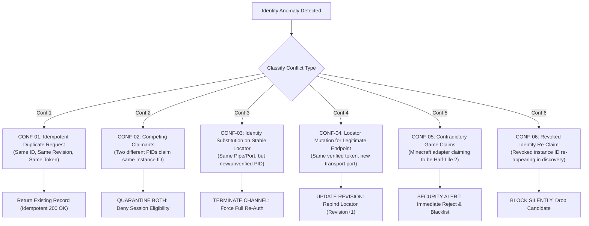

# LIVE BRIDGE IDENTITY CONFLICT & IMPERSONATION HANDLING POLICY

**Document ID:** `NLE-POL-ICI-001`  
**Classification:** Core Security & Conflict Resolution Policy  
**Phase:** Phase 9 — Live Game Bridge & Hybrid Integration (Step 71 of 100)  
**Status:** Authoritative Specification  
**Upstream Dependencies:** `NLE-SPC-EDR-001`, `NLE-CON-EID-001`, `NLE-CON-ERR-001`, `NLE-POL-EIV-001`  
**Downstream Consumed By:** `NLE-POL-DAP-001`, Steps 72–78  

---

## 1. Objective & Threat Scope

In a distributed local environment where external processes, mod scripts, and background services interact with NexLudic Engine, identity ambiguity or malicious impersonation poses a grave security risk. 

This policy establishes the formal conflict taxonomy, detection algorithms, and fail-closed resolution mechanisms required to prevent identity theft, rogue endpoint substitution, and accidental cross-game state pollution.

---

## 2. Identity Conflict Taxonomy

Identity conflicts occurring during discovery, registration, or live re-attestation are classified into six distinct categories:



### 2.1 Detailed Conflict Specifications

| Conflict ID | Category Name | Trigger Conditions | Immediate Action | Final Resolution |
| :--- | :--- | :--- | :--- | :--- |
| **`CONF-01`** | **Idempotent Duplicate** | Registration request arrives with identical canonical ID, revision, and token as an existing active record. | Suppress redundant registration; return existing record. | No state change. Safe retry behavior. |
| **`CONF-02`** | **Competing Claimants** | Two distinct processes (differing PIDs or connections) simultaneously claim the exact same canonical ID. | Quarantine both records immediately. Halt session eligibility. | Requires user disambiguation via UI or process restart. |
| **`CONF-03`** | **Identity Substitution** | A transport locator (Named Pipe / Port) previously used by verified Process A is suddenly used by Process B. | Immediately sever transport channel. Drop unverified frames. | Process B must complete full 4-tier handshake from scratch. |
| **`CONF-04`** | **Locator Mutation** | An active, verified endpoint reconnects from a new port but presents valid original ephemeral secret token. | Validate token; increment registration revision (`+1`). | Rebind locator to new address. Session restored. |
| **`CONF-05`** | **Contradictory Game Claims**| Endpoint claims canonical ID for Game A, but executable digest matches Game B. | Security strike logged in `TDJ-08`. Reject request. | Permanent blacklisting of candidate instance ID. |
| **`CONF-06`** | **Revoked Re-Claim** | A previously revoked instance ID is submitted in a new registration request. | Drop candidate silently. | Refuse registration. New instance ID required. |

---

## 3. Impersonation Defense & Identity Substitution Invariants

1. **Locators Are Not Identities:** The engine never uses an IP address, port, or pipe name to authenticate an endpoint. An incoming packet on an existing pipe is authenticated by its cryptographic session context, not its physical socket descriptor.
2. **Zero Trust for Replacement Processes:** If a host game crashes and restarts, the new process receives a new PID and a new `instance_id`. It **CANNOT** inherit the previous process's active session or verification status.
3. **Fail-Closed Default:** Whenever an identity conflict cannot be resolved with 100% mathematical certainty, the engine fails closed: both claimants are barred from active bridge participation until resolved.

---

## 4. Conflict Diagnostic Record Schema

Every detected identity conflict writes an immutable diagnostic entry to the audit journal:

```json
{
  "$schema": "https://schemas.nexludic.dev/v1/bridge/conflict-record.json",
  "conflict_id": "conf-01938a4b-6666-7000-8801-abcdef443322",
  "timestamp_utc": "2026-11-20T16:33:15.120Z",
  "conflict_type": "CONF_02_COMPETING_CLAIMANTS",
  "claimed_canonical_id": "mojang:minecraft-java:99b1c43f01:inst-01938a4c",
  "claimant_a": {
    "pid": 18420,
    "locator": "pipe://\\.\pipe\nexludic-bridge-sess-mojang-1",
    "token_digest": "sha256:7a8b9c..."
  },
  "claimant_b": {
    "pid": 20114,
    "locator": "pipe://\\.\pipe\nexludic-bridge-sess-mojang-2",
    "token_digest": "sha256:0f1e2d..."
  },
  "action_taken": "BOTH_CLAIMANTS_QUARANTINED",
  "security_severity": "HIGH"
}
```
