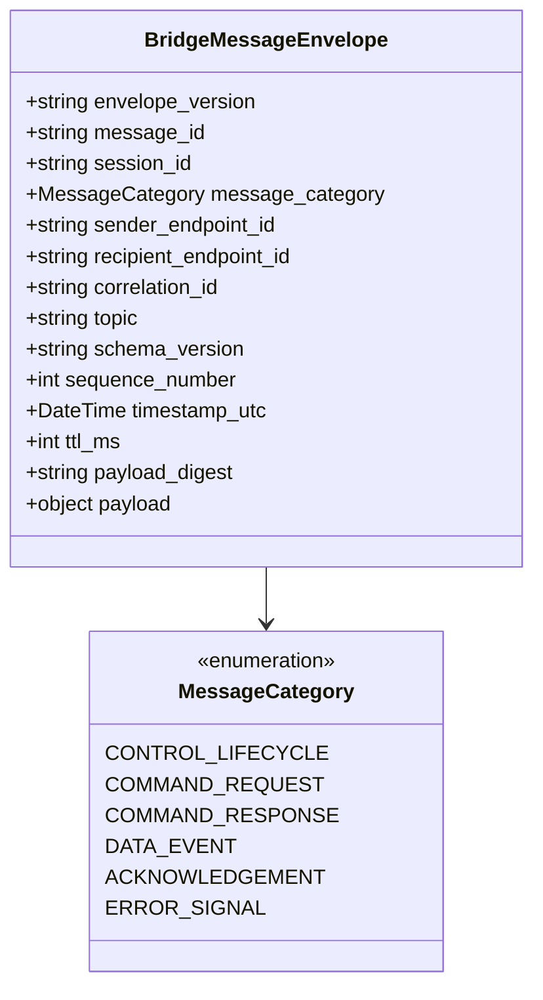

# LIVE BRIDGE MESSAGE ENVELOPE & CATEGORY CONTRACT

**Document ID:** `NLE-CON-MEC-001`  
**Classification:** Core Data Model & Envelope Schema Specification  
**Phase:** Phase 9 — Live Game Bridge & Hybrid Integration (Step 73 of 100)  
**Status:** Authoritative Specification  
**Upstream Dependencies:** `NLE-SPC-LBA-001`, `NLE-SPC-PME-001`, `NLE-CON-DEC-001`, `NLE-CON-CAS-001` (Step 72 Admission Contract)  
**Downstream Consumed By:** `NLE-POL-MVA-001`, `NLE-CON-RRR-001`, Steps 74–78  

---

## 1. Domain Entities & Canonical Envelope Structure

All messages traversing the NexLudic Engine bridge, regardless of underlying transport, conform to the canonical **Bridge Message Envelope**.



---

## 2. Canonical JSON Envelope Schema

```json
{
  "$schema": "https://schemas.nexludic.dev/v1/bridge/message-envelope.json",
  "envelope_version": "1.0",
  "message_id": "msg-01938a4b-7c12-7000-8801-abcdef123456",
  "session_id": "sess-01938a4b-7777-7000-8801-abcdef998877",
  "message_category": "COMMAND_REQUEST",
  "sender_endpoint_id": "mojang:minecraft-java:99b1c43f01:inst-01938a4c",
  "recipient_endpoint_id": "valve:half-life-2:a8f9c12e5d:inst-01938a4b",
  "correlation_id": "req-01938a4b-4433-7000-8801-998877665544",
  "topic": "inventory.item.transfer",
  "schema_version": "1.0.0",
  "sequence_number": 1042,
  "timestamp_utc": "2026-11-20T17:40:00.123456Z",
  "ttl_ms": 3000,
  "payload_digest": "sha256:e3b0c44298fc1c149afbf4c8996fb92427ae41e4649b934ca495991b7852b855",
  "payload": {
    "item_id": "minecraft:iron_sword",
    "quantity": 1,
    "durability_normalized": 0.85,
    "custom_name": "Excalibur"
  }
}
```

---

## 3. Field Invariants & Immutability Rules

1. **`message_id`:** Unique UUIDv4 prefixed with `msg-`. Must be unique across all messages within the session.
2. **`session_id`:** Must match the active session established under Step 72.
3. **`sender_endpoint_id`:** Must match the authenticated identity of the peer on the physical transport channel. Spoofing another endpoint ID triggers immediate socket termination.
4. **`recipient_endpoint_id`:** Must resolve to a valid participant registered in the session contract, or `*` for authorized multicast events.
5. **`sequence_number`:** Monotonically increasing 32-bit unsigned integer per sender within the session. Sequence regression triggers frame drops (`ERR_PME_004`).
6. **`payload_digest`:** Hex-encoded SHA-256 digest of the canonical JSON string of the `payload` object. Mismatches trigger `ERR_PME_003`.
7. **Immutable Origin Fields:** Intermediaries and routers **CANNOT** alter `message_id`, `sender_endpoint_id`, `sequence_number`, or `payload_digest`.

---

## 4. Category-Specific Envelope Contracts

### 4.1 Command Request (`COMMAND_REQUEST`)
- **`correlation_id`:** Mandatory. Unique identifier for tracking the pending RPC request.
- **`ttl_ms`:** Mandatory. Maximum time in milliseconds before the request times out. Default: 3000ms.
- **`topic`:** Must match an authorized capability in the session contract.

### 4.2 Command Response (`COMMAND_RESPONSE`)
- **`correlation_id`:** Mandatory. Must match the `correlation_id` of the originating `COMMAND_REQUEST`.
- **`topic`:** Must match the topic of the originating request.
- **Payload:** Must contain `status` (`SUCCESS` or `FAILED`) and either `result_data` or `error_details`.

### 4.3 Data Event (`DATA_EVENT`)
- **`correlation_id`:** Optional / Null. Events are self-contained and not correlated with prior requests.
- **`ttl_ms`:** Optional. Governs buffer retention under backpressure.
- **`recipient_endpoint_id`:** May be specific endpoint or `*` for fan-out.

### 4.4 Acknowledgement (`ACKNOWLEDGEMENT`)
- **`correlation_id`:** Mandatory. References the `message_id` being acknowledged.
- **Payload:** Contains `ack_type` (`RECEIVED`, `ACCEPTED`, `PROCESSED`) and `timestamp_utc`.
