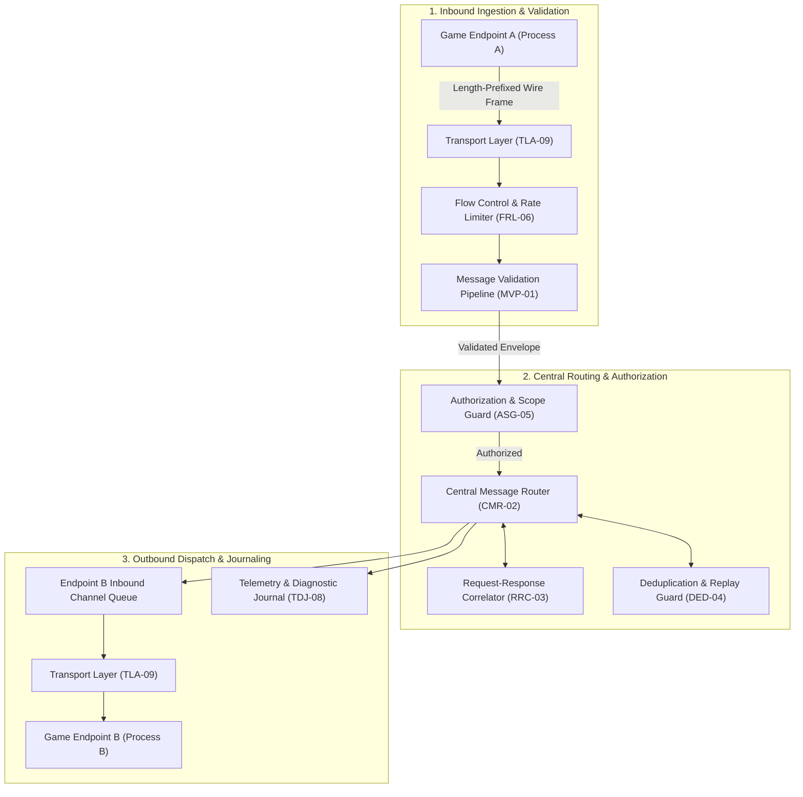

# LIVE BRIDGE MESSAGE EXCHANGE, ROUTING, VALIDATION & DELIVERY SEMANTICS SPECIFICATION

**Document ID:** `NLE-SPC-MRD-001`  
**Classification:** Core Messaging & Systems Architecture Specification  
**Phase:** Phase 9 — Live Game Bridge & Hybrid Integration (Step 73 of 100)  
**Status:** Authoritative Specification  
**Upstream Dependencies:** `NLE-SPC-LBA-001` (Live Game Bridge Architecture), `NLE-SPC-PME-001` (Protocol & Message Envelope Foundation), `NLE-CON-DEC-001` (Domain Model), `NLE-SPC-EDR-001` (Endpoint Discovery & Registration), `NLE-SPC-CPN-001` (Connection Establishment & Handshake)  
**Downstream Consumed By:** Step 74 (Bidirectional Event Routing & Guaranteed Delivery), Step 75 (Health Monitoring), Step 76 (Hybrid Integration Orchestrator)  

---

## 1. Executive Summary & Purpose

This specification defines the authoritative engineering, validation, routing, and delivery contracts governing runtime message exchange across active bridge sessions in the NexLudic Engine platform.

While Step 70 established the bridge topology, Step 71 established endpoint registration and identity verification, and Step 72 established connection preflight, peer authentication, and protocol negotiation, **Step 73 governs the live data plane**. It defines how messages are constructed, validated, authorized, routed, correlated, acknowledged, and delivered across heterogeneous game runtimes.

A foundational principle of this architecture is the rigorous distinction between transport-level communication, application-level execution, and empirically verified gameplay outcomes:

$$\text{Transport Delivery} \neq \text{Application Operation} \neq \text{Verified Gameplay Outcome}$$

$$\text{Created} \neq \text{Validated} \neq \text{Accepted} \neq \text{Transmitted} \neq \text{Received} \neq \text{Processing} \neq \text{Completed} \neq \text{Verified}$$

```
+----------------------------------------------------------------------------------------------------+
|                                    NEXLUDIC ENGINE PLATFORM                                        |
|                                                                                                    |
|   +--------------------------------------------------------------------------------------------+   |
|   |                       MESSAGE LIFECYCLE SEPARATION OF CONCERNS                             |   |
|   |                                                                                            |   |
|   |   +------------------+       +-------------------+       +--------------------+            |   |
|   |   |     CREATED      | ----> |     VALIDATED     | ----> |      ACCEPTED      |            |   |
|   |   |  Message parsed  |       |   Schema & Auth   |       |   Queue admission  |            |   |
|   |   +------------------+       +-------------------+       +---------+----------+            |   |
|   |                                                                    |                       |   |
|   |                                                                    v                       |   |
|   |   +------------------+       +-------------------+       +--------------------+            |   |
|   |   |    PROCESSING    | <---- |     RECEIVED      | <---- |    TRANSMITTED     |            |   |
|   |   | Recipient handle |       | Endpoint intake   |       | Transport delivery |            |   |
|   |   +--------+---------+       +-------------------+       +--------------------+            |   |
|   |            |                                                                               |   |
|   |            v                                                                               |   |
|   |   +------------------+       +-------------------+       +--------------------+            |   |
|   |   |    COMPLETED     | ----> |    UNCERTAIN /    | ----> |   INDEPENDENTLY    |            |   |
|   |   | Terminal result  |       |   TIMEOUT STATE   |       |      VERIFIED      |            |   |
|   |   +------------------+       +-------------------+       +--------------------+            |   |
|   +--------------------------------------------------------------------------------------------+   |
|                                                                                                    |
|   ================================ INVIOLABLE VERIFICATION BOUNDARY ==============================  |
|    - Successful message delivery does NOT imply successful operation execution.                     |
|    - Completed operation execution does NOT imply verified game-state modification.                 |
|    - Operation verification requires independent empirical evidence (telemetry / audit receipts).  |
+----------------------------------------------------------------------------------------------------+
```

---

## 2. Inviolable Messaging Architectural Tenets

1. **Session-Bound Communication:**
   Every message must be strictly bound to an active, authenticated `session_id` (`NegotiatedSessionContract`). Messages arriving outside an active session or attempting cross-session injection are immediately dropped.
2. **Untrusted Data Plane Boundary:**
   All message payloads originating from game processes or mod scripts (Zone 3) are treated as **Untrusted Inputs**. No payload field can elevate permissions, override schema rules, or execute raw shell or memory instructions.
3. **Multi-Stage Validation Pipeline:**
   Every message must pass through a seven-stage sequential validation pipeline (Framing, Envelope, Session State, Sender Attestation, Capability Authorization, Payload Schema, and Semantic Preconditions) before dispatch.
4. **Hub-and-Spoke Message Routing:**
   All inter-game communication routes centrally through the **Central Message Router (`CMR-02`)**. Direct peer-to-peer IPC between game executables is prohibited to ensure centralized authorization, rate limiting, and audit logging.
5. **Non-Invasive Execution Boundary (`BLK-SEC-01`, `DEC-002`):**
   - The messaging plane operates exclusively at **Windows Medium Integrity Level**.
   - Zero virtual memory reading/writing (`ReadProcessMemory`), zero DLL injection, zero API hooking.
   - Message payloads are strictly restricted to structured JSON or binary data schemas; raw code execution is categorically barred.
6. **Delivery Guarantee Transparency:**
   The engine provides explicit, bounded delivery guarantees (QoS 0 Best-Effort, QoS 1 At-Least-Once, QoS 2 Exactly-Once). The system never claims a guarantee it cannot mathematically and empirically verify.

---

## 3. Runtime Message Routing Architecture

The runtime message exchange subsystem operates within the Central Bridge Coordinator (`CBC-01`), interacting with six specialized components:



### 3.1 Component Responsibilities
- **`MVP-01` Message Validation Pipeline:** Enforces sequential syntax, envelope, session, sender, capability, and payload validation.
- **`CMR-02` Central Message Router:** Resolves recipient addresses, applies routing policies, manages message dispatch, and coordinates flow control.
- **`RRC-03` Request-Response Correlator:** Tracks outstanding RPC requests, correlates incoming responses via correlation IDs, and manages correlation timeouts.
- **`DED-04` Deduplication & Replay Guard:** Enforces monotonic sequence numbers, tracks duplicate message IDs, and filters stale or replayed frames.
- **`ASG-05` Authorization & Scope Guard:** Validates that the topic and payload range fall within the user-approved session security grant.
- **`FRL-06` Flow Control & Rate Limiter:** Enforces token-bucket rate limits per endpoint/topic and applies backpressure when channel queues reach high-water marks.

---

## 4. Message Category Taxonomy

The messaging engine supports six standardized message categories:

| Category Identifier | Category Name | Typical Pattern | QoS Tier | Delivery Guarantee |
| :--- | :--- | :--- | :--- | :--- |
| **`CAT-CTRL`** | **Control & Lifecycle** | Handshake, Heartbeat, Drain, Terminate. | QoS 1 | At-least-once. Mandatory ACK. |
| **`CAT-REQ`** | **Command Request** | RPC operation request requiring response. | QoS 1 / QoS 2 | Correlated response or error signal. |
| **`CAT-RESP`** | **Command Response** | Correlated reply to a specific request. | QoS 1 | Matched to pending request ID. |
| **`CAT-EVENT`** | **Data Event Stream** | Telemetry, positional updates, state events. | QoS 0 / QoS 1 | Best-effort or at-least-once. |
| **`CAT-ACK`** | **Acknowledgement** | Receipt, acceptance, or processing receipt. | QoS 0 | Unidirectional control signal. |
| **`CAT-ERR`** | **Error Signal** | Structured diagnostic or rejection notice. | QoS 1 | Dispatched to sender on gate failure. |

---

## 5. Document Roadmap & Traceability

This specification coordinates with the remaining Step 73 documents:
- **`NLE-CON-MEC-001`:** Message Envelope & Category-Specific Contracts.
- **`NLE-POL-MVA-001`:** Message Validation Pipeline & Operation Authorization Policies.
- **`NLE-CON-RRR-001`:** Logical Routing & Recipient Resolution Contracts.
- **`NLE-MOD-RRC-001`:** Request-Response Correlation & Lifecycle Models.
- **`NLE-SPC-DAC-001`:** Delivery, Acknowledgement & Completion Semantics.
- **`NLE-POL-DRI-001`:** Duplicate Detection, Replay Safety & Idempotency Policies.
- **`NLE-POL-MOF-001`:** Message Ordering, Freshness & Cancellation Policies.
- **`NLE-POL-QBR-001`:** Queue Bounds, Backpressure, Resource Quotas & Concurrency.
- **`NLE-CON-MDA-001`:** Message Diagnostics, Audit Journaling & Privacy Safeguards.
- **`NLE-CAT-MRD-001`:** Comprehensive Synthetic QA Test Plan (Scenarios A through AN: 40 scenarios).
- **`NLE-MAT-STP-073`:** Requirements Traceability Matrix (`MRD-REQ-001..040`).
- **`NLE-REG-STP-073`:** Open Architecture Decisions Register (`ADR-MRD-001..010`).
- **`NLE-REP-STP-073`:** Step 73 Completion Report.
