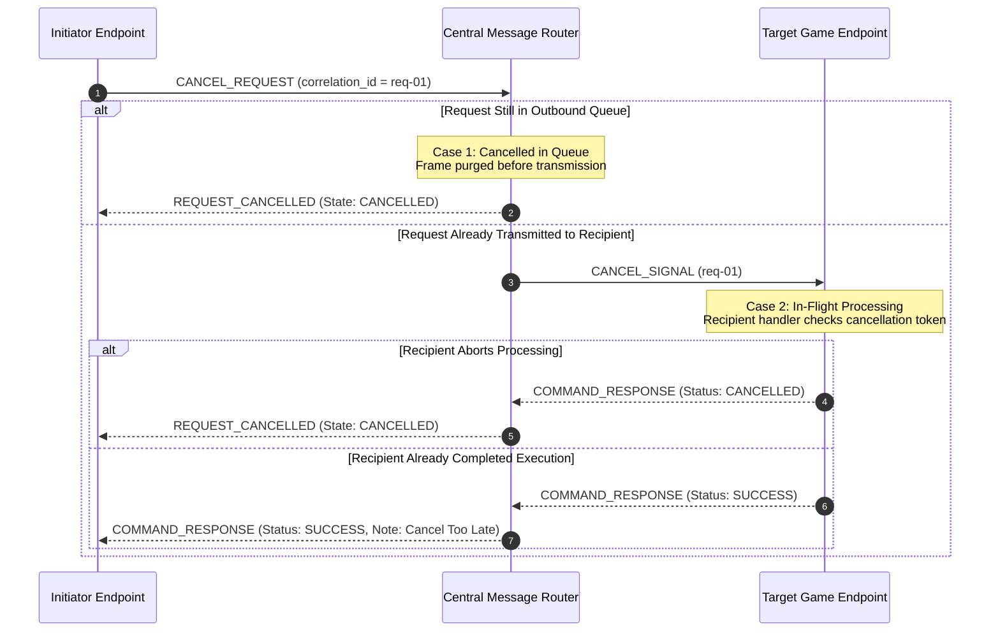

# LIVE BRIDGE MESSAGE ORDERING, FRESHNESS & CANCELLATION POLICY

**Document ID:** `NLE-POL-MOF-001`  
**Classification:** Operational Governance & Reliability Specification  
**Phase:** Phase 9 — Live Game Bridge & Hybrid Integration (Step 73 of 100)  
**Status:** Authoritative Specification  
**Upstream Dependencies:** `NLE-SPC-LBA-001`, `NLE-CON-MEC-001`, `NLE-SPC-DAC-001`  
**Downstream Consumed By:** `NLE-POL-QBR-001`, Steps 74–78  

---

## 1. Ordering Scopes & Sequencing Guarantees

NexLudic Engine enforces explicit ordering scopes tailored to specific message categories:

```
+-----------------------------------+-----------------------------------+-------------------------------------+
| Ordering Scope                    | Applicable Message Categories     | Guarantee & Enforcement             |
+-----------------------------------+-----------------------------------+-------------------------------------+
| Channel / Transport Scope         | All Frames on physical channel    | Strictly FIFO (Stream preservation).|
| Per-Topic Scope                   | DATA_EVENT (Spatial Telemetry)    | Strictly ordered by sequence_number.|
| Request-Response Scope            | COMMAND_REQUEST / RESPONSE        | Correlated; independent across RPCs.|
| Unordered / Independent Scope     | Status Queries, Pings             | Processed concurrently.             |
+-----------------------------------+-----------------------------------+-------------------------------------+
```

### 1.1 Sequence Gap Handling
- If a channel detects a missing sequence number (e.g. sequence 104 arrives after 102):
  - For **QoS 0 Telemetry:** Frame 104 is accepted immediately; frame 103 is skipped (stale telemetry dropped).
  - For **QoS 1 Commands:** Frame 104 is buffered (up to 10 frames); retransmit requested for 103. If timeout elapses, channel enters error recovery.

---

## 2. Message Freshness & TTL Expiration

1. **Envelope `ttl_ms` Enforcement:**
   When an envelope declares `ttl_ms`, the expiration timestamp is calculated at intake:
   $$t_{\text{expire}} = t_{\text{timestamp\_utc}} + \text{ttl\_ms}$$
2. **Queue Drop on Expiry:**
   If a message is queued behind high-water backpressure and $t_{\text{now}} > t_{\text{expire}}$, the router discards the frame and emits an `ERR_MESSAGE_EXPIRED` diagnostic to `TDJ-08`.

---

## 3. Cancellation Semantics for In-Flight Interactions



**Cancellation Invariant:** Cancelling a request does **NOT** guarantee that remote execution was halted. If execution cannot be confirmed, the request state transitions to `UNCERTAIN`.
