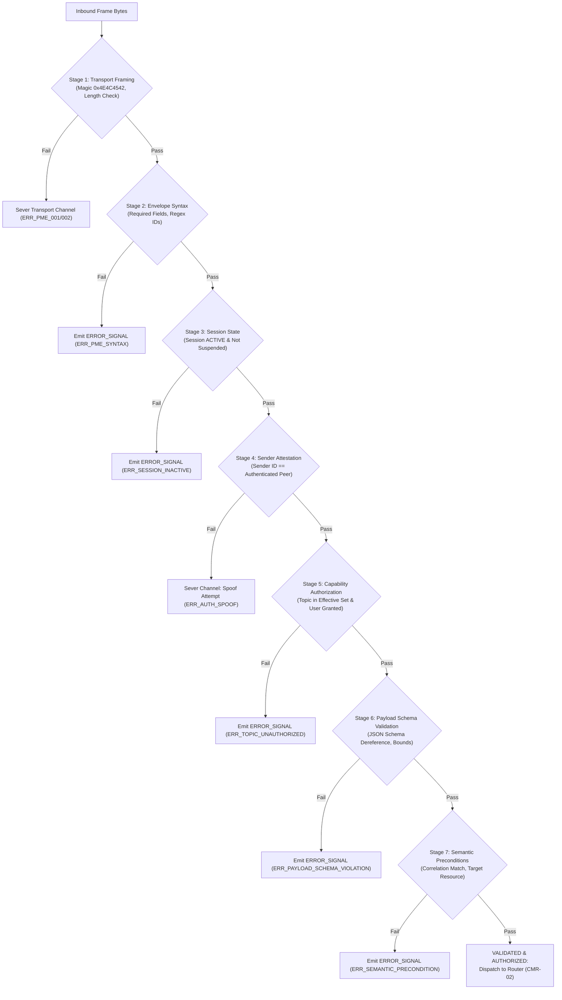

# LIVE BRIDGE MESSAGE VALIDATION & OPERATION AUTHORIZATION POLICY

**Document ID:** `NLE-POL-MVA-001`  
**Classification:** Core Security & Validation Policy  
**Phase:** Phase 9 — Live Game Bridge & Hybrid Integration (Step 73 of 100)  
**Status:** Authoritative Specification  
**Upstream Dependencies:** `NLE-SPC-LBA-001`, `NLE-MOD-CRB-001` (Validation Gates), `NLE-CON-MEC-001`, `NLE-POL-SRS-001`  
**Downstream Consumed By:** `NLE-CON-RRR-001`, Steps 74–78  

---

## 1. Scope & Objective

Every message entering the NexLudic Engine bridge must be rigorously validated before it can be dispatched to an internal handler or routed to another game endpoint.

This policy defines the **Seven-Stage Message Validation Pipeline (MVP-01)**, ensuring that malformed envelopes, unauthorized topics, schema violations, and command injection attacks are intercepted and neutralized at the boundary.

---

## 2. Seven-Stage Message Validation Pipeline

Every inbound frame must pass all seven stages sequentially:

### 2.1 Detailed Stage Validation Rules

| Stage | Verification Rule Name | Enforcement Standard | Action on Violation |
| :--- | :--- | :--- | :--- |
| **Stage 1** | **Transport Framing** | Length $\le 1\,\text{MB}$ (default); starts with `0x4E4C4542`. | Immediate socket severance (`SO_LINGER = 0`). |
| **Stage 2** | **Envelope Syntax** | Required fields present; valid UUIDv4 strings. | Emit `ERROR_SIGNAL`; frame dropped. |
| **Stage 3** | **Session State** | Session must be in `ACTIVE` state; not `SUSPENDED` or `DRAINING`. | Emit `ERROR_SIGNAL`; frame dropped. |
| **Stage 4** | **Sender Attestation** | `sender_endpoint_id` must match channel client PID/token. | Socket severed; security strike logged. |
| **Stage 5** | **Capability Authorization** | `topic` must be in `effective_capabilities` and covered by user grant. | Emit `ERROR_SIGNAL` (`ERR_TOPIC_UNAUTHORIZED`). |
| **Stage 6** | **Payload Schema** | Payload conforms to versioned schema; recursion depth $\le 8$; strings $\le 64\,\text{KB}$. | Emit `ERROR_SIGNAL` (`ERR_PAYLOAD_SCHEMA_VIOLATION`). |
| **Stage 7** | **Semantic Preconditions** | Correlation ID exists for responses; target entity exists. | Emit `ERROR_SIGNAL` (`ERR_SEMANTIC_PRECONDITION`). |

---

## 3. Operation Authorization & Privilege Non-Escalation

1. **Zero Privilege Escalation:** The inclusion of arbitrary fields within a message payload **CANNOT** elevate permissions or grant access to un-negotiated capabilities.
2. **Strict Operation Boundaries:** Bridge messages are strictly bounded to domain-level game concepts (e.g., `inventory.item.transfer`, `telemetry.player.spatial`). Any message requesting operating-system calls, process manipulation, or arbitrary filesystem I/O is rejected at Stage 5.
3. **Fail-Closed Gate Enforcement:** If validation cannot be completed (e.g. schema registry temporarily unavailable), the message is rejected. Validation is never skipped.
