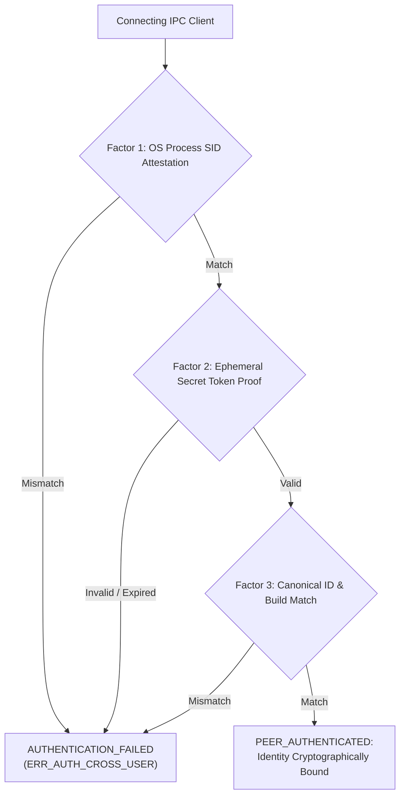

# LIVE BRIDGE PEER AUTHENTICATION & IDENTITY BINDING POLICY

**Document ID:** `NLE-POL-PAI-001`  
**Classification:** Core Security & Peer Authentication Policy  
**Phase:** Phase 9 — Live Game Bridge & Hybrid Integration (Step 72 of 100)  
**Status:** Authoritative Specification  
**Upstream Dependencies:** `NLE-SPC-LBA-001`, `NLE-POL-SRS-001`, `NLE-CON-ERR-001`, `NLE-POL-EIV-001`  
**Downstream Consumed By:** `NLE-SPC-CPN-001`, `NLE-POL-PNV-001`, Steps 73–78  

---

## 1. Scope & Peer Authentication Mandate

Peer authentication is the cryptographic and procedural verification that the process connecting to an established transport channel is genuinely the registered endpoint expected by the Connection Request.

Physical transport establishment provides a raw byte pipe; it conveys **zero trust**. The Peer Authentication Handler (`PAH-03`) enforces mutual attestation before allowing any protocol negotiation or capability exchange.

---

## 2. Multi-Factor Identity Binding Requirements

To successfully authenticate, a connecting peer must fulfill three concurrent identity bindings:



### 2.1 Detailed Factor Specifications

#### Factor 1: OS Process Token SID Attestation
- **Mechanism:** On Windows, the engine inspects the client process identity via `GetNamedPipeClientProcessId` and reads the primary user token (`TokenUser`).
- **Policy Rule:** The client process SID must match the engine process SID. Any connection from a different Windows user account, a sandbox container without user SID inheritance, or a network caller is immediately terminated (`ERR_AUTH_CROSS_USER`).

#### Factor 2: Ephemeral Secret Token Proof
- **Mechanism:** During preflight, the engine mints a cryptographically secure 256-bit random token (using OS CSPRNG). The token is injected into the connector process environment or passed via secure bootstrap pipe.
- **Policy Rule:** The peer must present this token in the `HANDSHAKE_INIT` frame.
- **Timing Constraint:** The token must be transmitted within **500ms** of socket connection. Late tokens trigger socket termination.

#### Factor 3: Canonical ID & Build Hash Binding
- **Mechanism:** The `HANDSHAKE_INIT` frame contains the peer's claimed `canonical_endpoint_id`.
- **Policy Rule:** The claimed canonical ID must match the pre-authorized endpoint ID in the connection request. Any attempt to substitute a different endpoint ID—even if validly registered—is rejected as an identity mismatch (`ERR_AUTH_IDENTITY_MISMATCH`).

---

## 3. Handshake Frame Formats (`HANDSHAKE_INIT` & `HANDSHAKE_ACK`)

Peer authentication utilizes normalized binary-framed JSON envelopes conforming to `NLE-SPC-PME-001`:

### 3.1 `HANDSHAKE_INIT` Frame (Peer to Coordinator)
```json
{
  "$schema": "https://schemas.nexludic.dev/v1/bridge/handshake-init.json",
  "version": "1.0",
  "message_type": "HANDSHAKE_INIT",
  "connection_request_ref": "creq-01938a4b-8800-7000-8801-abcdef123456",
  "claimed_endpoint_id": "mojang:minecraft-java:99b1c43f01:inst-01938a4c",
  "handshake_secret_token": "a8f9c1e2d3b4a5c6d7e8f90123456789abcdef0123456789abcdef0123456789",
  "client_timestamp_utc": "2026-11-20T17:05:01.050Z",
  "client_nonce": "99b1c43f-nonce-01"
}
```

### 3.2 `HANDSHAKE_ACK` Frame (Coordinator to Peer)
```json
{
  "$schema": "https://schemas.nexludic.dev/v1/bridge/handshake-ack.json",
  "version": "1.0",
  "message_type": "HANDSHAKE_ACK",
  "connection_request_ref": "creq-01938a4b-8800-7000-8801-abcdef123456",
  "authenticated_endpoint_id": "mojang:minecraft-java:99b1c43f01:inst-01938a4c",
  "coordinator_version": "NexLudic-Core-0.9.0",
  "assigned_channel_id": "chan-01938a4b-mojang",
  "status": "AUTHENTICATED",
  "server_nonce": "server-nonce-42a1",
  "max_handshake_frame_size": 65536
}
```

---

## 4. Replay & Downgrade Defenses

1. **Anti-Replay Nonce Exchange:** Both client and coordinator exchange unique nonces (`client_nonce`, `server_nonce`). Subsequent capability offer frames must include the composite hash $\mathcal{H}(\text{Token} \parallel \text{ClientNonce} \parallel \text{ServerNonce})$.
2. **Single-Use Tokens:** Once an ephemeral token is successfully validated, it is flagged as `CONSUMED`. Re-using the same token on a subsequent connection attempt is rejected immediately with `ERR_AUTH_TOKEN_REPLAY`.
3. **No Downgrade to Plaintext / Unauthenticated Mode:** The engine strictly forbids disabling authentication or downgrading to an unauthenticated mode. If authentication fails, the connection dies.
