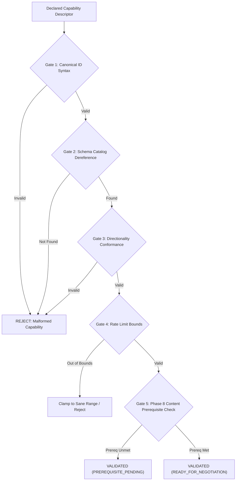

# LIVE BRIDGE PROTOCOL & CAPABILITY METADATA VALIDATION CONTRACT

**Document ID:** `NLE-CON-PCM-001`  
**Classification:** Interface Contract & Schema Validation Specification  
**Phase:** Phase 9 — Live Game Bridge & Hybrid Integration (Step 71 of 100)  
**Status:** Authoritative Specification  
**Upstream Dependencies:** `NLE-SPC-LBA-001`, `NLE-CON-DEC-001`, `CANONICAL_CAPABILITY_DEFINITION_SCHEMA.md` (Phase 5), `ADAPTER_CAPABILITY_DECLARATION_SCHEMA.md` (Phase 5)  
**Downstream Consumed By:** `NLE-POL-ICI-001`, Steps 72–78  

---

## 1. Architectural Scope & Integration Boundary

This contract defines the validation rules governing advertised protocol versions and capability declarations submitted by candidate endpoints during discovery and registration.

It bridges the **Phase 5 Universal Adapter Capability System** with the **Phase 9 Live Bridge Routing Subsystem**, ensuring that:
1. Endpoints declare only syntactically valid and recognized capabilities.
2. Advertised schemas exist in the authoritative catalog and are structurally sound.
3. Directionality and rate limit constraints are strictly validated.
4. **Core Invariant:** Advertised capabilities are strictly informative metadata. An advertised capability confers **ZERO** execution authority until verified by `IVS-03` and granted by the Authorization Guard (`ASG-05`).

---

## 2. Protocol Version Validation Rules

Before an endpoint's capabilities are even inspected, its declared wire protocol metadata must be validated:

```
Canonical Protocol Identifier Syntax:
NLE-WIRE-v{Major}

Supported Production Versions:
- NLE-WIRE-v1 (Authoritative Phase 9 wire protocol)
```

**Validation Checks:**
- **`CHK-PROT-01`:** The `advertised_protocol_version` must exactly match a supported wire protocol version registered in the engine configuration.
- **`CHK-PROT-02`:** If an endpoint declares an unknown or deprecated protocol version (e.g. `NLE-WIRE-v0.5` or `NLE-WIRE-v2`), registration validation rejects the endpoint with `ERR_UNSUPPORTED_PROTOCOL_VERSION`.
- **`CHK-PROT-03`:** Protocol version negotiation is not progressive. Both the coordinator and endpoint must agree on the identical major protocol revision.

---

## 3. Capability Metadata Validation Rules

Reusing Phase 5 schemas (`CANONICAL_CAPABILITY_DEFINITION_SCHEMA.md`), every capability descriptor declared by an endpoint must satisfy five mandatory validation gates:



### 3.1 Detailed Capability Validation Rules

| Gate | Validation Rule | Enforcement Standard | Failure Action |
| :--- | :--- | :--- | :--- |
| **Gate 1** | **Syntax Conformance** | Must match `^[a-z0-9_-]+(\.[a-z0-9_-]+)+$` (e.g. `inventory.item.transfer`). | Immediate rejection (`ERR_CAP_SYNTAX_INVALID`). |
| **Gate 2** | **Schema Dereferencing** | `schema_uri` must resolve to an immutable JSON Schema in the engine catalog. | Rejection (`ERR_CAP_SCHEMA_NOT_FOUND`). |
| **Gate 3** | **Directionality Check** | Must be strictly one of `INBOUND`, `OUTBOUND`, or `BIDIRECTIONAL`. | Rejection (`ERR_CAP_INVALID_DIRECTION`). |
| **Gate 4** | **Rate Limit Clamping** | `max_messages_per_sec` must be within $[1, 240]$. Default: 60 msgs/sec. | Clamped to ceiling or rejected if 0. |
| **Gate 5** | **Content Prerequisite** | If `requires_content_package = true`, verify package status in Phase 8 journal. | Capability flagged `PREREQUISITE_PENDING`. |

---

## 4. Capability Declaration Schema

```json
{
  "$schema": "https://schemas.nexludic.dev/v1/bridge/capability-declaration.json",
  "capability_id": "inventory.item.transfer",
  "namespace": "core.games.inventory",
  "contract_version": "1.0.0",
  "direction": "BIDIRECTIONAL",
  "schema_uri": "https://schemas.nexludic.dev/v1/schemas/inventory-transfer-v1.json",
  "rate_limit": {
    "max_messages_per_sec": 10,
    "burst_capacity": 5
  },
  "requires_content_package": true,
  "required_package_id": "pkg_inventory_sync_adapter_v1",
  "status": "VALIDATED_PREREQUISITE_PENDING"
}
```

---

## 5. Security & Privilege Non-Escalation Invariant

1. **Declarations Do Not Convey Rights:** The presence of a capability in an endpoint's registration record **DOES NOT** authorize the endpoint to emit or receive messages on that topic.
2. **Authorization Separation:** During bridge session establishment (Step 70 / Step 76), the Authorization Guard (`ASG-05`) independently verifies whether the user has granted permission for that specific topic.
3. **Immutable Registration State:** Endpoints cannot dynamically inject new capabilities into an active session. Any capability change requires an updated registration revision.
