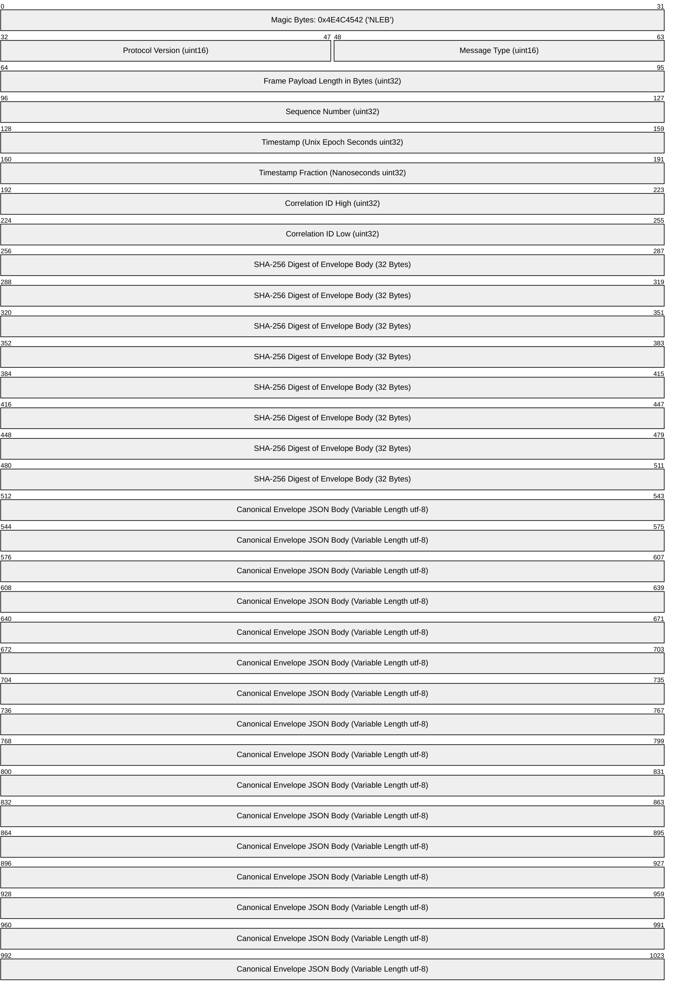

# LIVE BRIDGE PROTOCOL & MESSAGE ENVELOPE FOUNDATION

**Document ID:** `NLE-SPC-PME-001`  
**Classification:** Core Wire Protocol & Messaging Specification  
**Phase:** Phase 9 — Live Game Bridge & Hybrid Integration (Step 70)  
**Status:** Authoritative Foundation  
**Upstream Dependencies:** `NLE-SPC-LBA-001`, `NLE-MOD-CRB-001`, `NLE-CON-DEC-001`, `NLE-REQ-TIC-001`  
**Downstream Consumed By:** `NLE-POL-SLC-001`, Steps 71–78  

---

## 1. Protocol Architecture & Design Principles

The NexLudic Engine Bridge Protocol defines the message syntax, serialization rules, sequencing semantics, and operational message types utilized across all transport channels.

### 1.1 Core Principles
1. **Envelope Normalization:** All traffic—whether control handshakes, telemetry streams, or RPC commands—is wrapped in an immutable, standardized envelope structure.
2. **Schema-Driven Validation:** Payloads must strictly adhere to versioned JSON/Binary schemas registered in the capability manifest. Schemaless payloads are rejected at Gate 3.
3. **Deterministic Serialization:** JSON serialization enforces sorted object keys, UTF-8 encoding without BOM, and no insignificant whitespace to guarantee reproducible payload digest verification.
4. **Idempotency & Sequence Invariants:** Monotonically increasing sequence counters allow deduplication, out-of-order rejection, and at-least-once or at-most-once delivery semantics depending on capability QoS.

---

## 2. Operational Message Types

Every message envelope specifies a `message_type` from the standardized protocol taxonomy:

```
+--------------------+---------------------------------------------------------------+
| Message Type       | Functional Role & Semantic Scope                              |
+--------------------+---------------------------------------------------------------+
| HANDSHAKE_INIT     | Initiates connection, transmits endpoint identity & auth token.|
| HANDSHAKE_ACK      | Acknowledges connection, confirms engine version & accepted.  |
| CAPABILITY_OFFER   | Endpoint proposes its supported capabilities & schemas.       |
| CAPABILITY_ACCEPT  | Coordinator issues final Negotiated Session Contract.         |
| CAPABILITY_REJECT  | Coordinator rejects unsupported or conflicting capabilities.  |
| DATA_EVENT         | Asynchronous, unidirectional event dispatch (e.g. telemetry). |
| COMMAND_REQUEST    | Synchronous or correlated RPC request requiring a response.   |
| COMMAND_RESPONSE   | Correlated response to a previous COMMAND_REQUEST.            |
| HEARTBEAT_PING     | Liveness probe dispatched at periodic intervals.              |
| HEARTBEAT_PONG     | Immediate liveness reply acknowledging HEARTBEAT_PING.         |
| ERROR_SIGNAL       | Non-fatal protocol, rate limit, or schema validation error.   |
| SESSION_DRAIN      | Advisory notice that endpoint/coordinator is draining traffic.|
| SESSION_TERMINATE  | Immediate termination of bridge session with cause code.       |
+--------------------+---------------------------------------------------------------+
```

---

## 3. Wire Format & Envelope Structure



### 3.1 Canonical JSON Envelope Schema

When serialized as JSON over the transport frame, the envelope body conforms to the following schema:

```json
{
  "$schema": "https://schemas.nexludic.dev/v1/bridge/message-envelope.json",
  "version": "1.0",
  "message_id": "msg-01938a4b-7c12-7000-8801-abcdef123456",
  "session_id": "sess-9a7f3e12-4c28-4091-88f2-7104bce948a0",
  "message_type": "DATA_EVENT",
  "sequence_number": 1042,
  "correlation_id": null,
  "source_endpoint": "mojang:minecraft-java:99b1c43f01:inst-01938a4c",
  "target_endpoint": "valve:half-life-2:a8f9c12e5d:inst-01938a4b",
  "topic": "inventory.item.transfer",
  "schema_version": "1.0.0",
  "timestamp_utc": "2026-11-20T16:10:00.123456Z",
  "payload_digest": "sha256:4a5b6c...",
  "payload": {
    "item_id": "minecraft:iron_sword",
    "quantity": 1,
    "durability_normalized": 0.85
  }
}
```

---

## 4. Delivery Quality-of-Service (QoS) Tiers

The Live Bridge protocol defines three distinct Quality-of-Service tiers assigned per capability:

| QoS Tier | Delivery Guarantee | Ordering | Overhead | Typical Use Cases |
| :--- | :--- | :--- | :--- | :--- |
| **QoS 0: Best Effort** | Fire-and-forget; no ACK required. Dropped frames ignored. | Unsequenced / Stale dropped. | Minimal (< 1ms). | High-frequency spatial telemetry, player coordinates, head tracking. |
| **QoS 1: At-Least-Once** | Guaranteed delivery; recipient must reply with `COMMAND_RESPONSE` or ACK frame within timeout. Sender retransmits on timeout. | Monotonically sequenced. | Moderate (RTT dependent). | Inventory transfers, quest state transitions, game world events. |
| **QoS 2: Exactly-Once** | Two-phase commit / coordinated handshake with deduplication journal. | Strictly ordered & serialized. | High (2x RTT). | Irreversible currency transactions, unlock grants, cross-game achievements. |

---

## 5. Protocol Rejection & Error Taxonomy

When a frame fails validation at any stage, the Central Message Router emits an `ERROR_SIGNAL` frame to the sender:

| Error Code | Error Category | Description & Remedy |
| :--- | :--- | :--- |
| `ERR_PME_001` | Frame Parsing | Invalid magic bytes (`0x4E4C4542` missing). Connection dropped immediately. |
| `ERR_PME_002` | Frame Length | Frame length exceeds negotiated maximum (`max_frame_size_bytes`). |
| `ERR_PME_003` | Digest Mismatch | Calculated SHA-256 hash of payload does not match `payload_digest`. |
| `ERR_PME_004` | Sequence Reversion | Sequence number lower than previously accepted monotonic sequence. |
| `ERR_PME_005` | Stale Timestamp | Timestamp skew exceeds allowed clock drift (default: ±5000ms). |
| `ERR_PME_006` | Unknown Topic | Topic not present in active `NegotiatedSessionContract`. |
| `ERR_PME_007` | Rate Limit Exceeded | Token bucket exhausted for specified topic/endpoint. Backoff required. |
| `ERR_PME_008` | Scope Violation | Message attempts state mutation outside authorized capability scope. |
