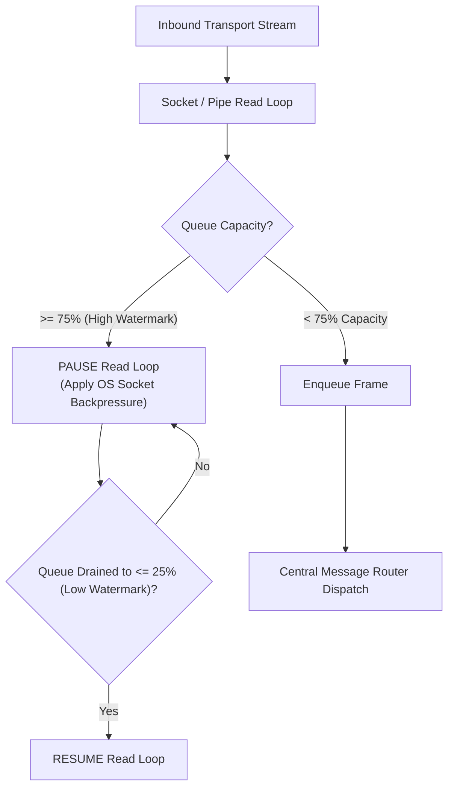

# LIVE BRIDGE QUEUE, BACKPRESSURE, RESOURCE & CONCURRENCY POLICY

**Document ID:** `NLE-POL-QBR-001`  
**Classification:** Operational Governance & Resource Policy  
**Phase:** Phase 9 — Live Game Bridge & Hybrid Integration (Step 73 of 100)  
**Status:** Authoritative Specification  
**Upstream Dependencies:** `NLE-SPC-LBA-001`, `NLE-REQ-TIC-001`, `NLE-SPC-MRD-001`  
**Downstream Consumed By:** `NLE-CON-MDA-001`, Steps 74–78  

---

## 1. Scope & Resource Governance Objectives

A core danger in real-time cross-game bridging is resource exhaustion: a high-frequency simulation (e.g. 144Hz physics) can easily swamp slower game runtimes, flood IPC memory buffers, or trigger out-of-memory (OOM) crashes in the central engine.

This policy establishes strict channel queue boundaries, backpressure watermarks, token-bucket rate limiting rules, and concurrency governance across all active message streams.

---

## 2. Channel Queue Boundaries & Backpressure Watermarks

Every connected endpoint has dedicated, bounded inbound and outbound queues within the Central Message Router (`CMR-02`):

### 2.1 Default Queue Quotas & Limits

| Dimension | Default Limit | Hard Ceiling | Violation Action |
| :--- | :--- | :--- | :--- |
| **Channel Queue Capacity** | 1,000 frames | 2,500 frames | Backpressure triggered at 750 frames. |
| **Total Channel Memory Buffer**| 10 MB per channel | 25 MB per channel | Frame intake suspended; sender throttled. |
| **Max Frame Payload Size** | 1 MB | 16 MB hard ceiling | Rejected at framing layer (`ERR_PME_002`). |
| **Outstanding RPC Requests** | 100 concurrent | 250 concurrent | New requests rejected (`ERR_QUEUE_SATURATED`). |
| **Token Bucket Refill Rate** | 60 tokens / sec | 120 tokens / sec max | Surplus frames dropped or throttled. |
| **Token Burst Capacity** | 10 tokens | 25 tokens max | Exceeded burst triggers `ERR_RATE_LIMITED`. |

---

## 3. Telemetry Coalescing & Drop Semantics

For high-frequency, non-transactional telemetry streams (`DATA_EVENT`, e.g. player spatial coordinates):
1. **Drop Oldest on Saturation:** If the outbound channel queue for a slower recipient reaches the 75% high watermark, the router is authorized to discard older, unconsumed telemetry samples in favor of the freshest observation.
2. **Never Drop Commands:** State-changing `COMMAND_REQUEST` and `COMMAND_RESPONSE` frames **MUST NEVER** be discarded under backpressure. If queues saturate, commands are paused, and backpressure halts the producer.

---

## 4. Concurrency Governance & Fairness

1. **Lock-Free Bounded Queues:** Queues utilize lock-free single-producer single-consumer (SPSC) ring buffers or bounded asynchronous channels (`System.Threading.Channels.Channel<T>`).
2. **No Priority Override:** External game endpoints and AI coding agents **CANNOT** self-assign elevated priority to bypass token buckets or backpressure watermarks. All endpoints adhere to identical fair-share scheduling.
