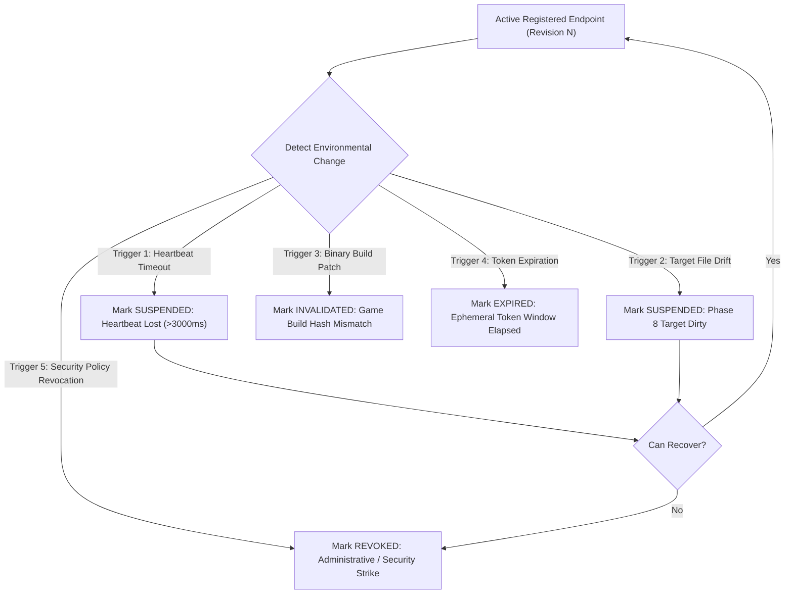

# LIVE BRIDGE REGISTRATION REVISION, REVOCATION & FRESHNESS POLICY

**Document ID:** `NLE-POL-RRR-001`  
**Classification:** Operational Governance & Lifecycle Maintenance Policy  
**Phase:** Phase 9 — Live Game Bridge & Hybrid Integration (Step 71 of 100)  
**Status:** Authoritative Specification  
**Upstream Dependencies:** `NLE-SPC-EDR-001`, `NLE-CON-ERR-001`, `NLE-POL-EIV-001`  
**Downstream Consumed By:** `NLE-POL-ICI-001`, Steps 72–78  

---

## 1. Revisioning & Immutability Governance

All endpoint registration records are versioned and immutable. In-place, unversioned mutation of registration records is strictly prohibited.

### 1.1 Monotonic Registration Revision Rules
1. Every registration record contains an integer `registration_revision` counter, initialized to `1` upon initial creation.
2. Any approved administrative update (e.g. locator rebind, capability amendment, evidence refresh) increments `registration_revision` by strictly `+1`.
3. Historical revisions are archived in the immutable append-only journal (`bridge-audit.jsonl`).
4. Protected core identity fields (`provider`, `title_id`, `build_hash`) **CANNOT** be updated across revisions. Any modification to these fields requires a completely new registration under a distinct canonical identity.

---

## 2. Registration Freshness & Invalidation Triggers

A registration record may be syntactically valid and historically true, but no longer fresh or eligible for active session communication.

### 2.1 Material Invalidation Triggers

| Trigger Identifier | Event Description | Impact on Registration | Immediate Bridge Impact |
| :--- | :--- | :--- | :--- |
| **`TRG-INV-01`** | **Heartbeat Liveness Failure:** Missing 3 consecutive heartbeats (3000ms). | State -> `SUSPENDED`. | Transport paused. Awaiting reconnect or termination. |
| **`TRG-INV-02`** | **Phase 8 Target File Drift:** Files in game directory modified externally. | State -> `SUSPENDED`. | Bridge session halted. State reconciliation required. |
| **`TRG-INV-03`** | **Executable Build Patch:** Host game binary modified by platform patch. | State -> `INVALIDATED`. | Session terminated. Must re-discover and re-register. |
| **`TRG-INV-04`** | **Handshake Token Expiry:** 2-hour default session window elapsed. | State -> `EXPIRED`. | Graceful drain initiated; re-authentication required. |
| **`TRG-INV-05`** | **Security Violation:** Replay attack, schema breach, or spoof attempt. | State -> `REVOKED`. | Instant socket reset; permanent block on instance ID. |

---

## 3. Revocation Policy & Cascade Semantics

Revocation is an irreversible administrative or security action stripping an endpoint of all trust and participation rights.

### 3.1 Revocation Cascade Rules
When an endpoint's registration state transitions to `REVOKED`:
1. **Immediate Session Termination:** The Central Bridge Coordinator immediately emits a `SESSION_TERMINATE` frame (cause: `REVOCATION_ENFORCED`) and closes all OS transport pipes/sockets (`SO_LINGER = 0`).
2. **Token Nullification:** The ephemeral 256-bit handshake token is immediately erased from the engine's active credential cache.
3. **Capability Revocation:** All active capability grants bound to this endpoint are immediately invalidated.
4. **No Silent Rediscovery:** If a subsequent discovery request encounters the revoked instance identifier, the Discovery Manager flags the candidate as `REVOKED_IDENTITY_BLOCKED` and refuses ingestion.
5. **Phase 8 File Invariant:** In accordance with `ADR-BRG-003`, revoking a live bridge registration **DOES NOT** trigger a filesystem rollback of installed Phase 8 packages.

---

## 4. Deregistration vs Historical Retention

- **Deregistration:** Clears the endpoint from active in-memory routing tables, connection listeners, and lookup caches.
- **Audit Retention:** The complete history of the endpoint—from initial discovery candidate to registration, verification proofs, revisions, and revocation—is **PERMANENTLY RETAINED** in the append-only `bridge-audit.jsonl` log. Deregistration never erases diagnostic audit history.
