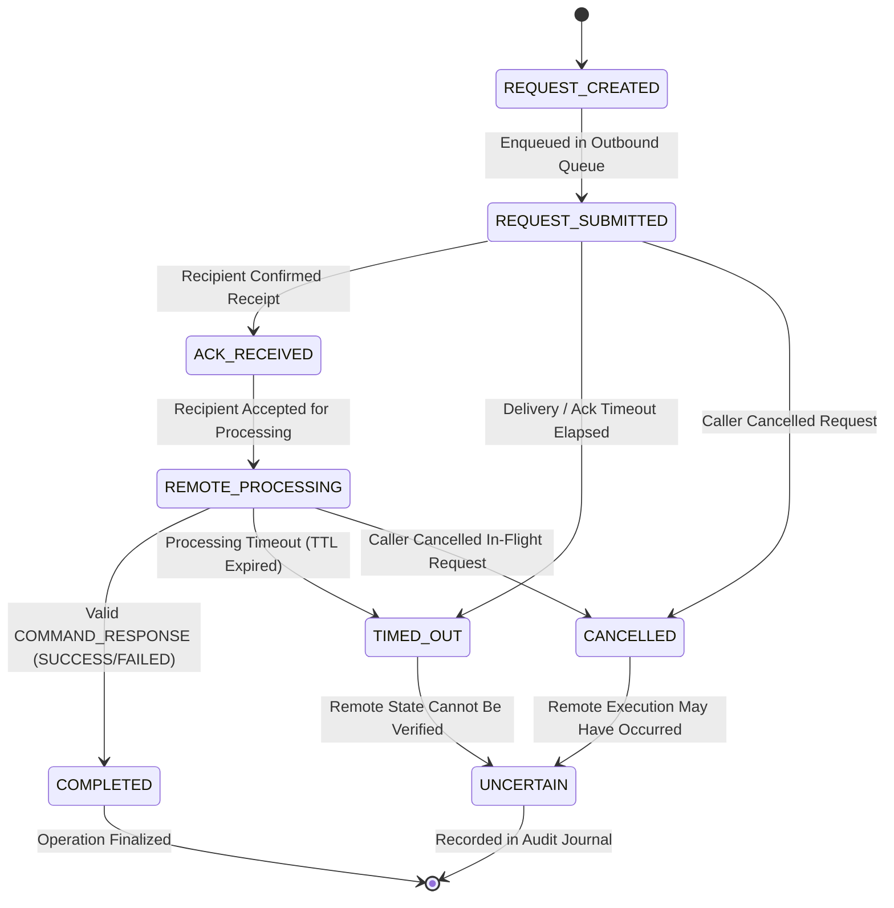

# LIVE BRIDGE REQUEST-RESPONSE CORRELATION & LIFECYCLE MODEL

**Document ID:** `NLE-MOD-RRC-001`  
**Classification:** Core Messaging Domain & Lifecycle Model  
**Phase:** Phase 9 — Live Game Bridge & Hybrid Integration (Step 73 of 100)  
**Status:** Authoritative Specification  
**Upstream Dependencies:** `NLE-SPC-LBA-001`, `NLE-SPC-MRD-001`, `NLE-CON-MEC-001`  
**Downstream Consumed By:** `NLE-SPC-DAC-001`, Steps 74–78  

---

## 1. Domain Overview & Correlator Role

In asynchronous, cross-game RPC communications, requests and responses are physically decoupled frames traversing message queues.

The **Request-Response Correlator (`RRC-03`)** manages the complete lifecycle of request-response interactions, pairing incoming `COMMAND_RESPONSE` frames with outstanding `COMMAND_REQUEST` entries via immutable `correlation_id` values.

---

## 2. Request Lifecycle Finite State Machine

Every correlated request progresses through a deterministic lifecycle state machine:



---

## 3. Correlation Matching & Validation Rules

When a `COMMAND_RESPONSE` frame arrives at the router, `RRC-03` executes strict correlation matching:

```
+-----------------------------------+-----------------------------------------------------------------+
| Correlation Matching Check        | Invariant Enforcement Standard                                  |
+-----------------------------------+-----------------------------------------------------------------+
| 1. Correlation ID Exists          | correlation_id must resolve to an active pending request.       |
| 2. Session Context Match          | session_id must match the session of the originating request.    |
| 3. Sender Identity Match          | sender_endpoint_id must match the original intended recipient.  |
| 4. Topic Match                    | topic must match the topic of the originating request.          |
| 5. Non-Terminal Request State     | Request must be in REQUEST_SUBMITTED or REMOTE_PROCESSING.      |
+-----------------------------------+-----------------------------------------------------------------+
```

### 3.1 Handling Anomalous Responses
1. **Unmatched / Unknown Correlation ID:** If a response contains a `correlation_id` with no matching pending request, it is dropped and logged as `WARN_CORRELATION_UNKNOWN_ID`. It **NEVER** matches another request.
2. **Late Responses (Arriving After Timeout):** If a response arrives for a request that has already transitioned to `TIMED_OUT`, the response is logged to `TDJ-08` as an informative diagnostic receipt (`INFO_LATE_RESPONSE_RECEIVED`), but **DOES NOT** reopen the request or mutate completed state.
3. **Contradictory / Duplicate Responses:** If a second terminal response arrives for a request already marked `COMPLETED`, the second response is rejected with `ERR_CORRELATION_DUPLICATE_RESPONSE`.
