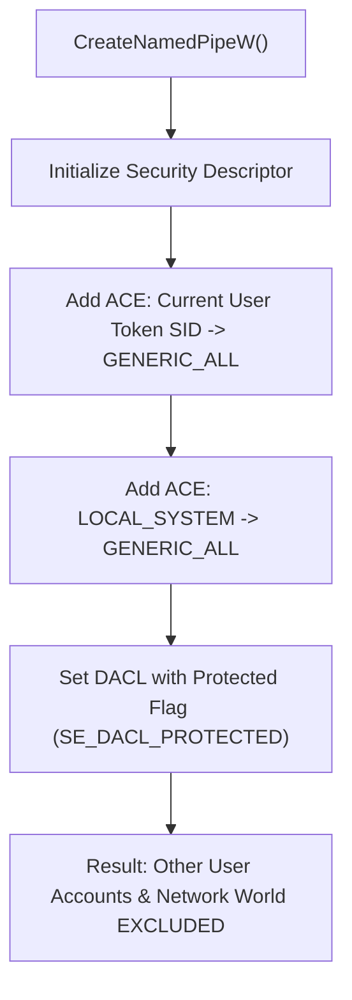

# LIVE BRIDGE SECURITY, RUNTIME SCOPE & PRIVILEGE POLICY

**Document ID:** `NLE-POL-SRS-001`  
**Classification:** Core Security Policy & Privilege Boundary Specification  
**Phase:** Phase 9 — Live Game Bridge & Hybrid Integration (Step 70)  
**Status:** Authoritative Foundation  
**Upstream Dependencies:** `DEC-002` (Windows Medium IL Constraint), `BLK-SEC-01` (Security Inviolability), `NLE-SPC-LBA-001`, `NLE-MOD-CRB-001`  
**Downstream Consumed By:** `NLE-REQ-FDR-001`, `NLE-CAT-LBA-001`, Steps 71–78  

---

## 1. Executive Security Mandate

The NexLudic Engine Live Game Interoperability Bridge operates under a zero-trust, defense-in-depth security model. 

Because runtime bridge operations interface with third-party, commercial game executables and untrusted user-created mod scripts, the bridge must never become an attack vector for privilege escalation, remote code execution, anti-cheat bans, or host system compromise.

---

## 2. Inviolable Security Tenets

### 2.1 Tenet 1: Windows Medium Integrity Level (`DEC-002`)
- The NexLudic Engine, its bridge coordinator, and all background worker threads must run strictly at **Windows Medium Integrity Level** (or POSIX standard non-root user space).
- The bridge coordinator **MUST NEVER** request User Account Control (UAC) elevation, run as Administrator, or operate within High or System Integrity Levels.
- Any attempt by a connected bridge component to perform actions requiring elevation (e.g., driver installation, service registration, global hooking) is **CATEGORICALLY PROHIBITED**.

### 2.2 Tenet 2: Anti-Cheat Inviolability & Non-Invasive Interoperability (`BLK-SEC-01`)
To ensure total player safety and prevent account bans across commercial gaming platforms:
- **Zero Binary DLL Injection:** The bridge never injects unapproved DLLs into game process spaces via `CreateRemoteThread`, `LoadLibrary` detours, or manual mapping.
- **Zero Virtual Memory Access:** The bridge code never calls Windows memory manipulation APIs (`OpenProcess` with `PROCESS_VM_READ`, `PROCESS_VM_WRITE`, `PROCESS_ALL_ACCESS`, `VirtualAllocEx`, or `WriteProcessMemory`) against any host game process.
- **Zero API Hooking / Byte Patching:** The bridge never overwrites game function pointers, modifies in-memory executable code bytes, or deploys inline hooks (e.g., MinHook, Detours).
- **Sanctioned Integration Only:** Bridge communication is conducted exclusively through:
  1. Standard, user-level OS IPC transports (Named Pipes, Loopback TCP sockets).
  2. Documented, official game developer telemetry interfaces or mod APIs.
  3. Modding frameworks running entirely within the game's supported mod loader context (e.g., Fabric/Forge mods, UE4SS Lua scripts, BepInEx plugins) that publish their own external IPC listener.

---

## 3. Local IPC Transport Access Control & Authentication

### 3.1 Windows Named Pipe Security Descriptors
When establishing local Named Pipes (`\\.\pipe\nexludic-bridge-*`), the transport layer must create a custom Security Descriptor with an explicit Discretionary Access Control List (DACL):



**Security Invariants:**
1. **Current User Only:** Only processes running under the identical Windows User SID (`TokenUser`) can open, read, or write to the pipe. Cross-user IPC is strictly blocked.
2. **Network World Denied:** Network access (`SECURITY_WORLD_RID` / `Everyone`) is explicitly omitted from the DACL, preventing remote access across the LAN.
3. **Pipe Mode:** `FILE_FLAG_FIRST_PIPE_INSTANCE` is enforced on pipe creation. If a rogue process previously created a pipe with the same name, creation fails immediately, preventing pipe squatter / man-in-the-middle attacks.

### 3.2 Loopback TCP Socket Authentication
When using TCP loopback transports:
1. **Loopback Binding Only:** Sockets must bind strictly to IPv4 `127.0.0.1` or IPv6 `::1`. Binding to `0.0.0.0` or any external network adapter is hard-blocked at the socket creation layer.
2. **Pre-Shared Ephemeral Token:** Every session generates a cryptographically secure 256-bit random authentication token (using `RNGCryptoServiceProvider` / OS CSPRNG).
3. **Handshake Window:** Connectors must transmit the auth token in the `HANDSHAKE_INIT` frame within **500ms** of establishing the TCP socket. Unauthenticated or misauthenticated connections are terminated immediately without diagnostic disclosure.

---

## 4. Mod Script Isolation & Sandboxing Scope

When game adapters execute user scripts (e.g., Lua, Python, JavaScript) to convert internal game state to bridge envelopes:

```
+-----------------------------------------------------------------------------------------+
|                              RESTRICTED GUEST SANDBOX                                   |
|                                                                                         |
|   ALLOWED OPERATIONS:                                                                   |
|   - Read internal game objects exposed by official mod API                              |
|   - Construct normalized JSON Bridge Message Envelopes                                  |
|   - Emit envelopes to NexLudic Bridge IPC endpoint                                      |
|   - Receive and deserialize validated bridge payloads from NexLudic IPC                 |
|                                                                                         |
|   STRICTLY FORBIDDEN OPERATIONS:                                                        |
|   - Arbitrary filesystem file writes (outside designated mod log)                       |
|   - Arbitrary process execution (`os.execute`, `Process.Start`, shell commands)         |
|   - Outbound internet socket connections (`connect` to non-loopback IP)                 |
|   - Loading native unmanaged DLLs or binary libraries                                   |
|   - Windows Registry modification or OS configuration queries                           |
+-----------------------------------------------------------------------------------------+
```

---

## 5. Denial-of-Service Defenses & Resource Quotas

To prevent buggy mod loops or malicious scripts from exhausting platform memory or CPU:

| Defense Dimension | Enforcement Mechanism | Limit / Threshold | Action on Violation |
| :--- | :--- | :--- | :--- |
| **Max Frame Size** | Transport Frame Header Check | 1 MB default (16 MB hard ceiling) | Connection dropped immediately (`ERR_PME_002`). |
| **Message Frequency** | Token Bucket Algorithm per Topic | 60 msgs/sec default (burst 100) | Surplus frames dropped; `ERR_PME_007` emitted. |
| **Max Memory Inbound Queue**| Bounded Channel Queue | 10 MB per endpoint channel | Socket read paused (backpressure signaled). |
| **JSON Parser Recursion** | Safe Deserializer Configuration | Max depth: 8 nested levels | Deserialization aborted (`ERR_PME_001`). |
| **Max String Length** | Schema String Validation | 65,536 characters per string field | Payload rejected with schema violation. |
