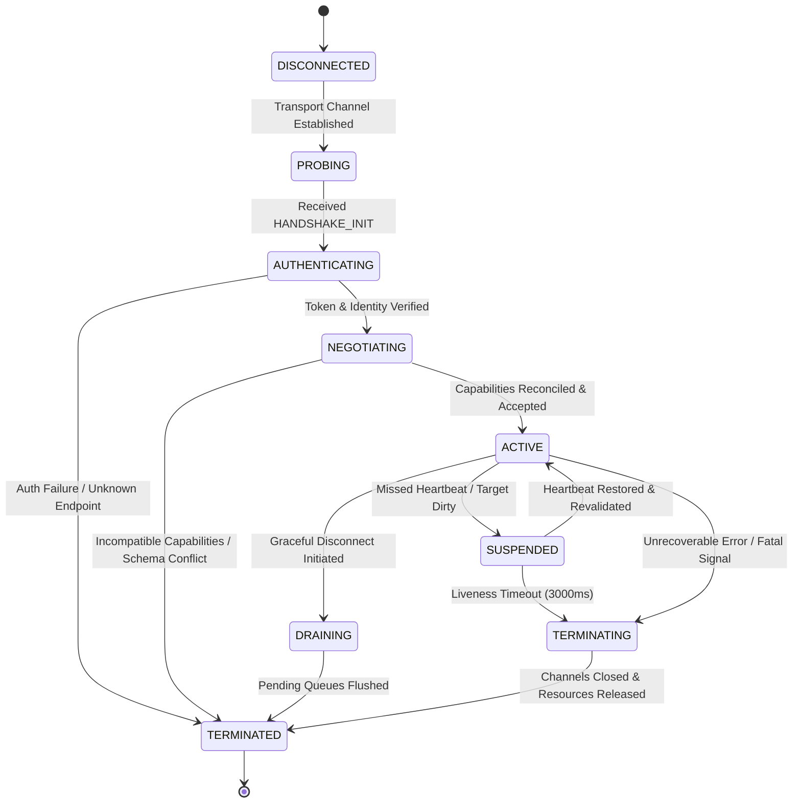
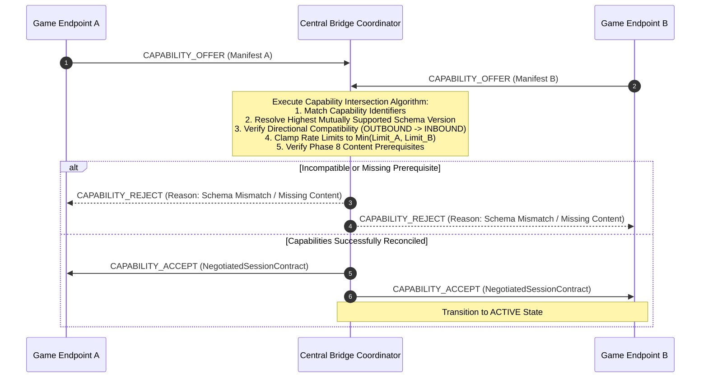

# LIVE BRIDGE SESSION LIFECYCLE & CAPABILITY NEGOTIATION POLICY

**Document ID:** `NLE-POL-SLC-001`  
**Classification:** Operational Governance & Lifecycle Policy  
**Phase:** Phase 9 — Live Game Bridge & Hybrid Integration (Step 70)  
**Status:** Authoritative Foundation  
**Upstream Dependencies:** `NLE-SPC-LBA-001`, `NLE-CON-DEC-001`, `NLE-SPC-PME-001`  
**Downstream Consumed By:** `NLE-POL-GPE-001`, `NLE-CON-HIC-001`, Steps 71–78  

---

## 1. Lifecycle State Machine Overview

The lifecycle of every Live Bridge connection is governed by a strict, deterministic finite state machine (FSM). No game data may traverse the bridge outside of the `ACTIVE` state.

---

## 2. Formal State Definitions & Invariants

| State | Allowed Inbound Messages | Allowed Outbound Messages | Security & Operational Invariants |
| :--- | :--- | :--- | :--- |
| **`DISCONNECTED`** | None | None | No sockets or pipes open. Endpoint resources unallocated. |
| **`PROBING`** | `HANDSHAKE_INIT` | None | Transport open; awaiting initiator handshake. Max duration: 2000ms before forced close. |
| **`AUTHENTICATING`** | None | `HANDSHAKE_ACK` | Engine verifies endpoint identity token, PID attestation, and local user SID. |
| **`NEGOTIATING`** | `CAPABILITY_OFFER` | `CAPABILITY_ACCEPT`, `CAPABILITY_REJECT` | Engine reconciles schemas. Zero game data or telemetry may be transmitted. |
| **`ACTIVE`** | All active topics, `HEARTBEAT_PING/PONG` | All active topics, `HEARTBEAT_PING/PONG` | Normal operational state. Strict rate limiting and authorization active. |
| **`SUSPENDED`** | `HEARTBEAT_PING/PONG` | `HEARTBEAT_PING/PONG` | Game data paused. Target state dirty or heartbeats delayed. Buffer preserved up to 5000ms. |
| **`DRAINING`** | In-flight ACKs | In-flight messages | New message dispatch prohibited. Engine waits for in-flight queues to drain (max 1000ms). |
| **`TERMINATING`** | None | `SESSION_TERMINATE` | Abrupt or completed closure. OS pipe/socket teardown initiated. |
| **`TERMINATED`** | None | None | Final state. Diagnostic records written. Session ID invalidated. |

---

## 3. Capability Negotiation Algorithm

Capability negotiation guarantees that two endpoints only communicate using mutually understood schemas and compatible rate expectations.

### 3.1 Directional Compatibility Matrix

For any capability shared between Endpoint A and Endpoint B:

| Endpoint A Direction | Endpoint B Direction | Reconciled Session Capability |
| :--- | :--- | :--- |
| `OUTBOUND` | `INBOUND` | **Valid** (Unidirectional A -> B) |
| `INBOUND` | `OUTBOUND` | **Valid** (Unidirectional B -> A) |
| `BIDIRECTIONAL` | `BIDIRECTIONAL` | **Valid** (Full Duplex A <-> B) |
| `OUTBOUND` | `OUTBOUND` | **Invalid** (No consumer; capability dropped) |
| `INBOUND` | `INBOUND` | **Invalid** (No producer; capability dropped) |

---

## 4. Liveness Monitoring & Heartbeat Policy

To detect game crashes, process freezing, or ungraceful network disconnections:
1. **Heartbeat Frequency:** In the `ACTIVE` state, the Central Bridge Coordinator dispatches a `HEARTBEAT_PING` every **1000ms** to each connected endpoint.
2. **Heartbeat Response:** Endpoints must immediately reply with `HEARTBEAT_PONG` containing the corresponding sequence identifier.
3. **Missed Heartbeat Threshold:**
   - **1 Missed Heartbeat (1000ms):** Warning logged; state remains `ACTIVE`.
   - **2 Missed Heartbeats (2000ms):** Connection transitioned to `SUSPENDED`; message dispatch paused.
   - **3 Missed Heartbeats (3000ms):** Liveness timeout triggered; transition to `TERMINATING` and session closed.
4. **Clock Jitter Tolerance:** Timestamp skew between endpoint and coordinator must not exceed ±5000ms. Endpoints exceeding this are flagged for clock desynchronization.
