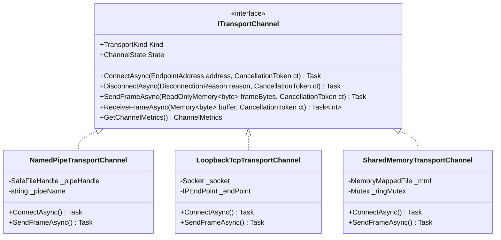
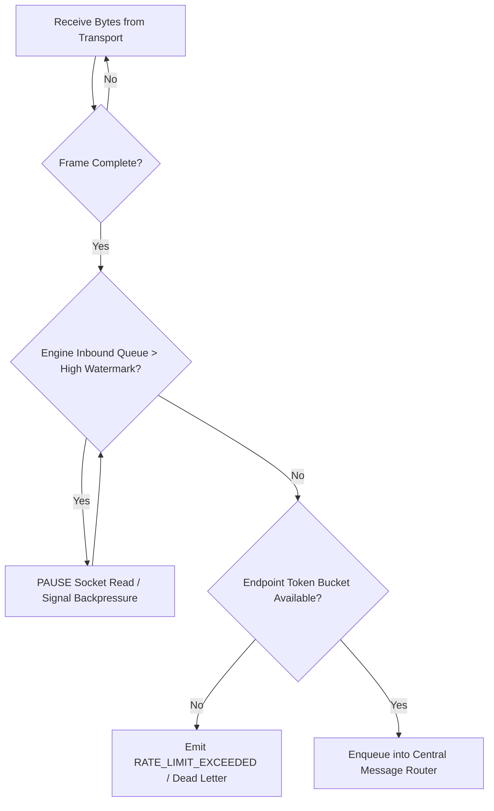

# LIVE BRIDGE TRANSPORT-INDEPENDENT COMMUNICATION REQUIREMENTS

**Document ID:** `NLE-REQ-TIC-001`  
**Classification:** Technical Requirements Specification  
**Phase:** Phase 9 — Live Game Bridge & Hybrid Integration (Step 70)  
**Status:** Authoritative Foundation  
**Upstream Dependencies:** `NLE-SPC-LBA-001` (Bridge Architecture), `NLE-CON-DEC-001` (Domain Model & Envelope Contracts)  
**Downstream Consumed By:** `NLE-SPC-PME-001`, Step 71 (Wire Protocol), Step 72 (IPC Handshake)  

---

## 1. Objective & Transport Independence Principle

The NexLudic Engine Live Bridge messaging protocol is strictly decoupled from physical transport mechanisms. 

The messaging system treats transports as abstract byte-stream or frame-oriented pipes satisfying a standardized interface contract (`ITransportChannel`). Whether communicating across Windows Named Pipes, local loopback TCP sockets, Unix Domain Sockets, or shared memory buffers, the higher-level routing, capability enforcement, and session governance logic remain 100% identical.

---

## 2. Standardized Transport Abstraction Interface (`ITransportChannel`)

All concrete transport implementations must fulfill the formal asynchronous transport abstraction interface:



---

## 3. Supported Physical Transport Profiles

### 3.1 Profile A: Local Inter-Process Named Pipes (Primary Windows Transport)

- **Target OS:** Windows (Medium Integrity Level).
- **Endpoint Pattern:** `\\.\pipe\nexludic-bridge-{session_id}-{endpoint_id}`
- **Security Descriptor Requirements:**
  - Pipe must be created with `PIPE_ACCESS_DUPLEX | FILE_FLAG_OVERLAPPED | FILE_FLAG_FIRST_PIPE_INSTANCE`.
  - Discretionary Access Control List (DACL) must explicitly restrict access to:
    - Current User Token SID (`TokenUser`): `GENERIC_READ | GENERIC_WRITE | SYNCHRONIZE`.
    - Local System (`SECURITY_LOCAL_SYSTEM_RID`): `GENERIC_READ | GENERIC_WRITE`.
    - Everyone / Network World (`SECURITY_WORLD_RID`): **STRICTLY DENIED**.
- **Framing Mode:** Byte-stream mode with application-level length-prefixed framing (recommended over message mode for cross-runtime interoperability).

### 3.2 Profile B: Loopback TCP Sockets (Cross-Runtime / WSL / Container Transport)

- **Target OS:** Cross-Platform / Windows / WSL / JVM Runtimes.
- **Binding Rule:** Strict binding to loopback interface `127.0.0.1` or `[::1]`. Binding to `0.0.0.0` or public interfaces is **CATEGORICALLY PROHIBITED**.
- **Port Allocation:** Dynamic ephemeral port allocation by OS (`port: 0`), passed to connector via secure bootstrap args or token file.
- **Authentication:** Mandatory pre-shared secret (PSK) or ephemeral handshake token exchanged during local launch. Unauthenticated connections are dropped within 500ms.
- **Socket Options:** `TCP_NODELAY = true` (disables Nagle's algorithm for low latency), `SO_KEEPALIVE = true`, `SO_LINGER = 0` on forced disconnect.

### 3.3 Profile C: Memory-Mapped Ring Buffer (High-Throughput / Spatial Telemetry Transport)

- **Target Scenario:** High-frequency spatial updates (e.g., 60-120 Hz positional tracking).
- **Mechanism:** Memory-Mapped File (`CreateFileMapping` / `shm_open`) with a lockless single-producer single-consumer (SPSC) circular ring buffer.
- **Memory Fencing:** Atomic read/write head pointers with acquire/release memory barriers.
- **Fallback:** If memory-mapped setup fails, endpoint transparently falls back to Profile A or Profile B.

---

## 4. Framing, Delimitation & Buffer Management

Because standard stream transports (TCP, Named Pipes in byte mode) provide arbitrary byte chunks without message boundaries, all physical transports must use **Length-Prefixed Framing**.

```
+-------------------+-------------------+------------------------------------------+
|  MAGIC BYTES (4B) | FRAME LENGTH (4B) |             PAYLOAD BYTES (N)            |
|   0x4E 0x4C 0x45 0x42  | (Big-Endian int32)|     (Canonical Serialized Envelope)      |
|    ('N' 'L' 'E' 'B')  | (e.g., 0x00000400)|                                          |
+-------------------+-------------------+------------------------------------------+
```

### 4.1 Frame Size Constraints

| Parameter | Specification Constraint | Rationale |
| :--- | :--- | :--- |
| **Minimum Frame Size** | **8 Bytes** (4B Magic + 4B Length header) | Enforces structural validity. |
| **Default Max Frame Size** | **1,048,576 Bytes (1 MB)** | Sufficient for complex game state snapshots while preventing memory exhaustion. |
| **Absolute Max Frame Ceiling**| **16,777,216 Bytes (16 MB)** | Hard architectural upper bound. Frames exceeding this are rejected immediately at transport boundary. |
| **Magic Header Bytes** | `0x4E 0x4C 0x45 0x42` ("NLEB") | Identifies valid NexLudic Engine Bridge protocol streams. |

---

## 5. Flow Control, Rate Limiting & Backpressure

To prevent rogue mod scripts or fast game engines from overwhelming slower endpoints or exhausting system memory:



### 5.1 Backpressure Watermarks

1. **High-Water Mark (75% buffer capacity):**
   When the engine's inbound frame queue for an endpoint reaches 75% capacity, the transport layer stops reading from the underlying OS socket/pipe buffer. The OS TCP/pipe window fills, naturally halting the sender's write calls.
2. **Low-Water Mark (25% buffer capacity):**
   Once downstream processing drains the queue below 25%, socket read operations resume.
3. **Dead-Letter Queue:**
   Frames rejected due to sustained rate limit violations, malformed envelopes, or missing sessions are routed to an in-memory ring buffer (default 1,000 entries) for diagnostic inspection without stalling active channels.
