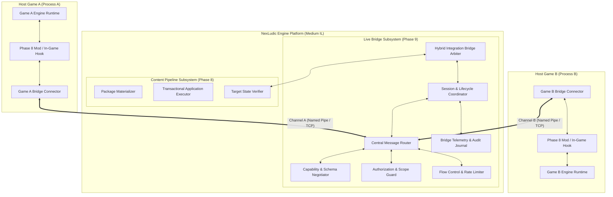

# LIVE GAME INTEROPERABILITY BRIDGE ARCHITECTURE & HYBRID FOUNDATION SPECIFICATION

**Document ID:** `NLE-SPC-LBA-001`  
**Classification:** Core Engineering Specification  
**Phase:** Phase 9 — Live Game Bridge & Hybrid Integration (Steps 70–78)  
**Status:** Authoritative Foundation  
**Upstream Dependencies:** `NLE-GAT-PH8-001` (Phase 8 Readiness Gate Decision Record), `NLE-SPC-GMS-001` (Host-Game Modification Strategy), `NLE-CON-ETA-001` (Transactional Execution Contract)  
**Downstream Consumed By:** Phase 9 Steps 71–78 (Protocol, Runtime Connectors, Hybrid Orchestration, Telemetry, Gateway Integration)  

---

## 1. Executive Summary & Purpose

The **Live Game Interoperability Bridge Architecture & Hybrid Foundation Specification** establishes the authoritative architectural blueprint for live, bidirectional, and cross-game runtime interoperability within the NexLudic Engine platform. 

While Phase 8 established the **Host-Game Modification & Content Pipeline**—governing static, offline file transformation, packaging, target validation, and transactional filesystem application—Phase 9 expands NexLudic Engine into **Live Runtime Interoperability**. This capability allows two or more distinct, running game applications to exchange structured game-state events, telemetry, inventory sync, positional metadata, and interactive control stimuli under strict session governance and security boundaries.

Crucially, this specification formalizes the **Hybrid Integration Foundation**, establishing the architectural boundary, coordination protocol, and dependency lifecycle connecting Phase 8 content modifications (e.g., custom mesh assets, UI hooks, script adapters installed into host directories) with Phase 9 live bridge communications (e.g., runtime event dispatch between running processes).

```
+-----------------------------------------------------------------------------------------+
|                                    NEXLUDIC ENGINE                                      |
|                                                                                         |
|   +------------------------------------+       +------------------------------------+   |
|   |         PHASE 8 SUBSYSTEM          |       |         PHASE 9 SUBSYSTEM          |   |
|   |  Host-Game Modification & Content  |       |   Live Game Interoperability       |   |
|   |             Pipeline               |       |         Bridge Engine              |   |
|   +-----------------+------------------+       +-----------------+------------------+   |
|                     |                                            |                      |
|                     | Offline File / Asset Mod                   | Live Message IPC     |
|                     v                                            v                      |
|   +------------------------------------+       +------------------------------------+   |
|   |     TARGET HOST ENVIRONMENT        |       |        LIVE GAME RUNTIME           |   |
|   |   (Filesystem Assets, Pak, Mod)    | <---> |   (Process State, Live Events)     |   |
|   +------------------------------------+       +------------------------------------+   |
|                                                                                         |
|   ============================ HYBRID INTEGRATION BOUNDARY ==========================   |
|    - Content Modification must precede Live Bridge Binding                              |
|    - Runtime Bridge failure MUST NOT trigger destructive File Rollback                   |
|    - Bridge Session does NOT grant Filesystem Write Privileges                          |
+-----------------------------------------------------------------------------------------+
```

---

## 2. Inviolable Architectural Tenets

The design of the Live Game Bridge is anchored on six inviolable architectural tenets:

1. **Strict Decoupling of Concerns:**
   $$\text{Communication Channel} \neq \text{Capability Support} \neq \text{Semantic Interoperability} \neq \text{Operation Authorization} \neq \text{Verified State}$$
   $$\text{Host Modification (Phase 8)} \neq \text{Live Interoperability Bridge (Phase 9)} \neq \text{Hybrid Integration Orchestration}$$
   The existence of a communication pipe does not imply that an endpoint supports a given capability; support for a capability does not imply semantic alignment between game concepts; semantic mapping does not authorize state mutation; and an authorized mutation does not imply verified execution.

2. **Universal Core Decoupled from Game Adapters:**
   The Central Bridge Coordinator contains zero game-specific logic, hardcoded telemetry structures, or proprietary modding conventions. All game-specific translation is encapsulated within isolated **Game Endpoint Connectors** communicating via normalized bridge protocol contracts.

3. **Transport-Independent Protocol:**
   The bridge messaging protocol operates identically across local named pipes, loopback TCP sockets, domain sockets, or shared memory ring buffers. Wire framing and transport mechanics are completely decoupled from message envelope syntax and payload semantics.

4. **Explicit Capability Negotiation & Handshake Contract:**
   No game data or event payload may be dispatched between endpoints until a formal, multi-phase capability negotiation and schema reconciliation handshake has successfully completed. Endpoints must explicitly agree on schema versions, rate limits, and directionality.

5. **Non-Invasive Runtime Boundaries & Anti-Cheat Inviolability:**
   In accordance with `DEC-002` (Windows Medium Integrity Level) and `BLK-SEC-01` (Security Inviolability), the NexLudic Engine Live Bridge:
   - Operates strictly in standard user space (Medium IL).
   - NEVER performs binary DLL injection into unapproved games.
   - NEVER inspects, reads, or writes arbitrary target process virtual memory (`ReadProcessMemory`, `WriteProcessMemory`, hooking, or detours).
   - NEVER modifies running executable code segments.
   - NEVER bypasses, disables, or interferes with anti-cheat engines (e.g., Easy Anti-Cheat, BattlEye, Vanguard) or platform DRM.
   - Integrates exclusively via documented, developer-sanctioned, or adapter-brokered communication endpoints (e.g., local loopback sockets, official modding APIs, IPC pipes established by authorized mods).

6. **Deterministic Failure Containment:**
   Runtime disconnection, latency spikes, malformed payloads, or host process crashes must never destabilize the central engine, corrupt sibling game sessions, or trigger blind, uncoordinated filesystem rollbacks in the Phase 8 content layer.

---

## 3. High-Level System Architecture & Topology

The NexLudic Engine Live Bridge utilizes a centralized **Hub-and-Spoke Gateway Architecture**. Rather than allowing peer-to-peer ad-hoc communication between disparate game executables, all cross-game interactions pass through the engine's Central Bridge Coordinator.



### 3.1 Subsystem Role Breakdown

1. **Central Message Router:**
   Inspects normalized message envelopes, verifies cryptographic integrity, validates schema version compliance, enforces routing rules, and dispatches frames between registered session endpoints.
2. **Session & Lifecycle Coordinator:**
   Governs the complete session state machine for each connected game endpoint, managing discovery, connection initiation, capability negotiation, active heartbeat monitoring, graceful draining, and fault termination.
3. **Capability & Schema Negotiator:**
   Evaluates endpoint capability manifests, computes the mathematical intersection of supported protocol versions, resolves semantic translation schemas, and issues immutable session capability contracts.
4. **Authorization & Scope Guard:**
   Enforces user-approved security boundaries, validating that inbound and outbound event topics, parameter ranges, and mutation operations conform to granted permissions.
5. **Flow Control & Rate Limiter:**
   Guards against denial-of-service, buffer bloat, and game desynchronization by enforcing per-topic token buckets, backpressure signaling, and queue saturation thresholds.
6. **Bridge Telemetry & Audit Journal:**
   Maintains a tamper-evident, append-only operational log of all session state transitions, capability agreements, security rejections, and abnormal termination events.
7. **Hybrid Integration Bridge Arbiter:**
   Enforces cross-phase preconditions. Before a bridge session is permitted to activate features that depend on modified content, the Arbiter verifies that the corresponding Phase 8 package is in an `APPLIED` and `VERIFIED` state.

---

## 4. The Hybrid Integration Foundation

A central innovation of NexLudic Engine is the principled synthesis of static filesystem modification and dynamic live bridging.

### 4.1 Hybrid Architecture Scenarios

| Integration Category | Phase 8 Role (Host Modification) | Phase 9 Role (Live Bridge) | Hybrid Coupling Invariant |
| :--- | :--- | :--- | :--- |
| **Pure Content Mashup** | Installs converted 3D models, textures, audio into target directory. | None (Session not required). | Independent. Phase 8 operates standalone. |
| **Pure Telemetry Bridge** | None (Uses existing game API / telemetry port). | Streams positional data or health to UI overlay or companion app. | Independent. Phase 9 operates standalone. |
| **Content-Assisted Bridge** | Installs custom script adapter, UI panel, or IPC socket provider into host mod directory. | Connects to the installed IPC socket provider to exchange live game events. | **Strict Precondition:** Bridge connection fails if Phase 8 mod artifact is missing, altered, or unverified. |
| **Bi-Directional Cross-Game Interop** | Installs custom resource packs and adapter hooks into Game A and Game B. | Streams inventory or entity state changes bidirectionally between Game A and Game B via Central Router. | **Dual Verification:** Both target games must have their Phase 8 modifications verified before cross-game session activates. |

### 4.2 Cross-Phase Invariants and Rules

1. **Precedence Invariant:** Phase 8 execution must reach `VERIFIED` status prior to Phase 9 session activation for any capability tagged with `requires_content_package`.
2. **Failure Independence:** If a live bridge socket disconnects, times out, or encounters a protocol error, the system **MUST NOT** trigger a filesystem rollback of the installed Phase 8 mod packages. Live bridge faults are transient network/process events; filesystem modifications are persistent application states.
3. **Privilege Containment:** Possessing an active Live Bridge session with a game process conveys **ZERO** filesystem write authority. Any filesystem changes must be routed exclusively through Phase 8 transactional planning and execution channels.
4. **Target Reconciliation Protection:** If an external update alters game files while a live bridge session is active, the Bridge Arbiter must immediately flag a `TARGET_DIRTY_INTERRUPTION`, gracefully suspend live message routing, and require state reconciliation.

---

## 5. Specification Roadmap & Phase 9 Governance

This foundation specification establishes the baseline for all subsequent Step specifications in Phase 9:
- **Step 70:** Foundational Architecture, Component Responsibilities, Domain Model, Transport Requirements, Security Policy, Synthetic QA.
- **Step 71:** Bridge Protocol Wire Format, Framing, Envelope Serialization & Compression.
- **Step 72:** Endpoint Discovery, Local IPC Handshake & Process Identity Attestation.
- **Step 73:** Cross-Game Semantic Translation Engine, Schema Transformation & Value Mapping.
- **Step 74:** Bidirectional Event Routing, Message Ordering & Guaranteed Delivery Mechanics.
- **Step 75:** Runtime Bridge Health Monitoring, Heartbeat Protocols & Fault Recovery.
- **Step 76:** Hybrid Integration Orchestrator, Multi-Game Launch Sequencing & State Synchronization.
- **Step 77:** Security Sandboxing, Privilege Isolation & Anti-Cheat Evasion Defense Audit.
- **Step 78:** End-to-End Live Bridge Integration Review & Phase 9 Readiness Gate.

---

## 6. Document Sign-Off & Architectural Status

- **Architecture Lead:** NexLudic Engine Systems Architecture Group
- **Security Lead:** Application Security & Inviolability Review Board
- **QA Automation Lead:** Verification & Test Infrastructure Engineering
- **Status:** **APPROVED & AUTHORITATIVE (DESIGN MILESTONE)**
- **Runtime Code Constraint:** Strict specification only. No runtime code or process manipulation permitted during Phase 9 foundation stage.
