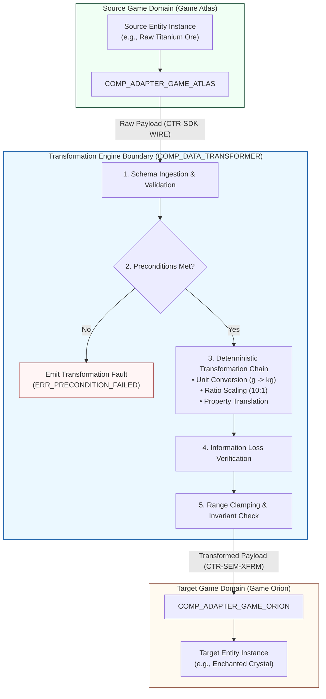

# Cross-Game Data Mapping & Transformation Specification

**Document ID:** `NLE-SPC-DMT-001`  
**Version:** `1.0.0`  
**Status:** `APPROVED ARCHITECTURAL SPECIFICATION`  
**Phase:** `Phase 6 of 12 — Mashup Designer & Integration Planning`  
**Step:** `Step 47 of 100`  
**Classification:** `Core Data Integration & Transformation Specification`  
**Related Documents:**
- [CROSS_GAME_REQUIREMENT_SEMANTICS_AND_PARTICIPANT_MAPPING.md](file:///d:/App%20Winrar%20Files/Nexludic%20Engine%20(working)/docs/mashup-designer/CROSS_GAME_REQUIREMENT_SEMANTICS_AND_PARTICIPANT_MAPPING.md) (`NLE-SPC-CRS-001`)
- [INTEGRATION_ARCHITECTURE_DATA_AND_EVENT_FLOW_SPECIFICATION.md](file:///d:/App%20Winrar%20Files/Nexludic%20Engine%20(working)/docs/mashup-designer/INTEGRATION_ARCHITECTURE_DATA_AND_EVENT_FLOW_SPECIFICATION.md) (`NLE-SPC-DEF-001`)
- [INTEGRATION_ARCHITECTURE_BLUEPRINT_AND_COMPONENT_MAPPING_SPECIFICATION.md](file:///d:/App%20Winrar%20Files/Nexludic%20Engine%20(working)/docs/mashup-designer/INTEGRATION_ARCHITECTURE_BLUEPRINT_AND_COMPONENT_MAPPING_SPECIFICATION.md) (`NLE-SPC-IAB-001`)
- [UNIVERSAL_ADAPTER_SDK_CORE_SPECIFICATION.md](file:///d:/App%20Winrar%20Files/Nexludic%20Engine%20(working)/docs/adapters/UNIVERSAL_ADAPTER_SDK_CORE_SPECIFICATION.md) (`NLE-SPC-SDK-001`)
- [PHASE_5_PHASE_GATE_AND_EXIT_CRITERIA.md](file:///d:/App%20Winrar%20Files/Nexludic%20Engine%20(working)/docs/adapters/PHASE_5_PHASE_GATE_AND_EXIT_CRITERIA.md) (`NLE-GAT-PH5-001`)

---

## 1. Executive Summary & Purpose

The **Cross-Game Data Mapping & Transformation Specification** defines how **NexLudic Engine** formally structures, validates, and governs mappings between heterogeneous information concepts across different games and their integration components.

Cross-game interoperability fundamentally requires reconciling divergent data representations, coordinate spaces, physics metrics, item attributes, and event models. Games do not share a universal schema: an inventory item in *Game Atlas* possesses durability, mass, and radiation attributes, whereas *Game Orion* represents items with enchantments, weight, and rarity tiers. 

This specification establishes:
1. **The Epistemic Data Hierarchy:** Strictly decoupling concept existence, semantic equivalence, data representation, transformation mechanics, information loss, and runtime execution.
2. **Concept & Property Mapping Schema:** Formally linking source and target concepts, cardinality ($1:1$, $1:N$, $N:1$, $N:M$), data types, ranges, and nullability.
3. **Semantic Transformation Contracts:** Defining 12 formal transformation categories (pass-through, unit conversion, range normalization, enumeration translation, spatial coordinate mapping, etc.) with explicit preconditions, mathematical bounding, and error boundaries.
4. **Information Fidelity & Loss Governance:** Categorizing transformations into *Preserved*, *Adapted*, and *Dropped* properties, with mandatory loss disclosure and reversibility classification.
5. **Security, Privacy & Sandboxing:** Enforcing Windows Medium Integrity Level (`DEC-002`), Volume D persistence (`DEC-009`), zero memory tampering (`BLK-SEC-01`), and safe non-executable mapping descriptors.

---

## 2. Epistemic Separation & Progression Invariant

A critical vulnerability in automated data systems is conflating syntactic conversion with semantic equivalence, or confusing a proposed mapping with verified runtime capability. NexLudic Engine enforces a strict 7-stage epistemic progression:

### Governing Invariants:
1. **Label Non-Equivalence (`RUL-DMT-01`):** Two properties sharing identical names across different games (e.g. `health`, `mana`, `weight`) **are never assumed to be equivalent**. Semantic correspondence requires verified documentation or empirical telemetry citations.
2. **Mandatory Property Preservation (`RUL-DMT-02`):** In accordance with `NLE-SPC-CRS-001`, if a user requirement classifies a property as mandatory, that property cannot be categorized as *Dropped*. If the target game lacks a corresponding representation, the mapping is marked `BLOCKED_UNSUPPORTED_MANDATORY_PROPERTY`.
3. **Non-Authorization of Execution (`RUL-DMT-03`):** A validated data mapping specification is a declarative data contract. It does not execute transformations, modify game files, or grant runtime execution rights.

---

## 3. High-Level Data Transformation Topology

Data transformation executes under the authority of `COMP_DATA_TRANSFORMER` established in Step 46 (`NLE-CAT-ICR-001`), governed by contract `CTR-SEM-XFRM`:

---

## 4. Platform Architectural Anchors

This specification conforms strictly to the governing decisions established in Volumes A through E:

1. **Volume D Persistence Sandbox (`DEC-009`):**  
   All cross-game data mapping descriptors, property dictionaries, and transformation manifests persist strictly under `D:\NexLudic\Projects\<project-id>\mappings\`.
2. **Windows Medium Integrity Level (`DEC-002`):**  
   All transformation models execute strictly within the standard user space. No administrative privileges, kernel drivers, or elevated tokens may be used or required.
3. **Anti-Cheat Dominance (`BLK-SEC-01`):**  
   Data mapping operations are strictly declarative and out-of-process. Transformations operate on structured payloads passed via unprivileged local named pipes (`ADR-0009`). Direct memory reading or foreign process hooking is strictly barred.
4. **Universal Core Agnosticism (`ADR-0002`):**  
   The Universal Core orchestrates mapping validation and lifecycle; it possesses zero hard-coded knowledge of specific game formats. Game-specific schemas are encapsulated within adapters.

---

## 5. Scope Boundaries

This document defines mapping standards and declarative contracts only:
- **Strictly Design-Only:** Contains zero executable transformation scripts, zero Python/C++ code generators, and zero database migration scripts.
- **Zero Live Execution:** No commercial games are launched, hooked, or modified during mapping definition.
- **Zero Step 48 Leak:** Does not implement visual node wiring editors or interactive graph canvases.

---
*End of Specification — Document `NLE-SPC-DMT-001`.*
