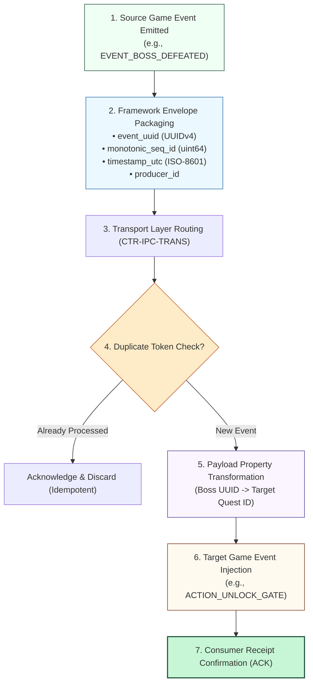
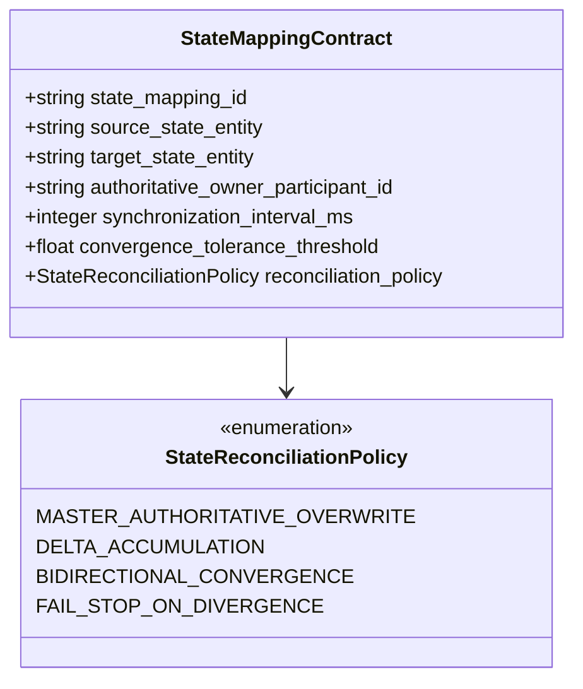

# Cross-Game Event & State Mapping Requirements

**Document ID:** `NLE-REQ-ESM-001`  
**Version:** `1.0.0`  
**Status:** `APPROVED REQUIREMENTS SPECIFICATION`  
**Phase:** `Phase 6 of 12 — Mashup Designer & Integration Planning`  
**Step:** `Step 47 of 100`  
**Classification:** `Event Semantics, Temporal Synchronization & State Mapping Specification`  
**Related Documents:**
- [CROSS_GAME_DATA_MAPPING_AND_TRANSFORMATION_SPECIFICATION.md](file:///d:/App%20Winrar%20Files/Nexludic%20Engine%20(working)/docs/mashup-designer/CROSS_GAME_DATA_MAPPING_AND_TRANSFORMATION_SPECIFICATION.md) (`NLE-SPC-DMT-001`)
- [INTEGRATION_ARCHITECTURE_DATA_AND_EVENT_FLOW_SPECIFICATION.md](file:///d:/App%20Winrar%20Files/Nexludic%20Engine%20(working)/docs/mashup-designer/INTEGRATION_ARCHITECTURE_DATA_AND_EVENT_FLOW_SPECIFICATION.md) (`NLE-SPC-DEF-001`)
- [CROSS_GAME_PROPERTY_AND_ATTRIBUTE_MAPPING_SPECIFICATION.md](file:///d:/App%20Winrar%20Files/Nexludic%20Engine%20(working)/docs/mashup-designer/CROSS_GAME_PROPERTY_AND_ATTRIBUTE_MAPPING_SPECIFICATION.md) (`NLE-SPC-PAM-001`)

---

## 1. Event Mapping Semantics & Ordering Governance

Cross-game gameplay integration often depends on event-driven triggers: an achievement in Game Atlas unlocking a dungeon gate in Game Orion, or a character death in Game Orion triggering a distress beacon in Game Atlas. 

The framework enforces strict temporal, ordering, and idempotency rules:

### Event Contract Requirements:
1. **Idempotency Invariant (`RUL-ESM-01`):** Every cross-game event payload must include an `event_uuid` and a `monotonic_seq_id`. If network jitter or process restart causes redelivery of a previously processed event, the target adapter acknowledges the frame but skips execution.
2. **Total FIFO Ordering per Channel (`RUL-ESM-02`):** Events transmitted along a specific functional channel (e.g. inventory transactions) must be delivered to the target game in strict first-in, first-out sequence. Out-of-order events are queued in a re-ordering buffer until preceding sequence numbers arrive.
3. **Missing Event Timeout (`RUL-ESM-03`):** If a missing sequence gap is not filled within $500\text{ ms}$, the re-ordering buffer drops the stale queue, logs `WARN_SEQUENCE_GAP_DETECTED`, and triggers an authoritative state resynchronization.

---

## 2. Cross-Game State Mapping & Consistency

State synchronization differs from event handling: state represents continuous or persistent condition (e.g. health points, player coordinates, inventory manifests).

### State Mapping Invariants:
1. **Single Authoritative Master (`RUL-ESM-04`):** For any synchronized state variable, exactly one game is designated as the master authority. The peer game maintains a follower mirror. Bidirectional peer-to-peer write conflicts are disallowed without an explicit convergence policy.
2. **Convergence Tolerance Bounds (`RUL-ESM-05`):** Continuous metrics (such as spatial coordinates) tolerate floating-point micro-drift. If the difference between master and mirror exceeds the configured `convergence_tolerance_threshold` (e.g. $> 0.5\text{ meters}$), the mirror is hard-snapped to the master's position.
3. **Staleness Invalidation (`RUL-ESM-06`):** If heartbeat telemetry indicates that no state updates have been received from the master game for $> 1,000\text{ ms}$, the mirror state is marked `STATE_STALE_UNAVAILABLE` and UI indicators reflect degraded connectivity.

---
*End of Specification — Document `NLE-REQ-ESM-001`.*
