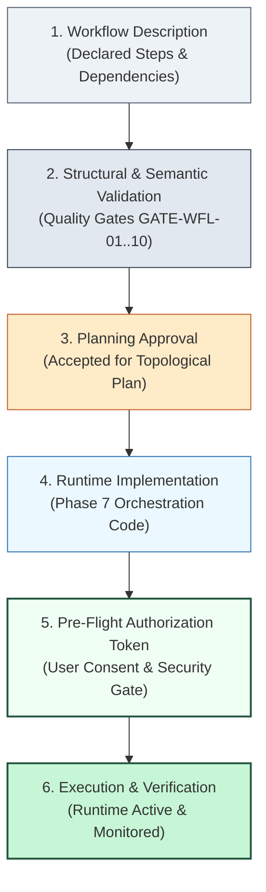

# Cross-Game Interaction Workflow & Sequencing Specification

**Document ID:** `NLE-SPC-IWS-001`  
**Version:** `1.0.0`  
**Status:** `APPROVED ARCHITECTURAL SPECIFICATION`  
**Phase:** `Phase 6 of 12 — Mashup Designer & Integration Planning`  
**Step:** `Step 48 of 100`  
**Classification:** `Core Interaction Workflow & Sequencing Specification`  
**Related Documents:**
- [CROSS_GAME_DATA_MAPPING_AND_TRANSFORMATION_SPECIFICATION.md](file:///d:/App%20Winrar%20Files/Nexludic%20Engine%20(working)/docs/mashup-designer/CROSS_GAME_DATA_MAPPING_AND_TRANSFORMATION_SPECIFICATION.md) (`NLE-SPC-DMT-001`)
- [INTEGRATION_ARCHITECTURE_BLUEPRINT_AND_COMPONENT_MAPPING_SPECIFICATION.md](file:///d:/App%20Winrar%20Files/Nexludic%20Engine%20(working)/docs/mashup-designer/INTEGRATION_ARCHITECTURE_BLUEPRINT_AND_COMPONENT_MAPPING_SPECIFICATION.md) (`NLE-SPC-IAB-001`)
- [INTEGRATION_STRATEGY_EVALUATION_AND_SELECTION_FRAMEWORK.md](file:///d:/App%20Winrar%20Files/Nexludic%20Engine%20(working)/docs/mashup-designer/INTEGRATION_STRATEGY_EVALUATION_AND_SELECTION_FRAMEWORK.md) (`NLE-SPC-ISE-001`)
- [MASHUP_REQUIREMENTS_ANALYSIS_AND_FEATURE_DECOMPOSITION_SPECIFICATION.md](file:///d:/App%20Winrar%20Files/Nexludic%20Engine%20(working)/docs/mashup-designer/MASHUP_REQUIREMENTS_ANALYSIS_AND_FEATURE_DECOMPOSITION_SPECIFICATION.md) (`NLE-SPC-MRD-001`)
- [UNIVERSAL_ADAPTER_SDK_CORE_SPECIFICATION.md](file:///d:/App%20Winrar%20Files/Nexludic%20Engine%20(working)/docs/adapters/UNIVERSAL_ADAPTER_SDK_CORE_SPECIFICATION.md) (`NLE-SPC-SDK-001`)
- [PHASE_5_PHASE_GATE_AND_EXIT_CRITERIA.md](file:///d:/App%20Winrar%20Files/Nexludic%20Engine%20(working)/docs/adapters/PHASE_5_PHASE_GATE_AND_EXIT_CRITERIA.md) (`NLE-GAT-PH5-001`)

---

## 1. Executive Summary & Purpose

The **Cross-Game Interaction Workflow & Sequencing Specification** establishes how **NexLudic Engine** formally models, validates, orders, and governs multi-step interactions between participating games and integration components to satisfy user mashup requirements.

A static architecture blueprint (Step 46) and declarative data mappings (Step 47) describe *what* components exist and *how* information is translated, but they do not define *when* interactions occur, in what sequence they execute, what prerequisites govern them, how decisions branch, or how the system safely recovers when an interaction fails or times out.

This specification provides the operational foundation for:
1. **Representing Interaction Workflows:** Defining an immutable, version-controlled workflow domain model (`InteractionWorkflowDescriptor`) bound to project revisions and architecture blueprints.
2. **Step Contracts & Preconditions:** Structuring discrete interaction steps with explicit preconditions, postconditions, responsible components, wire contracts, and expected observable outcomes.
3. **Dependency & Control-Flow Governance:** Specifying sequential execution, conditional branching, fork/join concurrency rules, and Kahn's algorithm cycle detection to guarantee Directed Acyclic Graph (DAG) ordering.
4. **Resilience, Timeouts & Compensation:** Defining deterministic timeout handling, cancellation propagation, retry safety with idempotency tokens, and non-destructive compensating actions.
5. **Security, Privacy & Sandboxing:** Enforcing Windows Medium Integrity Level sandboxing (`DEC-002`), Anti-Cheat Dominance (`BLK-SEC-01`), and Volume D persistence (`DEC-009`).

---

## 2. Epistemic Hierarchy & State Progression

To prevent architectural confusion between planning and execution, NexLudic Engine enforces a strict 6-stage progression:

### Governing Invariants:
1. **Description $\neq$ Execution (`RUL-IWS-01`):** A documented workflow is an engineering plan. It carries zero execution authority and does not start background IPC processes, modify game files, or dispatch network payloads.
2. **Action $\neq$ Permission (`RUL-IWS-02`):** Specifying an interaction in a workflow does not grant the security privilege to perform it. Operations requiring file staging or process hooking must satisfy explicit authorization gates (`NLE-SEC-WAT-001`).
3. **Single Responsibility Owner (`RUL-IWS-03`):** Every step in a workflow is assigned to exactly one authoritative component defined in the Step 46 catalog (`COMP_CORE_ORCHESTRATOR`, `COMP_ADAPTER_*`, `COMP_LIVE_BRIDGE_DAEMON`, `COMP_DATA_TRANSFORMER`, `COMP_RECOVERY_COORDINATOR`).

---

## 3. High-Level Interaction Workflow Topologies

The workflow model supports three primary operational topologies directly aligned with the approved integration strategies:

```mermaid
flowchart TD
    subgraph TopoHostMod["Topology A: Host-Game Modification Sequence (STRAT_HOST_MOD)"]
        InitA["Step 1: Staging Asset Manifest (Core)"] --> HookA["Step 2: Initialize Host Mod Loader (Host Ext)"]
        HookA --> IngestA["Step 3: Load Converted Guest Assets in Host Game"]
        IngestA --> LocalTick["Step 4: Execute Native Gameplay Script Tick (In-Process)"]
    end

    subgraph TopoBridge["Topology B: Live Bridge Synchronous Sequence (STRAT_LIVE_BRIDGE)"]
        InitB["Step 1: Handshake Adapters (Named Pipe CTR-SDK-WIRE)"] --> PollB["Step 2: Emit Telemetry Event (Adapter A)"]
        PollB --> RouteB["Step 3: Route & Transform Payload (Bridge + Transformer)"]
        RouteB --> InjectB["Step 4: Inject State into Game B (Adapter B)"]
        InjectB --> AckB["Step 5: Emit Receipt Acknowledgment (ACK)"]
    end

    subgraph TopoHybrid["Topology C: Hybrid Synchronized Sequence (STRAT_HYBRID)"]
        InitC["Step 1: Stage Host HUD Mod & Start Bridge Daemon"] --> HookC["Step 2: Dual Process Handshake"]
        HookC --> RenderC["Step 3: Render HUD Placeholder in Host Game"]
        HookC --> SyncC["Step 4: Stream Real-Time Guest Telemetry via Bridge"]
        RenderC --> MergeC["Step 5: Update Host HUD with Live Guest State"]
        SyncC --> MergeC
    end

    style TopoHostMod fill:#f0fff4,stroke:#22543d,stroke-width:1px
    style TopoBridge fill:#ebf8ff,stroke:#2b6cb0,stroke-width:1px
    style TopoHybrid fill:#fffaf0,stroke:#7b341e,stroke-width:1px
```

---

## 4. Platform Architectural Anchors

This specification conforms strictly to the governing decisions established in Volumes A through E:

1. **Volume D Persistence Sandbox (`DEC-009`):**  
   All workflow descriptors, sequencing manifests, and step transaction logs persist strictly under `D:\NexLudic\Projects\<project-id>\workflows\`.
2. **Windows Medium Integrity Level (`DEC-002`):**  
   All workflow models and future orchestration runners execute strictly within the standard user space. Administrative UAC elevation is barred.
3. **Anti-Cheat Dominance (`BLK-SEC-01`):**  
   Workflows cannot schedule steps that perform in-process injection, debugger attachment, or memory hooking into game binaries protected by active kernel-mode anti-cheat engines.
4. **Universal Core Agnosticism (`ADR-0002`):**  
   The Universal Core orchestrates workflow validation, dependency scheduling, and transaction boundaries; it contains zero game-specific code. Game-specific step logic is encapsulated within Adapters.

---

## 5. Scope Boundaries

This document defines interaction workflow standards and declarative contracts only:
- **Strictly Design-Only:** Contains zero executable workflow engines, zero schedulers, zero message dispatchers, and zero UI canvas components.
- **Zero Game Execution:** No commercial games are launched, hooked, or modified during workflow definition.
- **Zero Step 49 Leak:** Does not implement visual node wiring editors or interactive graph canvases.

---
*End of Specification — Document `NLE-SPC-IWS-001`.*
