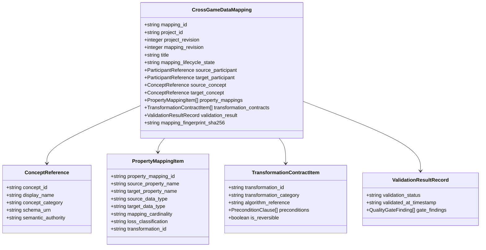
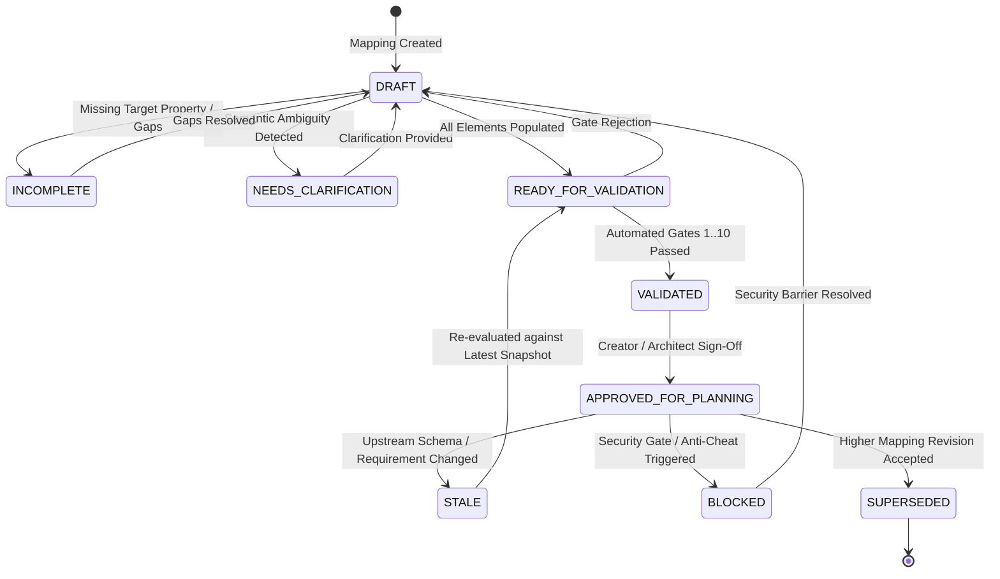

# Cross-Game Mapping Domain Model & Field Dictionary

**Document ID:** `NLE-MOD-DMD-001`  
**Version:** `1.0.0`  
**Status:** `APPROVED DOMAIN MODEL & SCHEMA SPECIFICATION`  
**Phase:** `Phase 6 of 12 — Mashup Designer & Integration Planning`  
**Step:** `Step 47 of 100`  
**Classification:** `Domain Entity Model & JSON Schema Specification`  
**Related Documents:**
- [CROSS_GAME_DATA_MAPPING_AND_TRANSFORMATION_SPECIFICATION.md](file:///d:/App%20Winrar%20Files/Nexludic%20Engine%20(working)/docs/mashup-designer/CROSS_GAME_DATA_MAPPING_AND_TRANSFORMATION_SPECIFICATION.md) (`NLE-SPC-DMT-001`)
- [INTEGRATION_ARCHITECTURE_BLUEPRINT_DOMAIN_MODEL.md](file:///d:/App%20Winrar%20Files/Nexludic%20Engine%20(working)/docs/mashup-designer/INTEGRATION_ARCHITECTURE_BLUEPRINT_DOMAIN_MODEL.md) (`NLE-MOD-ABD-001`)
- [MASHUP_PROJECT_SCHEMA_AND_DATA_DICTIONARY.md](file:///d:/App%20Winrar%20Files/Nexludic%20Engine%20(working)/docs/mashup-designer/MASHUP_PROJECT_SCHEMA_AND_DATA_DICTIONARY.md) (`NLE-CAT-MPD-001`)

---

## 1. Domain Entity Hierarchy & Conceptual Model

A **Cross-Game Data Mapping Specification** (`CrossGameDataMapping`) defines the declarative mapping between a source game concept and a target game concept:



---

## 2. Mapping Lifecycle State Machine

A data mapping transitions through nine formal states governed by structural, semantic, and evidence gates:



### Lifecycle State Definitions:
1. **`DRAFT`:** Mapping being defined; schema incomplete or properties unlinked.
2. **`INCOMPLETE`:** Contains missing required fields or unassigned mandatory properties.
3. **`NEEDS_CLARIFICATION`:** Ambiguity exists regarding property semantics, units, or fidelity loss.
4. **`READY_FOR_VALIDATION`:** Syntactically populated; ready for the 10 automated Quality Gates (`GATE-MAP-01..10`).
5. **`VALIDATED`:** Successfully passed all structural, type, semantic, constraint, and evidence gates.
6. **`APPROVED_FOR_PLANNING`:** Formally approved by creator/architect as the mapping baseline for Step 48 topological planning.
7. **`STALE`:** Upstream requirements, game builds, or adapter contracts updated; requires re-validation.
8. **`BLOCKED`:** Disqualified by hard security gate (e.g. anti-cheat detection or unapproved kernel hook).
9. **`SUPERSEDED`:** Replaced by a higher revision of the mapping specification.

---

## 3. Formal JSON Schema: `CrossGameDataMapping` (`NLE-SCH-DMT-001`)

```json
{
  "$schema": "https://json-schema.org/draft/2020-12/schema",
  "$id": "https://schemas.nexludic.internal/v1/cross-game-data-mapping.json",
  "title": "CrossGameDataMapping",
  "type": "object",
  "required": [
    "mapping_id",
    "project_id",
    "project_revision",
    "mapping_revision",
    "title",
    "mapping_lifecycle_state",
    "source_participant",
    "target_participant",
    "source_concept",
    "target_concept",
    "property_mappings",
    "transformation_contracts",
    "mapping_fingerprint_sha256"
  ],
  "properties": {
    "mapping_id": { "type": "string", "format": "uuid" },
    "project_id": { "type": "string", "format": "uuid" },
    "project_revision": { "type": "integer", "minimum": 1 },
    "mapping_revision": { "type": "integer", "minimum": 1 },
    "title": { "type": "string", "minLength": 1 },
    "description": { "type": "string" },
    "mapping_lifecycle_state": {
      "type": "string",
      "enum": [
        "DRAFT",
        "INCOMPLETE",
        "NEEDS_CLARIFICATION",
        "READY_FOR_VALIDATION",
        "VALIDATED",
        "APPROVED_FOR_PLANNING",
        "STALE",
        "BLOCKED",
        "SUPERSEDED"
      ]
    },
    "source_participant": { "$ref": "#/$defs/ParticipantRef" },
    "target_participant": { "$ref": "#/$defs/ParticipantRef" },
    "source_concept": { "$ref": "#/$defs/ConceptRef" },
    "target_concept": { "$ref": "#/$defs/ConceptRef" },
    "property_mappings": {
      "type": "array",
      "minItems": 1,
      "items": {
        "type": "object",
        "required": [
          "property_mapping_id",
          "source_property_name",
          "target_property_name",
          "source_data_type",
          "target_data_type",
          "mapping_cardinality",
          "loss_classification"
        ],
        "properties": {
          "property_mapping_id": { "type": "string", "pattern": "^PMAP_[A-Z0-9_]+$" },
          "source_property_name": { "type": "string" },
          "target_property_name": { "type": "string" },
          "source_data_type": { "type": "string" },
          "target_data_type": { "type": "string" },
          "mapping_cardinality": { "type": "string", "enum": ["ONE_TO_ONE", "ONE_TO_MANY", "MANY_TO_ONE", "CONDITIONAL"] },
          "loss_classification": { "type": "string", "enum": ["EXACT_PRESERVATION", "ADAPTED_LOSSLESS", "ADAPTED_LOSSY", "DROPPED_UNSUPPORTED"] },
          "transformation_id": { "type": ["string", "null"] }
        }
      }
    },
    "transformation_contracts": {
      "type": "array",
      "items": {
        "type": "object",
        "required": ["transformation_id", "transformation_category", "is_reversible"],
        "properties": {
          "transformation_id": { "type": "string", "pattern": "^XFRM_[A-Z0-9_]+$" },
          "transformation_category": {
            "type": "string",
            "enum": [
              "DIRECT_PASS_THROUGH",
              "REPRESENTATION_CONVERSION",
              "UNIT_CONVERSION",
              "RANGE_NORMALIZATION",
              "ENUMERATION_TRANSLATION",
              "IDENTIFIER_TRANSLATION",
              "SPATIAL_COORDINATE_MAPPING",
              "FIELD_SELECTION_PROJECTION",
              "MULTI_INPUT_COMBINATION",
              "CONDITIONAL_EVALUATION",
              "AGGREGATION_DECOMPOSITION",
              "CUSTOM_ALGORITHMIC_MAPPING"
            ]
          },
          "is_reversible": { "type": "boolean" },
          "preconditions": { "type": "array", "items": { "type": "string" } }
        }
      }
    },
    "mapping_fingerprint_sha256": { "type": "string", "pattern": "^[a-f0-9]{64}$" }
  },
  "$defs": {
    "ParticipantRef": {
      "type": "object",
      "required": ["canonical_game_id", "installed_build_id", "assigned_role"],
      "properties": {
        "canonical_game_id": { "type": "string", "format": "uuid" },
        "installed_build_id": { "type": "string" },
        "assigned_role": { "type": "string", "enum": ["HOST", "GUEST", "PEER"] }
      }
    },
    "ConceptRef": {
      "type": "object",
      "required": ["concept_id", "display_name", "concept_category", "schema_urn"],
      "properties": {
        "concept_id": { "type": "string" },
        "display_name": { "type": "string" },
        "concept_category": {
          "type": "string",
          "enum": ["INVENTORY_ITEM", "PLAYER_ENTITY", "SPATIAL_TRANSFORM", "GAME_EVENT", "UI_WIDGET", "ENVIRONMENT_METRIC"]
        },
        "schema_urn": { "type": "string" }
      }
    }
  }
}
```

---
*End of Model — Document `NLE-MOD-DMD-001`.*
