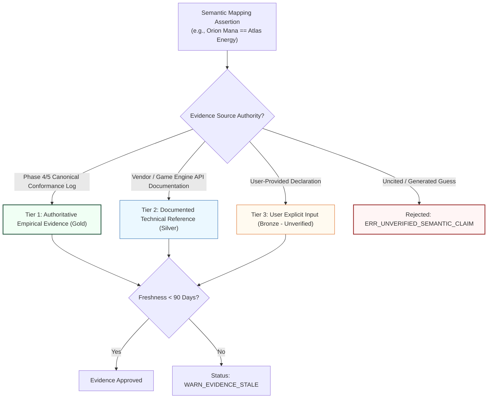
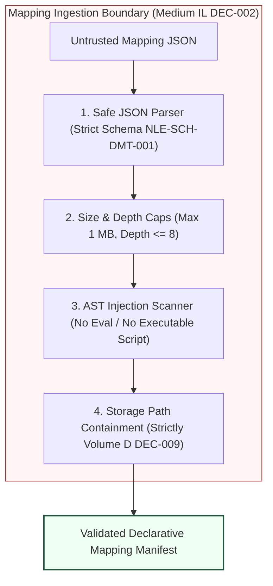

# Cross-Game Mapping Evidence, Security & Authorization Policy

**Document ID:** `NLE-POL-ESA-001`  
**Version:** `1.0.0`  
**Status:** `APPROVED ARCHITECTURAL POLICY`  
**Phase:** `Phase 6 of 12 — Mashup Designer & Integration Planning`  
**Step:** `Step 47 of 100`  
**Classification:** `Evidence Governance, Security Sandboxing & Authorization Specification`  
**Related Documents:**
- [CROSS_GAME_DATA_MAPPING_AND_TRANSFORMATION_SPECIFICATION.md](file:///d:/App%20Winrar%20Files/Nexludic%20Engine%20(working)/docs/mashup-designer/CROSS_GAME_DATA_MAPPING_AND_TRANSFORMATION_SPECIFICATION.md) (`NLE-SPC-DMT-001`)
- [CROSS_GAME_MAPPING_VALIDATION_AND_DIAGNOSTIC_CONTRACT.md](file:///d:/App%20Winrar%20Files/Nexludic%20Engine%20(working)/docs/mashup-designer/CROSS_GAME_MAPPING_VALIDATION_AND_DIAGNOSTIC_CONTRACT.md) (`NLE-CON-MVD-001`)
- [INTEGRATION_ARCHITECTURE_SECURITY_TRUST_AND_AUTHORIZATION_SPECIFICATION.md](file:///d:/App%20Winrar%20Files/Nexludic%20Engine%20(working)/docs/mashup-designer/INTEGRATION_ARCHITECTURE_SECURITY_TRUST_AND_AUTHORIZATION_SPECIFICATION.md) (`NLE-SEC-STA-001`)

---

## 1. Evidence Provenance & Conflict Resolution

Every semantic assertion, type mapping, and unit conversion must be grounded in verifiable empirical evidence. The framework strictly prohibits unsubstantiated assumptions:

### Conflicting Evidence Invariant (`RUL-ESA-01`):
If two authoritative evidence records contradict each other (e.g. Steam community wiki claims unit scale is $1.0\text{ m}$, but vendor patch notes state $0.5\text{ m}$), the validator **must never silently select the preferred claim**. The conflict is surfaced to the creator, and the mapping status is capped at `NEEDS_CLARIFICATION`.

---

## 2. Security Boundaries & Untrusted Data Ingestion

Mapping definitions (whether authored by users, imported from JSON manifests, or generated by assistant wizards) are formally classified as **Untrusted Data Inputs**:

### Security Invariants:
1. **Rule RUL-ESA-02 (Zero Executable Scripts):** Mapping contracts must be strictly declarative (JSON / Schema definitions). Embedding executable code, Python scripts, JavaScript expressions, or shell commands within transformation payloads is strictly prohibited (`ERR_EXECUTABLE_SCRIPT_INJECTION_BLOCKED`).
2. **Rule RUL-ESA-03 (Process Boundary Invariant):** Mapping validation operations execute out-of-process in standard user space. The mapping engine possesses zero permissions to attach debuggers, manipulate memory via `WriteProcessMemory`, or inject DLLs into participating games (`BLK-SEC-01`, `DEC-002`).
3. **Rule RUL-ESA-04 (Volume D Isolation):** All mapping manifests, validation caches, and sidecars must reside strictly on Volume D (`D:\NexLudic\Projects\<id>\mappings\`). Writing to Windows system directories or user desktop roots is blocked.

---

## 3. Privacy, Licensing & Asset Extraction Policy

1. **Local Privacy Mandate:** Mapping evaluations are 100% offline. No telemetry, game schemas, or project configurations are transmitted over the public internet.
2. **Asset Licensing Integrity:** When mappings involve static asset migration (e.g. textures or 3D meshes), the framework verifies that the source game's modding license permits offline file format transcoding. Proprietary commercial assets protected by DRM must not be extracted or decrypted without authorization.

---
*End of Policy — Document `NLE-POL-ESA-001`.*
