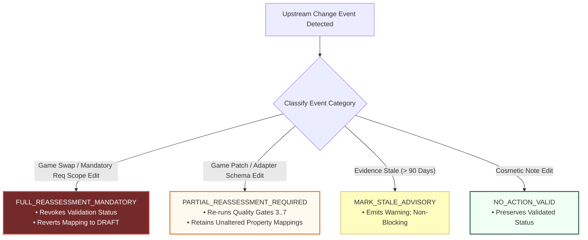

# Cross-Game Mapping Revision & Invalidation Policy

**Document ID:** `NLE-POL-MRI-001`  
**Version:** `1.0.0`  
**Status:** `APPROVED ARCHITECTURAL POLICY`  
**Phase:** `Phase 6 of 12 — Mashup Designer & Integration Planning`  
**Step:** `Step 47 of 100`  
**Classification:** `Mapping Revision Governance & Invalidation Specification`  
**Related Documents:**
- [CROSS_GAME_DATA_MAPPING_AND_TRANSFORMATION_SPECIFICATION.md](file:///d:/App%20Winrar%20Files/Nexludic%20Engine%20(working)/docs/mashup-designer/CROSS_GAME_DATA_MAPPING_AND_TRANSFORMATION_SPECIFICATION.md) (`NLE-SPC-DMT-001`)
- [CROSS_GAME_MAPPING_DOMAIN_MODEL_AND_FIELD_DICTIONARY.md](file:///d:/App%20Winrar%20Files/Nexludic%20Engine%20(working)/docs/mashup-designer/CROSS_GAME_MAPPING_DOMAIN_MODEL_AND_FIELD_DICTIONARY.md) (`NLE-MOD-DMD-001`)
- [INTEGRATION_ARCHITECTURE_REVISION_REVIEW_AND_INVALIDATION_POLICY.md](file:///d:/App%20Winrar%20Files/Nexludic%20Engine%20(working)/docs/mashup-designer/INTEGRATION_ARCHITECTURE_REVISION_REVIEW_AND_INVALIDATION_POLICY.md) (`NLE-POL-ARI-001`)

---

## 1. Invalidation Governance & Cascade Architecture

A cross-game data mapping specification remains valid only for the specific project snapshot, game binary builds, concept schemas, and evidence records under which it was validated. 

When any upstream dependency changes, the engine evaluates the change against the **Mapping Invalidation Cascade Matrix (`NLE-POL-MRI-001`)**:



---

## 2. The 8-Event Mapping Invalidation Cascade Matrix

| Event Code | Upstream Change Event Description | Impact on Data Mapping | Invalidation Action | Downstream Planning Impact |
| :--- | :--- | :--- | :--- | :--- |
| **`M-INV-01`** | Participating Game Added, Removed, or Swapped | Participant topology fundamentally altered | **`FULL_REASSESSMENT_MANDATORY`** | Clears mapping approval; halts Step 48. |
| **`M-INV-02`** | Game Executable Build Updated (Steam/Epic patch)| Entity schemas or memory offsets may change | **`PARTIAL_REASSESSMENT_REQUIRED`** | Re-validates concept schemas; pauses Step 48. |
| **`M-INV-03`** | Mandatory Requirement Added, Removed, or Edited | Scope of required mapped properties altered | **`FULL_REASSESSMENT_MANDATORY`** | Re-runs Gate 6 (Mandatory Alignment). |
| **`M-INV-04`** | Source or Target Concept Schema Updated in Adapter | Property types, units, or field names changed | **`PARTIAL_REASSESSMENT_REQUIRED`** | Re-runs Gates 2, 3, and 5 for affected fields. |
| **`M-INV-05`** | Adapter Version Upgraded or Capability Revoked | Underlying translation contract invalidated | **`FULL_REASSESSMENT_MANDATORY`** | Revokes `VALIDATED` status if adapter affected. |
| **`M-INV-06`** | Kernel Anti-Cheat Detected on clean game | In-process data extraction prohibited | **`MAPPING_REVOKED_BLOCKED`** | Immediately terminates hook-based mappings. |
| **`M-INV-07`** | Evidence Exceeds 90-Day Freshness Window | Provenance validity expired | **`MARK_STALE_ADVISORY`** | Prompts creator to refresh evidence verification. |
| **`M-INV-08`** | Non-Normative Description or Title Edit | Metadata only | **`NO_ACTION_VALID`** | Mapping remains valid and accepted. |

---

## 3. Revision Tracking & Historical Snapshot Preservation

1. **Monotonic Mapping Revision:** Every modification to a mapping descriptor increments `mapping_revision` by 1.
2. **Historical Snapshot Archiving (`DEC-009`):** Superseded mapping manifests are archived to:
   ```
   D:\NexLudic\Projects\<project-id>\mappings\history\<mapping-id>_rev<revision>.json
   ```
3. **Re-Validation Protocol:** Re-validating a `STALE` mapping re-runs the 10 Quality Gates. If all gates pass, the mapping state is restored to `VALIDATED`.

---
*End of Policy — Document `NLE-POL-MRI-001`.*
