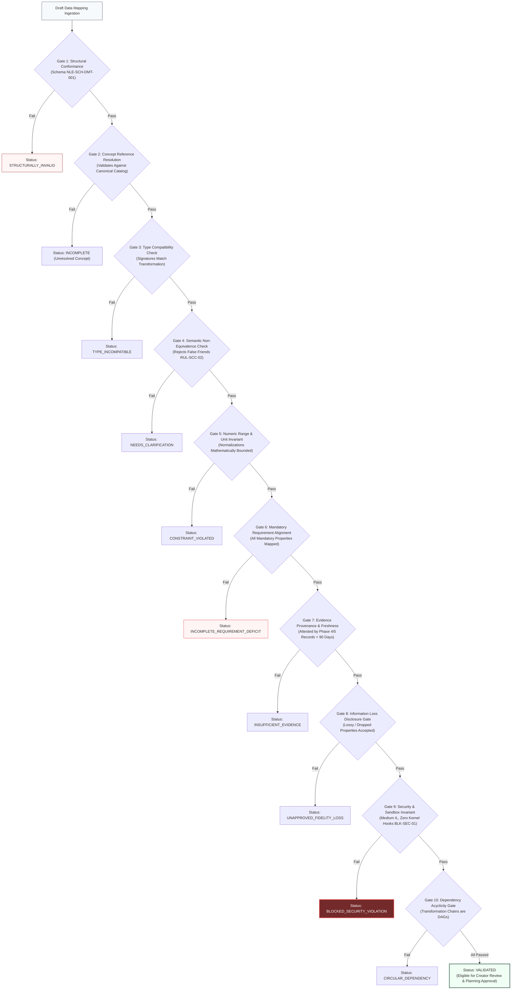

# Cross-Game Mapping Validation & Diagnostic Contract

**Document ID:** `NLE-CON-MVD-001`  
**Version:** `1.0.0`  
**Status:** `APPROVED CONTRACT SPECIFICATION`  
**Phase:** `Phase 6 of 12 — Mashup Designer & Integration Planning`  
**Step:** `Step 47 of 100`  
**Classification:** `Mapping Quality Gates, Validation Pipeline & Diagnostics Contract`  
**Related Documents:**
- [CROSS_GAME_DATA_MAPPING_AND_TRANSFORMATION_SPECIFICATION.md](file:///d:/App%20Winrar%20Files/Nexludic%20Engine%20(working)/docs/mashup-designer/CROSS_GAME_DATA_MAPPING_AND_TRANSFORMATION_SPECIFICATION.md) (`NLE-SPC-DMT-001`)
- [CROSS_GAME_MAPPING_DOMAIN_MODEL_AND_FIELD_DICTIONARY.md](file:///d:/App%20Winrar%20Files/Nexludic%20Engine%20(working)/docs/mashup-designer/CROSS_GAME_MAPPING_DOMAIN_MODEL_AND_FIELD_DICTIONARY.md) (`NLE-MOD-DMD-001`)
- [CROSS_GAME_TRANSFORMATION_CONTRACT_AND_COMPOSITION_RULES.md](file:///d:/App%20Winrar%20Files/Nexludic%20Engine%20(working)/docs/mashup-designer/CROSS_GAME_TRANSFORMATION_CONTRACT_AND_COMPOSITION_RULES.md) (`NLE-RUL-TCC-001`)

---

## 1. The 10-Layer Mapping Validation Pipeline

Before any mapping specification can be marked `VALIDATED` or approved for downstream integration planning, it must sequentially satisfy ten automated **Mapping Quality Gates (`GATE-MAP-01..10`)**:



---

## 2. Detailed Quality Gate Invariants

| Gate ID | Gate Name | Automated Verification Check | Rejection Code / Action |
| :--- | :--- | :--- | :--- |
| **`GATE-MAP-01`** | Structural Conformance | Full JSON validation against `NLE-SCH-DMT-001`. | `ERR_SCHEMA_VALIDATION_FAILED` |
| **`GATE-MAP-02`** | Concept Reference Resolution | Source and target concepts resolve in authoritative catalog. | `ERR_CONCEPT_REFERENCE_UNRESOLVED` |
| **`GATE-MAP-03`** | Type Compatibility | Source type matches transformation input; output matches target. | `ERR_TYPE_SIGNATURE_MISMATCH` |
| **`GATE-MAP-04`** | Semantic Non-Equivalence | Validates that identical names do not hide divergent mechanics. | `ERR_SEMANTIC_FALSE_FRIEND` |
| **`GATE-MAP-05`** | Constraint & Range Bounds | Output values mathematically bounded; units recognized in SI catalog. | `ERR_VALUE_OUT_OF_BOUNDS` |
| **`GATE-MAP-06`** | Requirement Alignment | Every mandatory requirement property achieves `EXACT` or `ADAPTED`. | `ERR_MANDATORY_PROPERTY_DROPPED` |
| **`GATE-MAP-07`** | Evidence Provenance | Supporting citations verified and fresh ($< 90\text{ days}$). | `ERR_EVIDENCE_STALE_OR_MISSING` |
| **`GATE-MAP-08`** | Loss Disclosure | Creator has accepted any lossy precision or dropped optional fields. | `ERR_UNACKNOWLEDGED_DATA_LOSS` |
| **`GATE-MAP-09`** | Security & Anti-Cheat | Zero kernel hooks; Medium IL sandboxing enforced (`BLK-SEC-01`). | `ERR_PROHIBITED_SECURITY_ASSUMPTION` |
| **`GATE-MAP-10`** | Transformation Acyclicity | Chained transformations form a Directed Acyclic Graph (Kahn DAG). | `ERR_TRANSFORMATION_CYCLE_DETECTED` |

---

## 3. Structured Mapping Diagnostic Schema

When validation detects an error, warning, or deficit, the validator outputs a structured diagnostic record conforming to the following schema:

```json
{
  "diagnostic_id": "DIAG_MAP_20261118_001",
  "mapping_id": "b3e2140a-5c12-4e89-9a74-d4b94f1c7e92",
  "property_mapping_id": "PMAP_ATLAS_RADIATION_TO_ORION",
  "gate_id": "GATE-MAP-06",
  "severity": "FATAL_BLOCKER",
  "error_code": "ERR_MANDATORY_PROPERTY_DROPPED",
  "summary": "Mandatory property 'radiation_level' cannot be dropped without creator consent",
  "detailed_explanation": "Requirement REQ-SURVIVAL-01 mandates that environmental hazards from Game Atlas must influence Game Orion. The target concept lacks a radiation property and no transformation contract was specified.",
  "source_context": {
    "concept_id": "CONCEPT_ATLAS_ATMOSPHERIC_HAZARD",
    "property_name": "radiation_level",
    "declared_type": "FLOAT32"
  },
  "target_context": {
    "concept_id": "CONCEPT_ORION_ENVIRONMENTAL_DEBUFF",
    "property_name": null,
    "declared_type": null
  },
  "remediation_guidance": "Specify an adapted transformation mapping radiation_level to Game Orion's 'poison_damage_per_sec' or adjust Requirement REQ-SURVIVAL-01 to mark radiation as optional."
}
```

---
*End of Contract — Document `NLE-CON-MVD-001`.*
