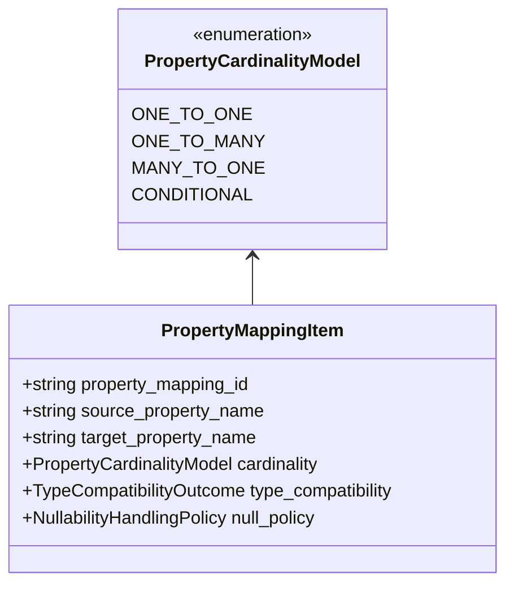

# Cross-Game Property & Attribute Mapping Specification

**Document ID:** `NLE-SPC-PAM-001`  
**Version:** `1.0.0`  
**Status:** `APPROVED PROPERTY MAPPING SPECIFICATION`  
**Phase:** `Phase 6 of 12 — Mashup Designer & Integration Planning`  
**Step:** `Step 47 of 100`  
**Classification:** `Attribute-Level Data Mapping & Cardinality Specification`  
**Related Documents:**
- [CROSS_GAME_DATA_MAPPING_AND_TRANSFORMATION_SPECIFICATION.md](file:///d:/App%20Winrar%20Files/Nexludic%20Engine%20(working)/docs/mashup-designer/CROSS_GAME_DATA_MAPPING_AND_TRANSFORMATION_SPECIFICATION.md) (`NLE-SPC-DMT-001`)
- [CROSS_GAME_MAPPING_DOMAIN_MODEL_AND_FIELD_DICTIONARY.md](file:///d:/App%20Winrar%20Files/Nexludic%20Engine%20(working)/docs/mashup-designer/CROSS_GAME_MAPPING_DOMAIN_MODEL_AND_FIELD_DICTIONARY.md) (`NLE-MOD-DMD-001`)
- [SOURCE_TARGET_CONCEPT_CORRESPONDENCE_AND_SEMANTIC_MAPPING_RULES.md](file:///d:/App%20Winrar%20Files/Nexludic%20Engine%20(working)/docs/mashup-designer/SOURCE_TARGET_CONCEPT_CORRESPONDENCE_AND_SEMANTIC_MAPPING_RULES.md) (`NLE-RUL-SCC-001`)

---

## 1. Property Mapping Cardinality Models

Every attribute mapping item operates under a formally declared cardinality relationship:

### Cardinality Specifications:
1. **One-to-One (`ONE_TO_ONE`):** Exactly one source attribute maps to exactly one target attribute (e.g. source `health_points` $\rightarrow$ target `current_hp`).
2. **One-to-Many (`ONE_TO_MANY`):** A single source attribute distributes across multiple target attributes (e.g. source `velocity_vector` $\rightarrow$ target `vel_x`, `vel_y`, `vel_z`).
3. **Many-to-One (`MANY_TO_ONE`):** Multiple source attributes combine to produce a single target value (e.g. source `base_damage` + `fire_bonus` $\rightarrow$ target `total_attack_power`).
4. **Conditional (`CONDITIONAL`):** Mapping selection depends on a boolean predicate evaluated against external context or state flags.

---

## 2. Type Compatibility Matrix

The framework enforces strict type compatibility checking before any property mapping can be validated:

| Source Data Type | Target Data Type | Compatibility Status | Permitted Conversion Mechanism | Potential Information Loss |
| :--- | :--- | :--- | :--- | :--- |
| `INT32` / `INT64` | `INT32` / `INT64` | **Fully Compatible** | Direct pass-through (bounds checked) | None (unless value exceeds target range) |
| `INT32` | `FLOAT32` / `FLOAT64` | **Lossless Conversion** | Numeric promotion | None |
| `FLOAT64` | `FLOAT32` | **Lossy Precision Conversion** | Down-casting / rounding | Precision loss beyond 7 decimal digits |
| `FLOAT32` / `FLOAT64` | `INT32` | **Lossy Truncation** | Explicit rounding / floor / ceil | Decimal fraction discarded |
| `ENUM_STRING` | `ENUM_STRING` | **Conditional Translation** | Explicit enumeration dictionary | Value dropped if unmapped in target enum |
| `STRING_IDENTIFIER` | `INT32_HASH` | **Irreversible Hash Translation** | Deterministic hash function (e.g. FNV-1a) | Reversibility lost; potential hash collision |
| `SPATIAL_VECTOR_3D` | `SPATIAL_VECTOR_3D` | **Coordinate Translation** | Coordinate frame & unit transform | Scaling / floating-point quantization error |

---

## 3. Nullability, Absence & Default Value Policy

NexLudic Engine enforces the **Zero Guesswork Default Invariant (`RUL-PAM-01`)**: an absent or null source property **must never be silently coerced to zero, false, or empty string** unless explicitly defined in the mapping contract.

| Observed Source Value State | Declared Property Status | Validator Handling | Transformation Action |
| :--- | :--- | :--- | :--- |
| `EXPLICIT_NULL` | Target accepts Null | Permitted | Propagate `null` to target field. |
| `EXPLICIT_NULL` | Target is Non-Nullable | Defect unless Default Specified | Apply verified contract default; else emit `ERR_NULL_COERCION_BLOCKED`. |
| `PROPERTY_MISSING` | Source Property Optional | Permitted | Omit target field from update payload. |
| `PROPERTY_MISSING` | Source Property Mandatory | **Critical Defect** | Halt transformation; emit `ERR_MANDATORY_PROPERTY_MISSING`. |
| `OUT_OF_BOUNDS_VALUE` | Clamping Policy Enabled | Permitted with Warning | Clamp to $[min, max]$; log `WARN_VALUE_CLAMPED`. |
| `OUT_OF_BOUNDS_VALUE` | Strict Policy (No Clamping) | **Critical Defect** | Reject payload; emit `ERR_VALUE_OUT_OF_BOUNDS`. |

---
*End of Specification — Document `NLE-SPC-PAM-001`.*
