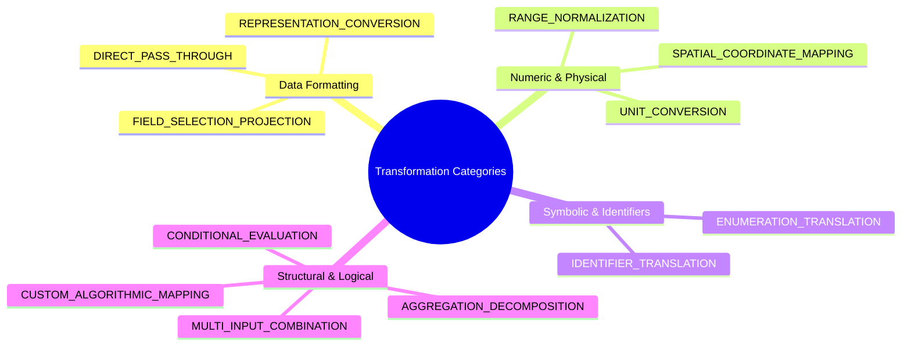

# Cross-Game Transformation Contract & Composition Rules

**Document ID:** `NLE-RUL-TCC-001`  
**Version:** `1.0.0`  
**Status:** `APPROVED TRANSFORMATION RULES & CONTRACT SPECIFICATION`  
**Phase:** `Phase 6 of 12 — Mashup Designer & Integration Planning`  
**Step:** `Step 47 of 100`  
**Classification:** `Transformation Semantics, Contracts & Composition Specification`  
**Related Documents:**
- [CROSS_GAME_DATA_MAPPING_AND_TRANSFORMATION_SPECIFICATION.md](file:///d:/App%20Winrar%20Files/Nexludic%20Engine%20(working)/docs/mashup-designer/CROSS_GAME_DATA_MAPPING_AND_TRANSFORMATION_SPECIFICATION.md) (`NLE-SPC-DMT-001`)
- [CROSS_GAME_PROPERTY_AND_ATTRIBUTE_MAPPING_SPECIFICATION.md](file:///d:/App%20Winrar%20Files/Nexludic%20Engine%20(working)/docs/mashup-designer/CROSS_GAME_PROPERTY_AND_ATTRIBUTE_MAPPING_SPECIFICATION.md) (`NLE-SPC-PAM-001`)
- [CROSS_GAME_REQUIREMENT_SEMANTICS_AND_PARTICIPANT_MAPPING.md](file:///d:/App%20Winrar%20Files/Nexludic%20Engine%20(working)/docs/mashup-designer/CROSS_GAME_REQUIREMENT_SEMANTICS_AND_PARTICIPANT_MAPPING.md) (`NLE-SPC-CRS-001`)

---

## 1. The 12 Formal Transformation Categories

A transformation contract (`TransformationContractItem`) specifies the mathematical or logical algorithm applied to source inputs to produce target outputs. The framework supports twelve standardized categories:



### Category Definitions:
1. **`DIRECT_PASS_THROUGH`:** Unmodified bitwise or value copy when schemas and units are identical.
2. **`REPRESENTATION_CONVERSION`:** Format translation without semantic change (e.g. JSON string to binary buffer, or Unix epoch to ISO-8601).
3. **`UNIT_CONVERSION`:** Linear or dimensional transformation between physical units (e.g. pounds to kilograms, miles/hour to meters/second).
4. **`RANGE_NORMALIZATION`:** Rescaling a numeric value from source interval $[S_{min}, S_{max}]$ to target interval $[T_{min}, T_{max}]$.
5. **`ENUMERATION_TRANSLATION`:** Explicit dictionary mapping between discrete symbol sets (e.g. `{COMMON, RARE, EPIC}` $\rightarrow$ `{TIER_1, TIER_2, TIER_3}`).
6. **`IDENTIFIER_TRANSLATION`:** Mapping cross-game entity keys via a lookup table or deterministic UUID derivation.
7. **`SPATIAL_COORDINATE_MAPPING`:** 3D affine transformation (translation, rotation, scale) between divergent coordinate frames (e.g. Y-up left-handed to Z-up right-handed).
8. **`FIELD_SELECTION_PROJECTION`:** Extracting a subset of fields from a composite object while omitting non-pertinent metadata.
9. **`MULTI_INPUT_COMBINATION`:** Evaluating a multi-variable formula over multiple input properties to yield a single target property.
10. **`CONDITIONAL_EVALUATION`:** Selecting output values or branch transformations based on runtime boolean predicates.
11. **`AGGREGATION_DECOMPOSITION`:** Splitting composite objects into primitive components or grouping primitives into a parent container.
12. **`CUSTOM_ALGORITHMIC_MAPPING`:** Complex domain-specific translation logic verified by an approved adapter extension contract.

---

## 2. Transformation Contract Structure

Every transformation contract must satisfy the 16-point contract schema:

```json
{
  "transformation_id": "XFRM_ATLAS_TO_ORION_ORE_SCALING",
  "category": "UNIT_CONVERSION",
  "purpose": "Converts raw mining ore weight in kilograms into equivalent refined crystal count",
  "source_inputs": [
    { "name": "ore_weight_kg", "type": "FLOAT32", "range": [0.1, 1000.0] }
  ],
  "expected_output": {
    "name": "crystal_count",
    "type": "INT32",
    "range": [1, 100]
  },
  "preconditions": [
    "Input ore_weight_kg must be strictly positive",
    "Player character must possess mining license flag"
  ],
  "transformation_semantics": "crystal_count = clamp(floor(ore_weight_kg * 0.1), 1, 100)",
  "assumptions": [
    "Conversion ratio remains constant at 10:1 across game sessions"
  ],
  "missing_input_behavior": "HALT_WITH_ERROR",
  "invalid_input_behavior": "CLAMP_TO_BOUNDS",
  "is_deterministic": true,
  "is_reversible": false,
  "loss_classification": "ADAPTED_LOSSY",
  "contract_dependency_ref": "CTR-SEM-XFRM",
  "validation_rules": ["RULE-TCC-01", "RULE-TCC-02"]
}
```

---

## 3. Transformation Chaining & Composition Rules

When multiple transformations compose sequentially ($T_1 \rightarrow T_2 \rightarrow T_3$), the engine enforces four compositional invariants:


### Invariant Rules:
1. **Type Signature Compatibility (`RUL-TCC-01`):** For any chain $T_a \rightarrow T_b$, the output data type of $T_a$ must be strictly assignable to the expected input data type of $T_b$. Mismatches fail validation (`ERR_CHAIN_TYPE_INCOMPATIBILITY`).
2. **Acyclic Composition (`RUL-TCC-02`):** Transformation chains must be strictly feed-forward Directed Acyclic Graphs (DAGs). Circular feedback loops within a transformation chain are prohibited (`ERR_TRANSFORMATION_CYCLE_DETECTED`).
3. **Cumulative Loss Tracking (`RUL-TCC-03`):** If any stage in a chain is classified as `ADAPTED_LOSSY`, the entire composition is marked `ADAPTED_LOSSY`. A lossy stage permanently breaks downstream reversibility.
4. **Deterministic Reproducibility (`RUL-TCC-04`):** Transformations must not depend on ambient system clock, unseeded pseudorandomness, or non-deterministic hash table iteration. Given the same inputs, the output must be bit-identical.

---
*End of Rules — Document `NLE-RUL-TCC-001`.*
