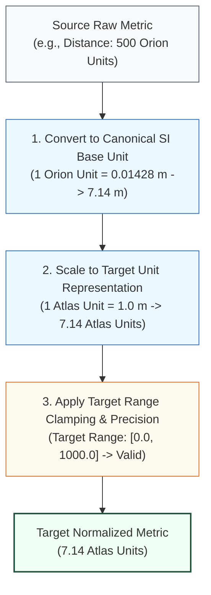
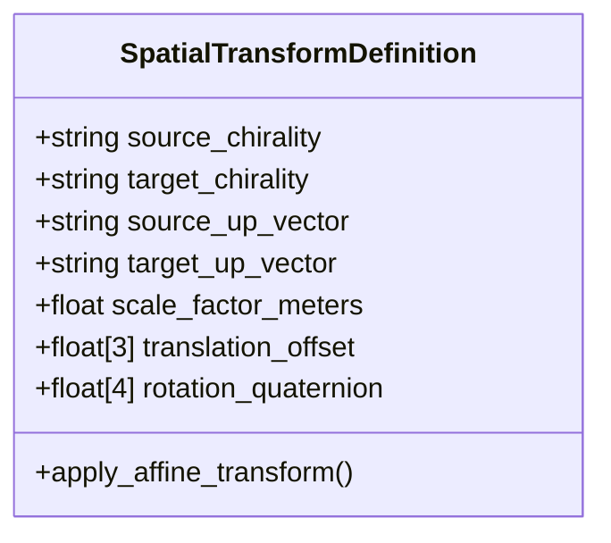
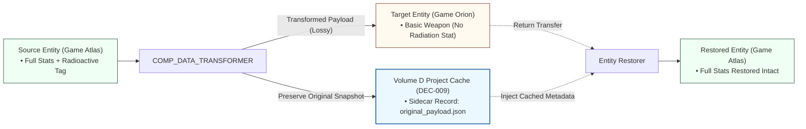

# Cross-Game Units, Normalization & Information Fidelity Policy

**Document ID:** `NLE-POL-UNF-001`  
**Version:** `1.0.0`  
**Status:** `APPROVED ARCHITECTURAL POLICY`  
**Phase:** `Phase 6 of 12 — Mashup Designer & Integration Planning`  
**Step:** `Step 47 of 100`  
**Classification:** `Units Governance, Spatial Normalization & Fidelity Policy`  
**Related Documents:**
- [CROSS_GAME_DATA_MAPPING_AND_TRANSFORMATION_SPECIFICATION.md](file:///d:/App%20Winrar%20Files/Nexludic%20Engine%20(working)/docs/mashup-designer/CROSS_GAME_DATA_MAPPING_AND_TRANSFORMATION_SPECIFICATION.md) (`NLE-SPC-DMT-001`)
- [CROSS_GAME_REQUIREMENT_SEMANTICS_AND_PARTICIPANT_MAPPING.md](file:///d:/App%20Winrar%20Files/Nexludic%20Engine%20(working)/docs/mashup-designer/CROSS_GAME_REQUIREMENT_SEMANTICS_AND_PARTICIPANT_MAPPING.md) (`NLE-SPC-CRS-001`)
- [CROSS_GAME_TRANSFORMATION_CONTRACT_AND_COMPOSITION_RULES.md](file:///d:/App%20Winrar%20Files/Nexludic%20Engine%20(working)/docs/mashup-designer/CROSS_GAME_TRANSFORMATION_CONTRACT_AND_COMPOSITION_RULES.md) (`NLE-RUL-TCC-001`)

---

## 1. Physical Units & Normalization Framework

Video games employ vastly disparate unit systems. A coordinate unit in Game Atlas may equal 1 meter, while in Game Orion 1 unit represents 1.428 centimeters. The framework establishes standardized mathematical normalization models for physical dimensions:

### Physical Dimension Categories:
- **Mass & Weight:** Grams ($g$), Kilograms ($kg$), Pounds ($lbs$), Game-specific inventory slots.
- **Distance & Spatial Scale:** Millimeters ($mm$), Meters ($m$), Kilometers ($km$), Engine-specific units.
- **Velocity & Speed:** Meters/second ($m/s$), Kilometers/hour ($km/h$), Miles/hour ($mph$).
- **Time & Duration:** Ticks ($1/60\text{ s}$, $1/144\text{ s}$), Milliseconds ($ms$), Seconds ($s$).
- **Angles & Orientation:** Radians ($rad$), Degrees ($deg$), Quaternions ($x, y, z, w$), Euler angles ($yaw, pitch, roll$).

---

## 2. Spatial Coordinate System Transformation

When mapping 3D positions, orientations, or vectors across engines, the transformation must account for three fundamental divergence vectors:
1. **Chirality (Handedness):** Left-handed vs. Right-handed coordinate frames.
2. **Up-Vector Convention:** Y-up (e.g. Unity, Godot) vs. Z-up (e.g. Unreal Engine, Havok physics).
3. **World Origin & Bounds:** Local offset anchors vs. world-space absolute floating-point coordinates.

### Spatial Mapping Invariants:
- **Rule RUL-UNF-01 (Chirality Inversion):** When transforming from a left-handed frame to a right-handed frame, exactly one axis (typically the Z-axis or X-axis, as defined by the engine matrix) must be inverted. Omitting chirality transformation causes mirrored geometry and reversed steering controls.
- **Rule RUL-UNF-02 (Quaternion Normalization):** All rotation transformations must re-normalize output quaternions ($\sqrt{x^2 + y^2 + z^2 + w^2} = 1.0$) to prevent floating-point skew and rendering degeneration.

---

## 3. Information Fidelity & Loss Classification

In accordance with `NLE-SPC-CRS-001`, every property mapping is classified into one of four formal fidelity tiers:

| Fidelity Tier | Definition & Semantic Implication | Reversibility Status | User Disclosure Requirement |
| :--- | :--- | :---: | :--- |
| **`EXACT_PRESERVATION`** | Value preserved with 100% bitwise identity or exact mathematical isomorphism. | **`REVERSIBLE`** | None (Fully transparent). |
| **`ADAPTED_LOSSLESS`** | Representation changed (e.g. enum translation, unit scaling) with zero semantic information lost. | **`REVERSIBLE`** | Low (Documented in blueprint). |
| **`ADAPTED_LOSSY`** | Meaning preserved, but precision truncated, ranges clamped, or nuances simplified. | **`NON_REVERSIBLE`** | **Mandatory Warning** (Creator must accept loss). |
| **`DROPPED_UNSUPPORTED`** | Source property completely omitted because target lacks equivalent representation. | **`NON_REVERSIBLE`** | **Mandatory Consent** (Blocked if mandatory requirement). |

---

## 4. Reversibility & Sidecar Metadata Governance

When a mapping involves a lossy transformation ($T: S \rightarrow T_{lossy}$), but downstream gameplay requires restoring the original entity upon returning to the host game:

### Invariant Rules:
1. **Rule RUL-UNF-03 (Sidecar Preservation):** If a requirement mandates round-trip preservation across a lossy game pair, the architecture must store the original unquantized source payload in the Volume D sidecar store (`D:\NexLudic\Projects\<id>\mappings\sidecars\`).
2. **Rule RUL-UNF-04 (Mandatory Loss Rejection):** If a user requirement classifies a property as `MANDATORY` and `EXACT_PRESERVATION`, but the target game can only support `ADAPTED_LOSSY` or `DROPPED_UNSUPPORTED`, the mapping validator rejects the mapping (`ERR_FIDELITY_REQUIREMENT_UNMET`). The user must either accept the loss or adjust the requirement.

---
*End of Policy — Document `NLE-POL-UNF-001`.*
