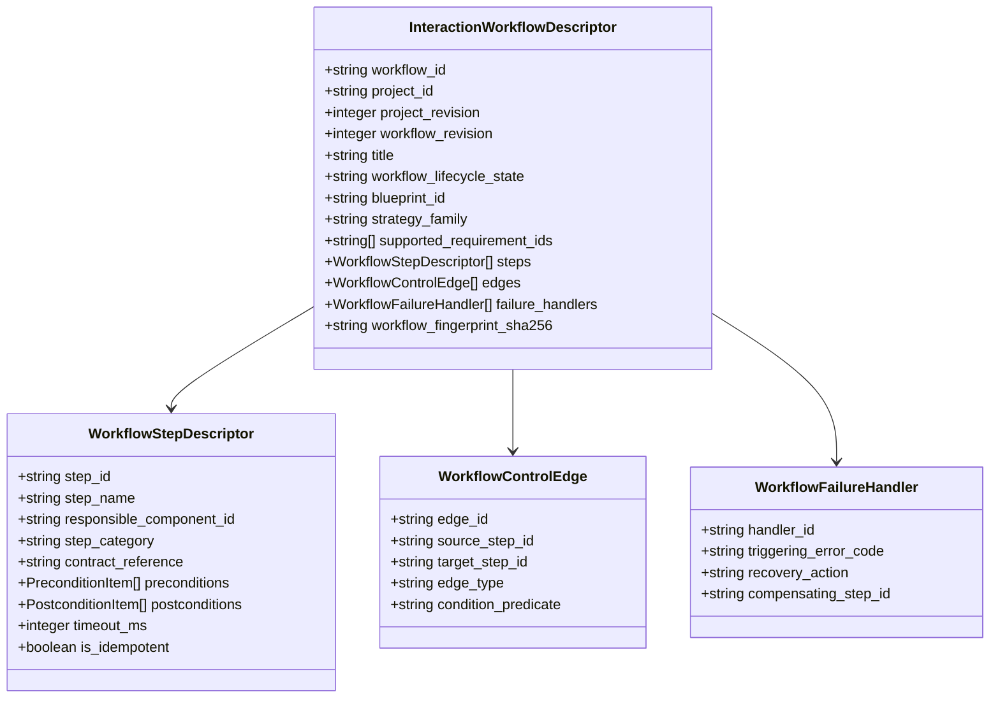
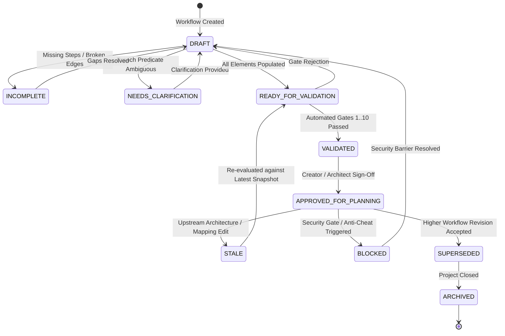

# Cross-Game Workflow Domain Model & Lifecycle

**Document ID:** `NLE-MOD-WDL-001`  
**Version:** `1.0.0`  
**Status:** `APPROVED DOMAIN MODEL & SCHEMA SPECIFICATION`  
**Phase:** `Phase 6 of 12 — Mashup Designer & Integration Planning`  
**Step:** `Step 48 of 100`  
**Classification:** `Domain Entity Model & JSON Schema Specification`  
**Related Documents:**
- [CROSS_GAME_INTERACTION_WORKFLOW_AND_SEQUENCING_SPECIFICATION.md](file:///d:/App%20Winrar%20Files/Nexludic%20Engine%20(working)/docs/mashup-designer/CROSS_GAME_INTERACTION_WORKFLOW_AND_SEQUENCING_SPECIFICATION.md) (`NLE-SPC-IWS-001`)
- [INTEGRATION_ARCHITECTURE_BLUEPRINT_DOMAIN_MODEL.md](file:///d:/App%20Winrar%20Files/Nexludic%20Engine%20(working)/docs/mashup-designer/INTEGRATION_ARCHITECTURE_BLUEPRINT_DOMAIN_MODEL.md) (`NLE-MOD-ABD-001`)
- [CROSS_GAME_MAPPING_DOMAIN_MODEL_AND_FIELD_DICTIONARY.md](file:///d:/App%20Winrar%20Files/Nexludic%20Engine%20(working)/docs/mashup-designer/CROSS_GAME_MAPPING_DOMAIN_MODEL_AND_FIELD_DICTIONARY.md) (`NLE-MOD-DMD-001`)

---

## 1. Domain Entity Hierarchy & Conceptual Model

An **Interaction Workflow Descriptor** (`InteractionWorkflowDescriptor`) defines an ordered, verifiable sequence of interactions designed to realize one or more cross-game feature requirements:



---

## 2. Workflow Lifecycle State Machine

A workflow transitions through ten formal states governed by structural, semantic, and security gates:



### Lifecycle State Definitions:
1. **`DRAFT`:** Workflow being drafted; sequence incomplete or unlinked.
2. **`INCOMPLETE`:** Contains dangling step references or unmapped mandatory requirements.
3. **`NEEDS_CLARIFICATION`:** Branch conditions or timeout behaviors lack clear definitions.
4. **`READY_FOR_VALIDATION`:** Syntactically populated; ready for the 10 automated Quality Gates (`GATE-WFL-01..10`).
5. **`VALIDATED`:** Successfully passed all structural, dependency DAG, contract, and evidence checks.
6. **`APPROVED_FOR_PLANNING`:** Formally approved by creator/architect as the workflow baseline for Step 49 topological planning.
7. **`STALE`:** Upstream requirements, game builds, architecture blueprints, or data mappings updated; requires re-validation.
8. **`BLOCKED`:** Disqualified by hard security gate (e.g. anti-cheat detection or unapproved kernel hook).
9. **`SUPERSEDED`:** Replaced by a higher revision of the workflow specification.
10. **`ARCHIVED`:** Read-only historical record retained for audit traceability under `DEC-009`.

---

## 3. Formal JSON Schema: `InteractionWorkflowDescriptor` (`NLE-SCH-IWS-001`)

```json
{
  "$schema": "https://json-schema.org/draft/2020-12/schema",
  "$id": "https://schemas.nexludic.internal/v1/interaction-workflow-descriptor.json",
  "title": "InteractionWorkflowDescriptor",
  "type": "object",
  "required": [
    "workflow_id",
    "project_id",
    "project_revision",
    "workflow_revision",
    "title",
    "workflow_lifecycle_state",
    "blueprint_id",
    "strategy_family",
    "supported_requirement_ids",
    "steps",
    "edges",
    "failure_handlers",
    "workflow_fingerprint_sha256"
  ],
  "properties": {
    "workflow_id": { "type": "string", "format": "uuid" },
    "project_id": { "type": "string", "format": "uuid" },
    "project_revision": { "type": "integer", "minimum": 1 },
    "workflow_revision": { "type": "integer", "minimum": 1 },
    "title": { "type": "string", "minLength": 1 },
    "description": { "type": "string" },
    "workflow_lifecycle_state": {
      "type": "string",
      "enum": [
        "DRAFT",
        "INCOMPLETE",
        "NEEDS_CLARIFICATION",
        "READY_FOR_VALIDATION",
        "VALIDATED",
        "APPROVED_FOR_PLANNING",
        "STALE",
        "BLOCKED",
        "SUPERSEDED",
        "ARCHIVED"
      ]
    },
    "blueprint_id": { "type": "string", "format": "uuid" },
    "strategy_family": { "type": "string", "enum": ["STRAT_HOST_MOD", "STRAT_LIVE_BRIDGE", "STRAT_HYBRID"] },
    "supported_requirement_ids": { "type": "array", "minItems": 1, "items": { "type": "string" } },
    "steps": {
      "type": "array",
      "minItems": 1,
      "items": {
        "type": "object",
        "required": [
          "step_id",
          "step_name",
          "responsible_component_id",
          "step_category",
          "contract_reference",
          "timeout_ms",
          "is_idempotent"
        ],
        "properties": {
          "step_id": { "type": "string", "pattern": "^STEP_[A-Z0-9_]+$" },
          "step_name": { "type": "string" },
          "responsible_component_id": { "type": "string", "pattern": "^COMP_[A-Z0-9_]+$" },
          "step_category": {
            "type": "string",
            "enum": [
              "INITIALIZATION_HANDSHAKE",
              "EVENT_EMISSION",
              "PAYLOAD_TRANSFORMATION",
              "STATE_INJECTION",
              "TELEMETRY_POLL",
              "USER_CONFIRMATION",
              "RECOVERY_COMPENSATION"
            ]
          },
          "contract_reference": { "type": "string" },
          "mapping_reference_id": { "type": ["string", "null"] },
          "timeout_ms": { "type": "integer", "minimum": 10, "maximum": 60000 },
          "is_idempotent": { "type": "boolean" },
          "preconditions": { "type": "array", "items": { "type": "string" } },
          "postconditions": { "type": "array", "items": { "type": "string" } }
        }
      }
    },
    "edges": {
      "type": "array",
      "items": {
        "type": "object",
        "required": ["edge_id", "source_step_id", "target_step_id", "edge_type"],
        "properties": {
          "edge_id": { "type": "string", "pattern": "^EDGE_[A-Z0-9_]+$" },
          "source_step_id": { "type": "string" },
          "target_step_id": { "type": "string" },
          "edge_type": {
            "type": "string",
            "enum": [
              "SEQUENTIAL_THEN",
              "CONDITIONAL_TRUE",
              "CONDITIONAL_FALSE",
              "PARALLEL_FORK",
              "SYNCHRONIZING_JOIN",
              "FAILURE_FALLBACK"
            ]
          },
          "condition_predicate": { "type": ["string", "null"] }
        }
      }
    },
    "failure_handlers": {
      "type": "array",
      "items": {
        "type": "object",
        "required": ["handler_id", "triggering_error_code", "recovery_action"],
        "properties": {
          "handler_id": { "type": "string", "pattern": "^FAIL_[A-Z0-9_]+$" },
          "triggering_error_code": { "type": "string" },
          "recovery_action": { "type": "string", "enum": ["RETRY_STEP", "EXECUTE_COMPENSATION", "DEGRADE_GRACEFULLY", "ABORT_WORKFLOW"] },
          "compensating_step_id": { "type": ["string", "null"] }
        }
      }
    },
    "workflow_fingerprint_sha256": { "type": "string", "pattern": "^[a-f0-9]{64}$" }
  }
}
```

---
*End of Model — Document `NLE-MOD-WDL-001`.*
