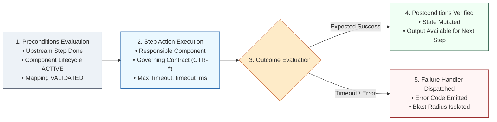

# Cross-Game Workflow Step & Interaction Contract

**Document ID:** `NLE-CON-WSI-001`  
**Version:** `1.0.0`  
**Status:** `APPROVED CONTRACT SPECIFICATION`  
**Phase:** `Phase 6 of 12 — Mashup Designer & Integration Planning`  
**Step:** `Step 48 of 100`  
**Classification:** `Step Interaction Contracts, Preconditions & Observability Specification`  
**Related Documents:**
- [CROSS_GAME_INTERACTION_WORKFLOW_AND_SEQUENCING_SPECIFICATION.md](file:///d:/App%20Winrar%20Files/Nexludic%20Engine%20(working)/docs/mashup-designer/CROSS_GAME_INTERACTION_WORKFLOW_AND_SEQUENCING_SPECIFICATION.md) (`NLE-SPC-IWS-001`)
- [CROSS_GAME_WORKFLOW_DOMAIN_MODEL_AND_LIFECYCLE.md](file:///d:/App%20Winrar%20Files/Nexludic%20Engine%20(working)/docs/mashup-designer/CROSS_GAME_WORKFLOW_DOMAIN_MODEL_AND_LIFECYCLE.md) (`NLE-MOD-WDL-001`)
- [INTEGRATION_COMPONENT_INTERFACE_AND_CONTRACT_REFERENCE_SPECIFICATION.md](file:///d:/App%20Winrar%20Files/Nexludic%20Engine%20(working)/docs/mashup-designer/INTEGRATION_COMPONENT_INTERFACE_AND_CONTRACT_REFERENCE_SPECIFICATION.md) (`NLE-SPC-ICI-001`)

---

## 1. Step Architecture & Contract Decomposition

Every discrete action in an interaction workflow is defined as an isolated, auditable execution unit: `WorkflowStepDescriptor`. 

A step encapsulates all input prerequisites, behavioral contracts, data mappings, timeouts, and expected observable outcomes:



---

## 2. Seven Step Categories

The framework classifies all interaction steps into seven standardized categories:

| Step Category Code | Category Scope & Description | Responsible Component Class | Governing Contract | Typical Timeout |
| :--- | :--- | :--- | :--- | :---: |
| **`INITIALIZATION_HANDSHAKE`** | Bootstrapping adapter channels, verifying readiness, and establishing IPC sessions. | `COMP_CORE_ORCHESTRATOR` | `CTR-SDK-WIRE` (`NLE-CON-AIR-001`) | $5,000\text{ ms}$ |
| **`EVENT_EMISSION`** | Capturing an in-game trigger or state change and dispatching a framed event envelope. | `COMP_ADAPTER_*` | `CTR-IPC-TRANS` (`ADR-0009`) | $50\text{ ms}$ |
| **`PAYLOAD_TRANSFORMATION`** | Applying mathematical, unit, or schema conversions to event payloads. | `COMP_DATA_TRANSFORMER` | `CTR-SEM-XFRM` (`NLE-SPC-DMT-001`) | $10\text{ ms}$ |
| **`STATE_INJECTION`** | Updating target game entity properties, spawning items, or modifying memory state. | `COMP_ADAPTER_*` | Host Mod API / Live Pipe | $100\text{ ms}$ |
| **`TELEMETRY_POLL`** | Querying health status, pinging heartbeats, or reading high-frequency spatial vectors. | `COMP_DIAGNOSTICS_MONITOR` | `CTR-DIA-TELE` (`NLE-SPC-ALC-001`) | $16\text{ ms}$ (60 Hz) |
| **`USER_CONFIRMATION`** | Halting workflow to present an explicit decision, consent prompt, or branch choice to user. | `COMP_CORE_ORCHESTRATOR` | Mashup Designer UI Bus | $60,000\text{ ms}$ (Configurable)|
| **`RECOVERY_COMPENSATION`** | Executing rollback manifests, reversing partial actions, or resetting states. | `COMP_RECOVERY_COORDINATOR`| Internal Recovery Engine | $2,000\text{ ms}$ |

---

## 3. Precondition & Postcondition Governance

NexLudic Engine enforces the **Explicit Verification Invariant (`RUL-WSI-01`)**: a step cannot proceed based on assumed conditions. Every prerequisite must be verified against live state:

### Precondition Invariant Rules:
1. **Component Readiness (`PRE-01`):** The responsible component must be in lifecycle state `ACTIVE` or `READY`. If in `INITIALIZING`, `DEGRADED`, or `FAULTED`, the step is blocked (`ERR_COMPONENT_NOT_READY`).
2. **Mapping Freshness (`PRE-02`):** If the step depends on a cross-game data mapping (`mapping_reference_id`), the referenced mapping must be in state `VALIDATED` and its input evidence must be fresh ($< 90\text{ days}$).
3. **Data Availability (`PRE-03`):** All declared input parameters must be present in the workflow execution context. Missing mandatory inputs immediately halt execution (`ERR_STEP_INPUT_DEFICIT`).

### Postcondition Invariant Rules:
1. **Receipt Acknowledgment (`POST-01`):** Network or IPC dispatches must receive a positive acknowledgment (`ACK`) from the target adapter within `timeout_ms`.
2. **Schema Conformance (`POST-02`):** Output data emitted by the step must conform strictly to the declared target schema. Corrupt or out-of-bounds outputs fail the step.

---

## 4. Synthetic Step Definition (Example)

```json
{
  "step_id": "STEP_ATLAS_TITANIUM_MINE_DETECTED",
  "step_name": "Detect Mining Harvest & Emit Event",
  "responsible_component_id": "COMP_ADAPTER_GAME_ATLAS",
  "step_category": "EVENT_EMISSION",
  "contract_reference": "CTR-IPC-TRANS",
  "mapping_reference_id": "b3e2140a-5c12-4e89-9a74-d4b94f1c7e92",
  "timeout_ms": 50,
  "is_idempotent": true,
  "preconditions": [
    "Adapter Game Atlas in lifecycle state ACTIVE",
    "Game Atlas process running in unprivileged sandbox"
  ],
  "inputs": [
    { "name": "harvest_item_id", "type": "STRING", "required": true },
    { "name": "harvest_weight_kg", "type": "FLOAT32", "required": true }
  ],
  "outputs": [
    { "name": "event_payload_envelope", "type": "OBJECT", "schema_ref": "CTR-SEM-XFRM" }
  ],
  "postconditions": [
    "Event frame successfully written to Named Pipe \\\\.\\pipe\\nexludic-atlas",
    "Monotonic sequence ID incremented by 1"
  ]
}
```

---
*End of Contract — Document `NLE-CON-WSI-001`.*
