# Cross-Game Workflow Synthetic Scenarios & Test Plan

**Document ID:** `NLE-CAT-WST-001`  
**Version:** `1.0.0`  
**Status:** `APPROVED TEST PLAN & SYNTHETIC SCENARIO CATALOG`  
**Phase:** `Phase 6 of 12 — Mashup Designer & Integration Planning`  
**Step:** `Step 48 of 100`  
**Classification:** `Verification Plan & Synthetic Scenario Catalog`  
**Related Documents:**
- [CROSS_GAME_INTERACTION_WORKFLOW_AND_SEQUENCING_SPECIFICATION.md](file:///d:/App%20Winrar%20Files/Nexludic%20Engine%20(working)/docs/mashup-designer/CROSS_GAME_INTERACTION_WORKFLOW_AND_SEQUENCING_SPECIFICATION.md) (`NLE-SPC-IWS-001`)
- [CROSS_GAME_WORKFLOW_STEP_AND_INTERACTION_CONTRACT.md](file:///d:/App%20Winrar%20Files/Nexludic%20Engine%20(working)/docs/mashup-designer/CROSS_GAME_WORKFLOW_STEP_AND_INTERACTION_CONTRACT.md) (`NLE-CON-WSI-001`)
- [WORKFLOW_DEPENDENCY_ORDERING_AND_BRANCHING_RULES.md](file:///d:/App%20Winrar%20Files/Nexludic%20Engine%20(working)/docs/mashup-designer/WORKFLOW_DEPENDENCY_ORDERING_AND_BRANCHING_RULES.md) (`NLE-RUL-WOB-001`)

---

## 1. Testability & Verification Charter

This document defines the formal validation plan for the Cross-Game Interaction Workflow and Sequencing framework.

> [!NOTE]
> All scenarios presented are **formal specification benchmarks and synthetic validation test cases**, evaluated against fictional canonical titles **Game Orion** (Single-player fantasy RPG; 64-bit; active modding; no anti-cheat) and **Game Atlas** (Multiplayer sci-fi survival simulator; 64-bit; EAC kernel anti-cheat in multiplayer mode). None of these scenarios represent executed tests on live commercial games.

The verification plan audits:
1. **Sequence & Ordering Integrity:** Kahn DAG cycle rejection and monotonic sequence validation.
2. **Precondition & Postcondition Logic:** Tri-state condition evaluation without default coercion.
3. **Resilience & Fault Isolation:** Timeout handling, uncertain completion state isolation, and SAGA compensation execution.
4. **Security & Sandbox Isolation:** Zero UAC elevation (`DEC-002`), Anti-Cheat Dominance (`BLK-SEC-01`), and Volume D storage anchoring (`DEC-009`).

---

## 2. Synthetic Acceptance Scenarios (Scenarios A through M)

```mermaid
flowchart TD
    ScenA["A: Simple Sequential Interaction"]
    ScenB["B: Multiple Prerequisites"]
    ScenC["C: Conditional Tri-State Behavior"]
    ScenD["D: Independent Activities Concurrency"]
    ScenE["E: Missing Target Mapping Deficit"]
    ScenF["F: Timeout with Uncertain Completion"]
    ScenG["G: Partial Failure Containment"]
    ScenH["H: Stale Capability Reassessment"]
    ScenI["I: Authorization Denied Blocker"]
    ScenJ["J: Hybrid Interaction Sequence"]
    ScenK["K: Missing Upstream Contract"]
    ScenL["L: Changed Requirement Escalation"]
    ScenM["M: Non-Restorable Compensation"]

    style ScenA fill:#f0fff4,stroke:#22543d,stroke-width:1px
    style ScenB fill:#ebf8ff,stroke:#2b6cb0,stroke-width:1px
    style ScenC fill:#feebc8,stroke:#c05621,stroke-width:1px
    style ScenD fill:#faf5ff,stroke:#553c9e,stroke-width:1px
    style ScenE fill:#fff5f5,stroke:#e53e3e,stroke-width:1px
    style ScenF fill:#ffedd5,stroke:#c2410c,stroke-width:1px
    style ScenG fill:#fffaf0,stroke:#dd6b20,stroke-width:1px
    style ScenH fill:#fefcbf,stroke:#d69e2e,stroke-width:1px
    style ScenI fill:#742a2a,color:#fff,stroke:#e53e3e,stroke-width:2px
    style ScenJ fill:#f0fff4,stroke:#22543d,stroke-width:1px
    style ScenK fill:#fff5f5,stroke:#9b2c2c,stroke-width:1px
    style ScenL fill:#e2e8f0,stroke:#2d3748,stroke-width:1px
    style ScenM fill:#fff5f5,stroke:#9b2c2c,stroke-width:1px
```

---

### Scenario A: Simple Sequential Interaction
- **Context:** Harvesting titanium in Game Atlas triggers crystal creation in Game Orion.
- **Workflow:** Step 1 (`EVENT_EMISSION`) $\rightarrow$ Step 2 (`PAYLOAD_TRANSFORMATION`) $\rightarrow$ Step 3 (`STATE_INJECTION`).
- **Outcome:** Passes Gates 1–10. Linear DAG validated. Status: **`VALIDATED`**.

### Scenario B: Multiple Prerequisites
- **Context:** Player teleportation between worlds requires both Adapter Game Orion `ACTIVE` and `CAP_SPATIAL_WARP` negotiated in Phase 5.
- **Finding:** Validator checks preconditions `PRE-01` and `PRE-02`. If capability negotiation is incomplete, step is capped at `AWAITING_PRECONDITIONS`.
- **Outcome:** **`VALIDATED`** once prerequisites are satisfied.

### Scenario C: Conditional Behavior (Tri-State Predicate)
- **Context:** If player level in Game Atlas is $> 50$, grant legendary armor; else grant standard armor.
- **Finding:** If player level telemetry is unavailable, predicate evaluates to `UNKNOWN`. Engine branches to `FAILURE_FALLBACK` rather than defaulting to false (`RUL-WOB-05`).
- **Outcome:** **`VALIDATED`** (Safe Tri-State Handling).

### Scenario D: Independent Activities (Concurrency Safety)
- **Context:** Event triggers audio playback in Game Orion AND logs an achievement badge in Game Atlas via `PARALLEL_FORK`.
- **Finding:** Validator verifies that branches mutate disjoint state variables (`RUL-WOB-03`).
- **Outcome:** **`VALIDATED`** (Parallel Execution Approved).

### Scenario E: Missing Target Mapping
- **Context:** Step 2 attempts to transform Game Atlas radiation levels, but the referenced mapping lacks a target property representation.
- **Finding:** Gate 6 fails (`ERR_MAPPING_DEPENDENCY_DEFECT`).
- **Outcome:** Status capped at **`INCOMPLETE`**; halts planning until mapping is resolved.

### Scenario F: Timeout with Uncertain Completion
- **Context:** Step 3 dispatches an item deduction frame to Game Atlas over Named Pipe, but Game Atlas fails to respond within $50\text{ ms}$.
- **Finding:** Because item deduction is non-idempotent (`is_idempotent == false`), automated retry is blocked (`RUL-WTC-02`). State marked `UNCERTAIN_COMPLETION`.
- **Outcome:** Halts workflow; prompts query reconciliation.

### Scenario G: Partial Failure Containment
- **Context:** Audio fork branch fails due to device buffer overrun, but UI overlay branch succeeds.
- **Finding:** SAGA failure handler isolates fault; independent branch preserved; workflow marked `COMPLETED_PARTIAL`.
- **Outcome:** **`VALIDATED`** (Fault Containment Verified).

### Scenario H: Stale Capability Reassessment
- **Context:** Workflow validated. Game Orion adapter revokes `CAP_IN_ENGINE_UI`.
- **Finding:** Invalidation event `W-INV-05` triggered.
- **Outcome:** Status transitions from `VALIDATED` to **`STALE`**.

### Scenario I: Authorization Denied Blocker
- **Context:** Step proposes writing custom mod files to Game Atlas installation directory without creator consent.
- **Finding:** Gate 9 rejects unauthorized file write (`ERR_STEP_AUTHORIZATION_DENIED`).
- **Outcome:** Status marked **`BLOCKED`**.

### Scenario J: Hybrid Interaction Sequence
- **Context:** Simultaneous in-engine HUD mod rendering and live out-of-process IPC streaming.
- **Finding:** Workflow models dual component boundaries (`COMP_HOST_EXTENSION_SURFACE` + `COMP_LIVE_BRIDGE_DAEMON`) with independent failure isolation.
- **Outcome:** **`VALIDATED`**.

### Scenario K: Missing Upstream Contract
- **Context:** Step 1 references unapproved wire protocol `CTR-EXPERIMENTAL-NET`.
- **Finding:** Gate 5 fails (`ERR_CONTRACT_REFERENCE_UNRESOLVED`).
- **Outcome:** Status capped at **`INCOMPLETE`**.

### Scenario L: Changed Requirement (Escalation)
- **Context:** Creator elevates optional ambient weather sync to `MANDATORY`.
- **Finding:** Invalidation event `W-INV-03` triggered; re-evaluates Gate 3.
- **Outcome:** Workflow transitions to **`STALE`**; requires re-validation.

### Scenario M: Non-Restorable Compensation
- **Context:** Permanent character permadeath event occurs in Game Atlas; Game Orion fails to spawn tombstone. Inverse operation does not exist in Game Atlas.
- **Finding:** SAGA handler detects `NON_COMPENSATABLE` flag; enters `FAIL_STOP_MANUAL_INTERVENTION`.
- **Outcome:** Safe fail-stop mode verified.

---
*End of Catalog — Document `NLE-CAT-WST-001`.*
